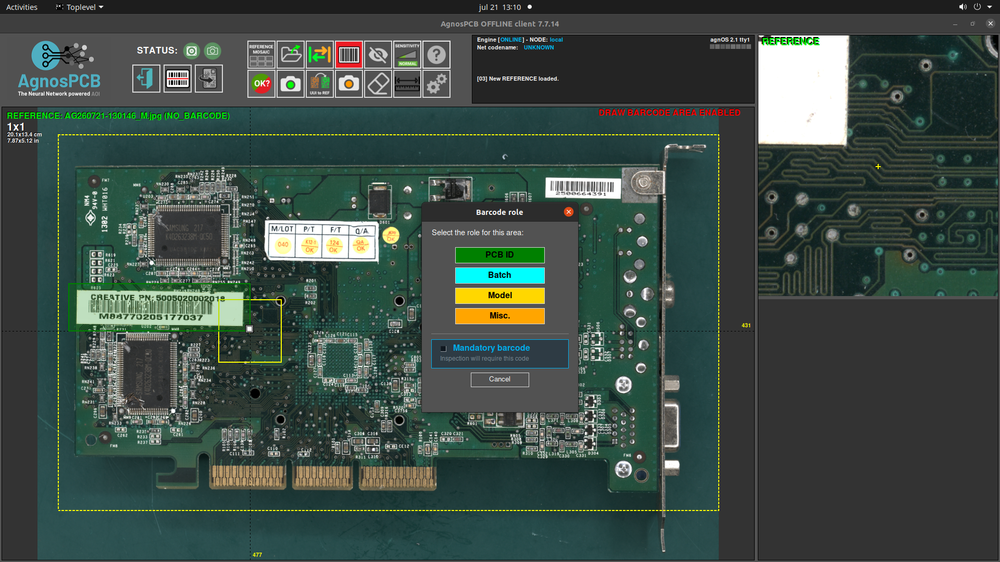
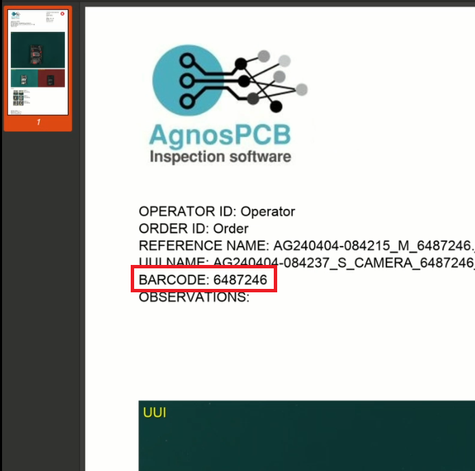
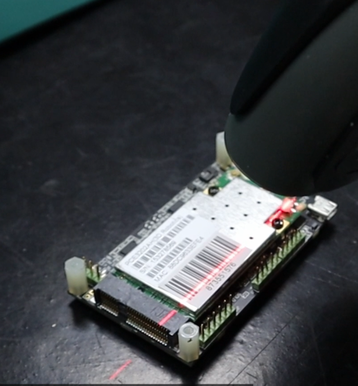

# Barcode-Lesegerät

Die AgnosPCB-Software enthält eine Barcode-Lesefunktion, die **1D-Barcodes, QR und Datamatrix** unterstützt.

Sie können entweder ein **REFERENZ**-Foto aufnehmen oder eines direkt aus Ihren Dateien über die Schaltfläche **"Referenz öffnen"** hochladen.

{.center}

Drücken Sie die Schaltfläche **"Barcode-Bereich zeichnen"** und zeichnen Sie einen Bereich, in dem sich ein Code auf der Platine befindet. Legen Sie anschließend fest, um welchen Codetyp es sich handelt. Wiederholen Sie dies für jeden Code, den die Software lesen soll — bis zu **vier** verschiedene Typen:

| Typ | Beschreibung |
| --- | --- |
| **Serial Number** | Die Seriennummer jeder einzelnen Platine. Sie ist auf jeder Platine anders und wird daher zur Benennung der Berichte verwendet, identifiziert die REFERENZ aber **nicht**. |
| **Batch** | Chargen- oder Losnummer. |
| **Model ID** | Der Code des Platinenmodells, der auf allen Platinen dieses Modells gleich ist. Er **identifiziert die REFERENZ** und wird verwendet, um sie [per Barcode zu laden](#eine-referenz-per-barcode-laden). |
| **Misc.** | Jeder andere Code. Sie werden aufgefordert, einen Namen dafür einzugeben. |

!!! note "Hinweis"
    Vor Version 7.11 hieß **Serial Number** noch **PCB ID** und **Model ID** hieß **Model**. Bestehende REFERENZEN funktionieren weiterhin und zeigen die neuen Namen an; nichts muss neu erstellt werden.

{.center}

Ist die Option **mandatory barcode** für einen bestimmten Code aktiviert, setzt die Software die Inspektion erst fort, wenn dieser Code erfolgreich gelesen wurde. Wird er nicht automatisch erkannt, wird der Bediener aufgefordert, ihn manuell einzugeben, bevor fortgefahren werden kann.

Sobald die REFERENZ geladen ist, fahren Sie mit der Inspektion fort, indem Sie ein Bild der UUI aufnehmen. Jeder Code der UUI wird automatisch in den auf der REFERENZ festgelegten Bereichen gelesen.

Fahren Sie mit dem [Inspektionsprozess](../how_to/Inspection_workflow.md) wie gewohnt fort. 

Der gescannte Code wird in den endgültigen PDF-Bericht der UUI aufgenommen.

{.center}

## Eine REFERENZ per Barcode laden

Wenn Sie bereits eine **REFERENZ** gespeichert haben, können Sie diese einfach mithilfe ihrer **Model ID** abrufen. Drücken Sie dazu die Schaltfläche **"Barcode lesen"**, lesen Sie dann den Barcode mit dem Handscanner, und die **REFERENZ** wird automatisch geladen. Es ist auch möglich, den Code manuell einzugeben.

- Haben **mehrere** REFERENZEN diese Model ID, können Sie in einer kurzen Liste (Name, Alias und Datum) auswählen, welche geladen werden soll.
- Hat **keine** REFERENZ diese Model ID, wird angeboten, den Code als Model ID der aktuell geladenen REFERENZ zuzuweisen. Ist die [Benutzerzugriffskontrolle](User_control.md) aktiviert, ist dafür die Berechtigung **Assign barcode to Reference** erforderlich.
- Eine doppelseitige REFERENZ wird über ihre TOP-Seite gefunden.
- Eine REFERENZ ohne Model ID wird weiterhin über den Code gefunden, mit dem sie vor Version 7.11 verknüpft war. Eine REFERENZ mit Model ID wird nur über diese gefunden; eine Platinen-Seriennummer, mit der sie früher geladen wurde, funktioniert also nicht mehr.
- Solange die Ergebnisse einer Inspektion auf dem Bildschirm angezeigt werden, legt dieselbe Schaltfläche stattdessen die **Serial Number** der inspizierten Platine fest.

{.center}

{.center}

{.center}
