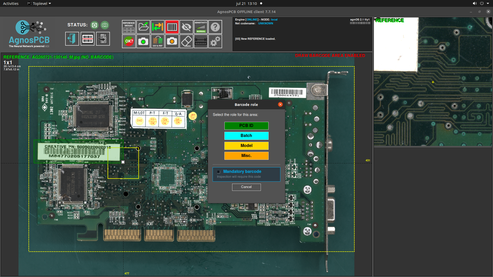
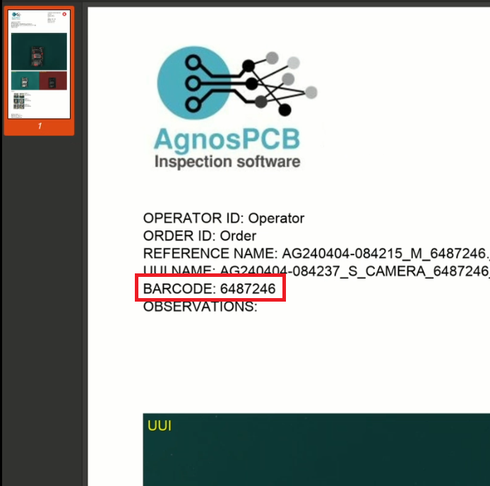
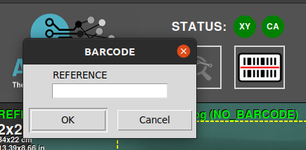
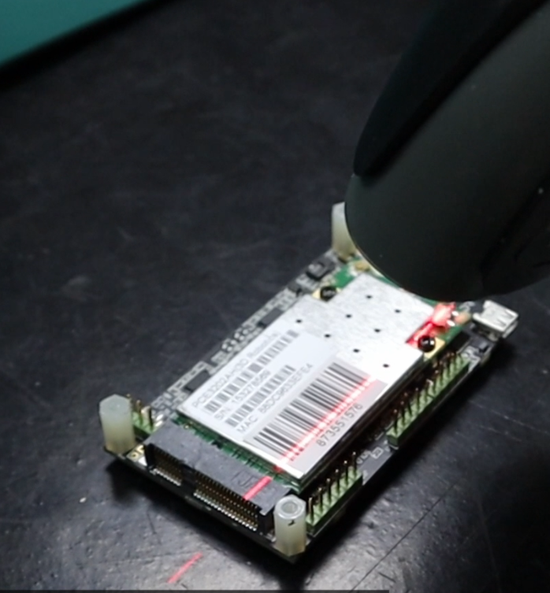

# Lector de código de barras

El software AgnosPCB incorpora una función de lectura de código de barras que soporta **códigos de barras 1D, QR y Datamatrix**.

Puede tomar una foto de **REFERENCIA** o subir una directamente desde sus archivos usando el botón **"Abrir referencia"**.

{.center}

Pulse el botón **"dibujar área de código de barras"** y dibuje un área donde se encuentra un código en el panel, luego defina de qué tipo de código se trata. Repita esto por cada código que quiera que el software lea, hasta **cuatro** tipos distintos:

| Tipo | Descripción |
| --- | --- |
| **Serial Number** | El número de serie de cada placa. Es distinto en cada placa, por lo que se usa para nombrar los informes, pero **no** identifica la REFERENCIA. |
| **Batch** | Identificador de lote. |
| **Model ID** | El código del modelo de placa, igual en todas las placas de ese modelo. **Identifica la REFERENCIA** y se usa para [cargarla por código de barras](#cargar-una-referencia-por-codigo-de-barras). |
| **Misc.** | Cualquier otro código. Se le pedirá que introduzca un nombre para él. |

!!! note "Nota"
    Antes de la versión 7.11, **Serial Number** se llamaba **PCB ID** y **Model ID** se llamaba **Model**. Las REFERENCIAS existentes siguen funcionando y muestran los nuevos nombres; no hay que rehacer nada.

{.center}

Si la opción **mandatory barcode** está activada en un código concreto, la inspección no continuará hasta que ese código se haya leído correctamente. Si no se detecta automáticamente, se solicitará al operador que lo introduzca manualmente antes de continuar.

Una vez que la REFERENCIA esté cargada, proceda con la inspección tomando una foto de la UUI. Cada uno de los códigos de la UUI se leerá automáticamente en las mismas áreas definidas en la REFERENCIA.

Continúe con el [proceso de inspección](../how_to/Inspection_workflow.md) como de costumbre. 

El código escaneado se incluirá en el informe PDF final de la UUI.

{.center}

## Cargar una REFERENCIA por código de barras

Si ya tiene una **REFERENCIA** almacenada, puede recuperarla fácilmente usando su **Model ID**. Para hacer esto, presione el botón **"leer código de barras"**, luego lea el código de barras usando el lector de mano, y la **REFERENCIA** se cargará automáticamente. También es posible ingresar el código manualmente.

- Si **varias** REFERENCIAS tienen ese Model ID, una lista breve (nombre, alias y fecha) le permite elegir cuál cargar.
- Si **ninguna** REFERENCIA lo tiene, se le ofrece asignar el código como Model ID de la REFERENCIA cargada actualmente. Esto requiere el permiso **Assign barcode to Reference** cuando el [control de acceso de usuarios](User_control.md) está habilitado.
- Una REFERENCIA de doble cara se encuentra a través de su cara TOP.
- Una REFERENCIA sin Model ID se sigue encontrando por el código con el que estaba asociada antes de la versión 7.11. Una REFERENCIA que tiene Model ID solo se encuentra por él, por lo que un número de serie de placa que antes la cargaba ya no lo hace.
- Mientras los resultados de una inspección están en pantalla, el mismo botón establece en su lugar el **Serial Number** de la placa inspeccionada.

{.center}

{.center}

{.center}
