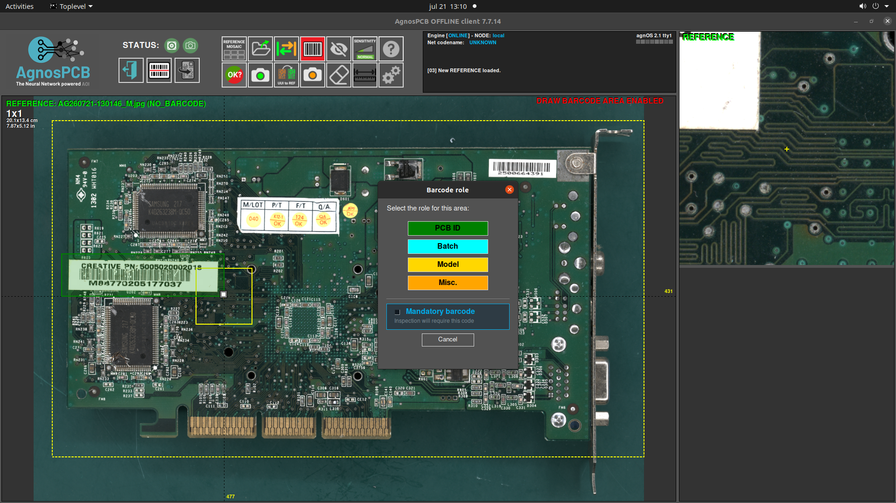
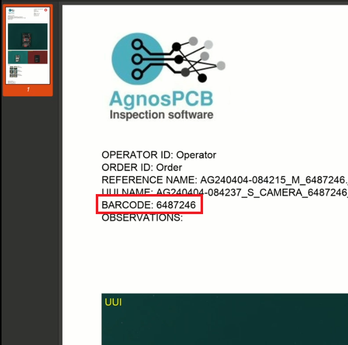
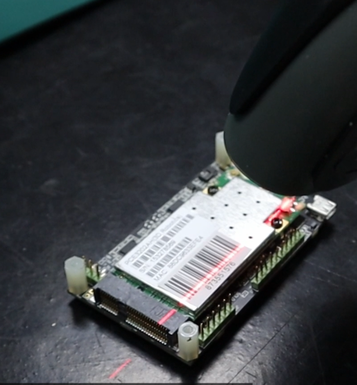

# Lecteur de code-barres

Le logiciel AgnosPCB intègre une fonction de lecture de code-barres qui prend en charge les **codes-barres 1D, QR et Datamatrix**.

Vous pouvez soit prendre une photo de **RÉFÉRENCE**, soit en télécharger une directement depuis vos fichiers en utilisant le bouton **"Ouvrir référence"**.

{.center}

Appuyez sur le bouton **"dessiner la zone de code-barres"** et dessinez une zone où se trouve un code sur le panneau, puis définissez de quel type de code il s'agit. Répétez cette opération pour chaque code que vous souhaitez faire lire par le logiciel, jusqu'à **quatre** types différents :

| Type | Description |
| --- | --- |
| **Serial Number** | Le numéro de série de chaque carte. Il est différent sur chaque carte ; il sert donc à nommer les rapports, mais il n'identifie **pas** la RÉFÉRENCE. |
| **Batch** | Identifiant de lot. |
| **Model ID** | Le code du modèle de carte, identique sur toutes les cartes de ce modèle. Il **identifie la RÉFÉRENCE** et sert à [la charger par code-barres](#charger-une-reference-par-code-barres). |
| **Misc.** | Tout autre code. Il vous est demandé de lui donner un nom. |

!!! note "Note"
    Avant la version 7.11, **Serial Number** s'appelait **PCB ID** et **Model ID** s'appelait **Model**. Les RÉFÉRENCES existantes continuent de fonctionner et affichent les nouveaux noms ; rien n'est à refaire.

{.center}

Si l'option **mandatory barcode** est activée sur un code donné, l'inspection ne se poursuivra pas tant que ce code n'aura pas été lu correctement. S'il n'est pas détecté automatiquement, l'opérateur est invité à le saisir manuellement avant de poursuivre.

Une fois la RÉFÉRENCE chargée, passez à l'inspection en prenant une photo de l'UUI. Chacun des codes de l'UUI sera lu automatiquement dans les zones définies sur la RÉFÉRENCE.

Poursuivez le [processus d'inspection](../how_to/Inspection_workflow.md) comme d'habitude. 

Le code scanné sera inclus dans le rapport PDF final de l'UUI.

{.center}

## Charger une RÉFÉRENCE par code-barres

Si vous avez déjà une **RÉFÉRENCE** stockée, vous pouvez facilement la récupérer grâce à son **Model ID**. Pour ce faire, appuyez sur le bouton **"lire le code-barres"**, puis lisez le code-barres à l'aide du lecteur portable, et la **RÉFÉRENCE** se chargera automatiquement. Il est également possible de saisir le code manuellement.

- Si **plusieurs** RÉFÉRENCES ont ce Model ID, une courte liste (nom, alias et date) vous permet de choisir celle à charger.
- Si **aucune** RÉFÉRENCE ne l'a, le logiciel vous propose d'attribuer ce code comme Model ID de la RÉFÉRENCE actuellement chargée. Cela nécessite la permission **Assign barcode to Reference** lorsque le [contrôle d'accès des utilisateurs](User_control.md) est activé.
- Une RÉFÉRENCE recto verso est trouvée par sa face TOP.
- Une RÉFÉRENCE sans Model ID est toujours trouvée par le code auquel elle était associée avant la version 7.11. Une RÉFÉRENCE qui a un Model ID n'est trouvée que par celui-ci : un numéro de série de carte qui la chargeait auparavant ne la charge plus.
- Lorsque les résultats d'une inspection sont affichés à l'écran, ce même bouton définit à la place le **Serial Number** de la carte inspectée.

{.center}

{.center}

{.center}
