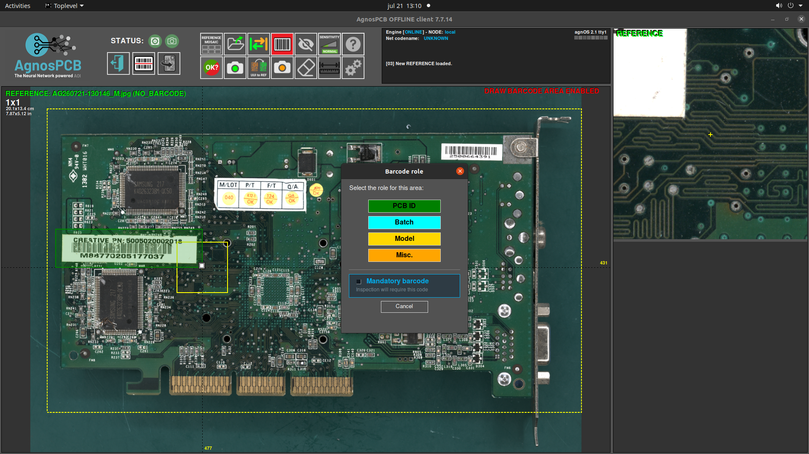
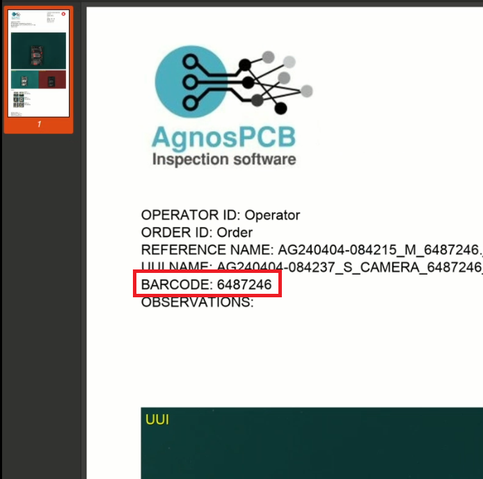
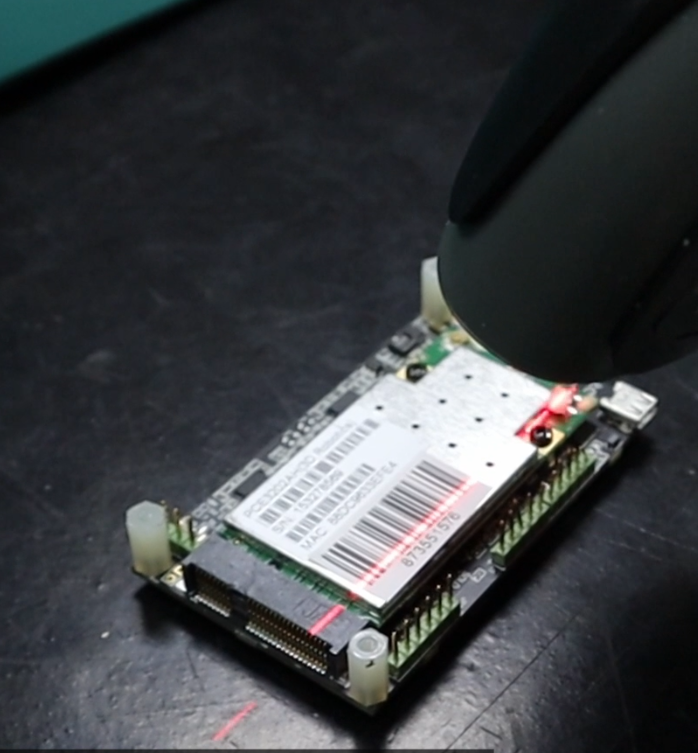

# Lettore di codici a barre

Il software AgnosPCB incorpora una funzione di lettura di codici a barre che supporta **codici a barre 1D, QR e Datamatrix**.

È possibile scattare una foto di **RIFERIMENTO** o caricarne una direttamente dai propri file utilizzando il pulsante **"Apri riferimento"**.

{.center}

Premete il pulsante **"disegna area codice a barre"** e disegnate un'area dove si trova un codice sul pannello, quindi definite di che tipo di codice si tratta. Ripetete questa operazione per ogni codice che volete far leggere al software, fino a **quattro** tipi diversi:

| Tipo | Descrizione |
| --- | --- |
| **Serial Number** | Il numero di serie di ciascuna scheda. È diverso su ogni scheda, quindi viene usato per nominare i report ma **non** identifica il RIFERIMENTO. |
| **Batch** | Identificativo del batch o del lotto. |
| **Model ID** | Il codice del modello di scheda, identico su ogni scheda di quel modello. **Identifica il RIFERIMENTO** e viene usato per [caricarlo tramite codice a barre](#caricare-un-riferimento-tramite-codice-a-barre). |
| **Misc.** | Qualsiasi altro codice. Vi viene chiesto di inserire un nome per esso. |

!!! note "Nota"
    Prima della versione 7.11, **Serial Number** si chiamava **PCB ID** e **Model ID** si chiamava **Model**. I RIFERIMENTI esistenti continuano a funzionare e mostrano i nuovi nomi; non è necessario rifare nulla.

{.center}

Se l'opzione **mandatory barcode** è attivata su un codice specifico, l'ispezione non continuerà finché quel codice non sarà stato letto correttamente. Se non viene rilevato automaticamente, all'operatore verrà richiesto di inserirlo manualmente prima di proseguire.

Una volta caricato il RIFERIMENTO, procedere con l'ispezione scattando una foto della UUI. Ciascuno dei codici della UUI verrà letto automaticamente nelle stesse aree definite sul RIFERIMENTO.

Procedere con il [processo di ispezione](../how_to/Inspection_workflow.md) come di consueto. 

Il codice scansionato sarà incluso nel report PDF finale della UUI.

{.center}

## Caricare un RIFERIMENTO tramite codice a barre

Se si dispone già di un **RIFERIMENTO** archiviato, è possibile recuperarlo facilmente utilizzando il suo **Model ID**. Per fare ciò, premere il pulsante **"leggi codice a barre"**, quindi leggere il codice a barre utilizzando il lettore portatile, e il **RIFERIMENTO** si caricherà automaticamente. È anche possibile inserire il codice manualmente.

- Se **più** RIFERIMENTI hanno quel Model ID, un breve elenco (nome, alias e data) consente di scegliere quale caricare.
- Se **nessun** RIFERIMENTO lo ha, vi viene proposto di assegnare il codice come Model ID del RIFERIMENTO attualmente caricato. Ciò richiede il permesso **Assign barcode to Reference** quando il [controllo di accesso utenti](User_control.md) è abilitato.
- Un RIFERIMENTO a doppia faccia viene trovato tramite il suo lato TOP.
- Un RIFERIMENTO senza Model ID viene comunque trovato tramite il codice a cui era associato prima della versione 7.11. Un RIFERIMENTO che ha un Model ID viene trovato solo tramite esso, quindi un numero di serie di scheda che in precedenza lo caricava non lo carica più.
- Mentre i risultati di un'ispezione sono sullo schermo, lo stesso pulsante imposta invece il **Serial Number** della scheda ispezionata.

{.center}

{.center}

{.center}
