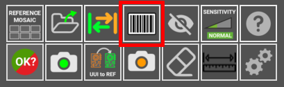
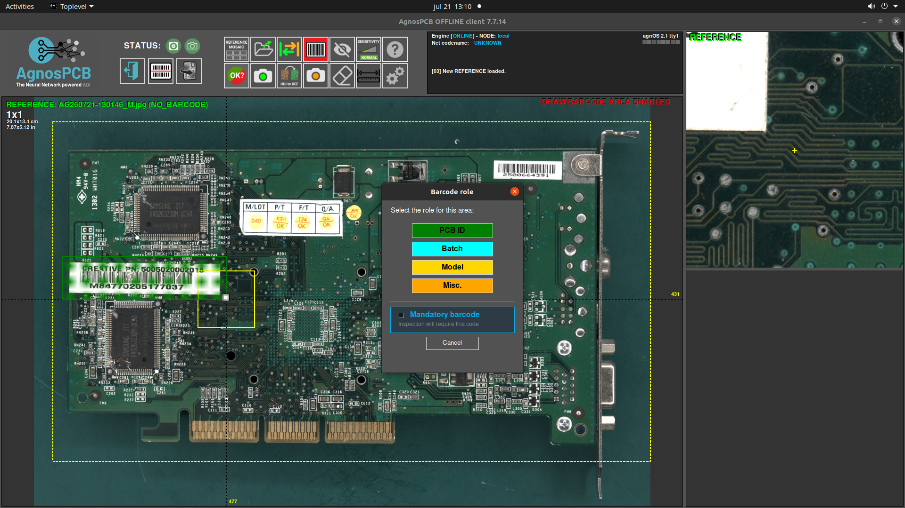
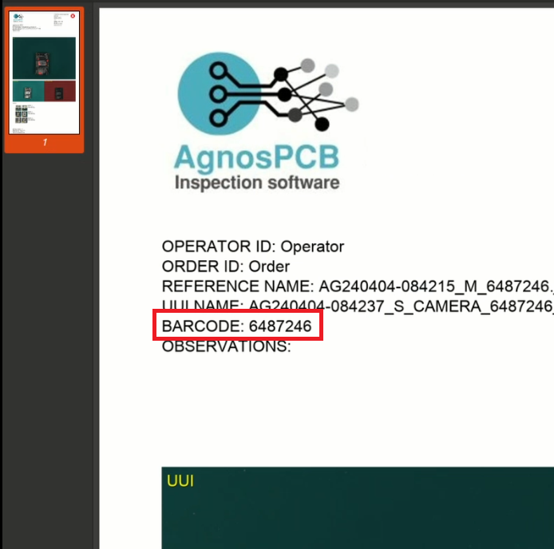
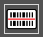
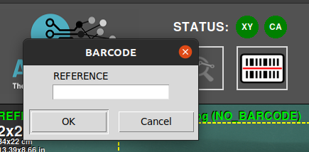
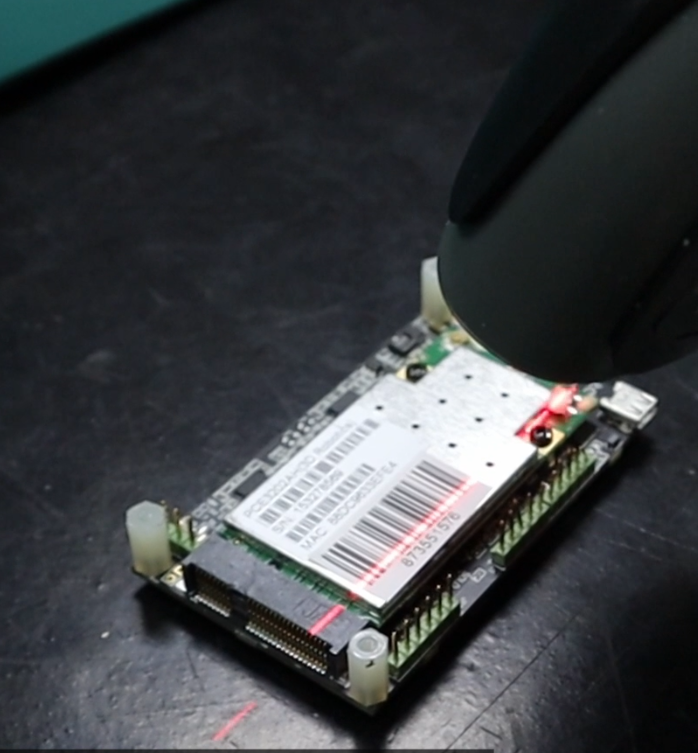

# Barcode reader

The AgnosPCB software incorporates a barcode reader function that supports **1D barcodes, QR and Datamatrix**.

You can either take a **REFERENCE** photo or upload one directly from your files using the **"Open reference"** button.

{.center}

Press the **"draw barcode area"** button and draw an area where a code is placed on the panel, then define what type of code it is: **ID, Batch ID, Model or Misc**. Repeat this for every code you want the software to read — up to **four** different types.

{.center}

If the **mandatory barcode** option is set on a specific code, the inspection won't continue until that code has been read successfully. If it isn't detected automatically, the operator is prompted to enter it manually before proceeding.

Once the REFERENCE is loaded, proceed with the inspection by taking a picture of the UUI. Each of the UUI's codes will be read automatically from the same areas defined on the REFERENCE.

Proceed with the [inspection process](../how_to/Inspection_workflow.md) as usual. 

The scanned codes will be included in the final PDF report of the UUI.

{.center}

## Load a REFERENCE by barcode

If you already have a **REFERENCE** stored, you can easily retrieve it using the code associated with it. To do this, press the **"read barcode"** button, then read the barcode using the handheld reader, and the **REFERENCE** will load automatically. It is also possible to enter the code manually.

{.center}

{.center}

{.center}
