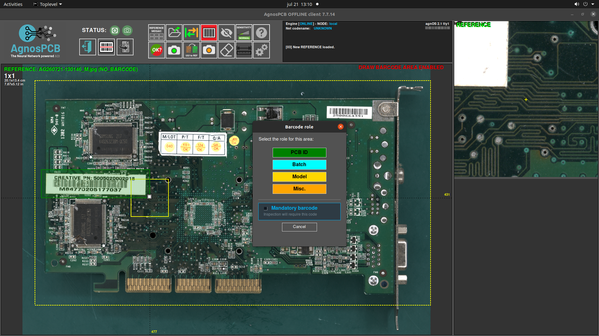
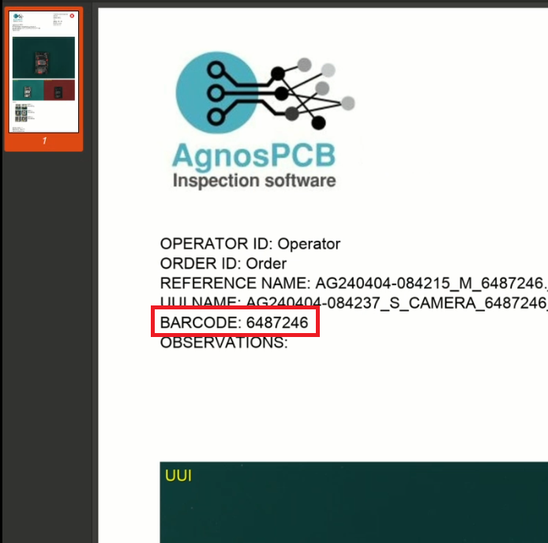
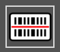
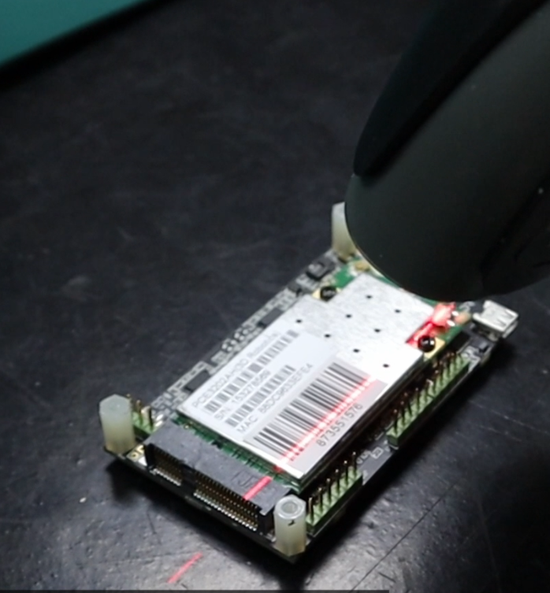

# Barcode reader

The AgnosPCB software incorporates a barcode reader function that supports **1D barcodes, QR and Datamatrix**.

You can either take a **REFERENCE** photo or upload one directly from your files using the **"Open reference"** button.

{.center}

Press the **"draw barcode area"** button and draw an area where a code is placed on the panel, then define what type of code it is. Repeat this for every code you want the software to read — up to **four** different types:

| Type | Description |
| --- | --- |
| **Serial Number** | The serial number of each board. It is different on every board, so it is used to name the reports but it does **not** identify the REFERENCE. |
| **Batch** | Batch or lot identifier. |
| **Model ID** | The code of the board model, the same on every board of that model. It **identifies the REFERENCE** and is used to [load it by barcode](#load-a-reference-by-barcode). |
| **Misc.** | Any other code. You are asked to enter a name for it. |

!!! note "Note"
    Before version 7.11, **Serial Number** was called **PCB ID** and **Model ID** was called **Model**. Existing REFERENCES keep working and show the new names; nothing has to be redone.

{.center}

If the **mandatory barcode** option is set on a specific code, the inspection won't continue until that code has been read successfully. If it isn't detected automatically, the operator is prompted to enter it manually before proceeding.

Once the REFERENCE is loaded, proceed with the inspection by taking a picture of the UUI. Each of the UUI's codes will be read automatically from the same areas defined on the REFERENCE.

Proceed with the [inspection process](../how_to/Inspection_workflow.md) as usual. 

The scanned codes will be included in the final PDF report of the UUI.

{.center}

## Load a REFERENCE by barcode

If you already have a **REFERENCE** stored, you can easily retrieve it using its **Model ID**. To do this, press the **"read barcode"** button, then read the barcode using the handheld reader, and the **REFERENCE** will load automatically. It is also possible to enter the code manually.

- If **several** REFERENCES have that Model ID, a short list (name, alias and date) lets you choose which one to load.
- If **no** REFERENCE has it, you are offered to assign the code as the Model ID of the REFERENCE currently loaded. This requires the **Assign barcode to Reference** permission when [user access control](User_control.md) is enabled.
- A double-sided REFERENCE is found through its TOP side.
- A REFERENCE with no Model ID is still found by the code it was associated with before version 7.11. A REFERENCE that has a Model ID is only found by it, so a board serial number that used to load it no longer does.
- While the results of an inspection are on screen, the same button sets the **Serial Number** of the inspected board instead.

{.center}

{.center}

{.center}
