# Control de acceso de usuarios

## ¿Qué es el control de acceso de usuarios?

Por defecto, cualquier persona con acceso a la AOI puede usar el software y cambiar cualquiera de sus ajustes.

El **control de acceso de usuarios** le permite crear cuentas individuales y exigir un **nombre de usuario y una contraseña** cada vez que se inicia el software. Cada cuenta tiene un rol que determina qué puede hacer su usuario, de modo que puede dejar que un operador realice inspecciones mientras mantiene protegida la configuración de la máquina.

## Los dos roles

Cada cuenta tiene uno de estos dos roles **integrados**, o un [rol personalizado](#roles-personalizados-y-permisos) creado por un administrador:

| | **admin** | **operator** |
| --- | --- | --- |
| Opciones de General, Workflow y Report | Sí | Sí |
| Opciones de Date/time, Path y Share | Sí | No |
| Users, Sequences, Machine y Debug | Sí | No |
| Tomar una imagen de REFERENCIA | Sí | Solo si el modo operador está deshabilitado |
| Gestionar usuarios | Sí | No |
| Calibrar la plataforma | Sí | No |
| Establecer la contraseña de configuración | Sí | No |
| Generar una copia de seguridad | Sí | No |

!!! note "El rol operador y el modo operador no son lo mismo"

    El **rol operador** descrito aquí limita qué pestañas del [menú de configuración](../how_to/Settings_menu.md) puede abrir el usuario.

    El **modo operador**, en *Settings → Workflow*, simplifica la interfaz y bloquea la captura de imágenes de REFERENCIA. Se aplica a quien esté usando la máquina, independientemente de su rol.

    Pueden usarse juntos: una cuenta de operador con el modo operador habilitado obtiene tanto la interfaz simplificada como la configuración restringida.

## Roles personalizados y permisos

Además de los roles integrados **admin** y **operator** descritos arriba, los administradores pueden crear roles adicionales desde la lista **Roles** situada al final de la pestaña **Users** del [menú de configuración](../how_to/Settings_menu.md).

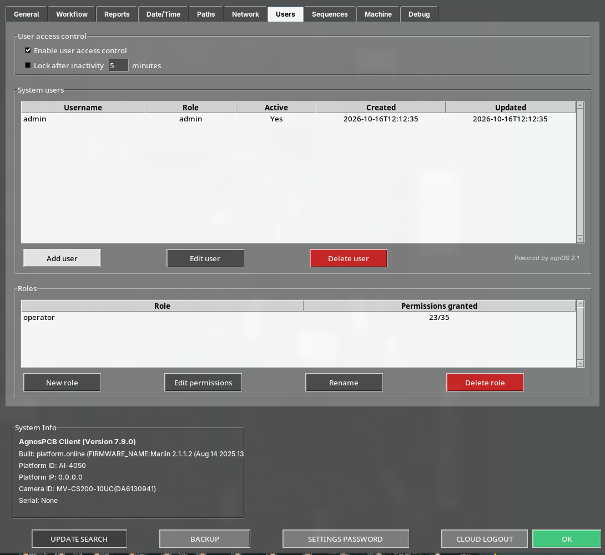{.center}

Pulse **New role**, dele un nombre y pulse **Create**.

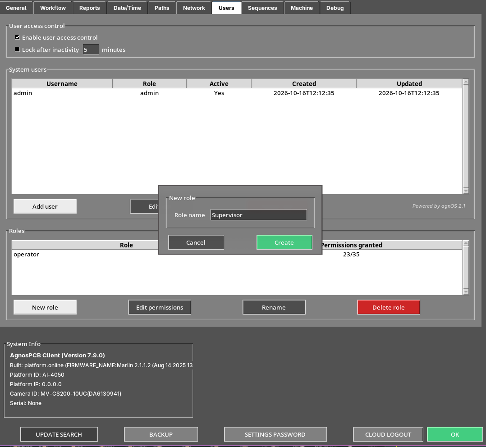{.center}

Seleccione el nuevo rol en la lista y pulse **Edit permissions** para elegir exactamente qué concede. Los permisos se agrupan en categorías como **Reference**, **Inspection** o **Maintenance** —por ejemplo, crear o eliminar una variante de referencia, ejecutar inspecciones o calibrar la plataforma— y cada categoría tiene su propio atajo **Select all** / **Deselect all**.

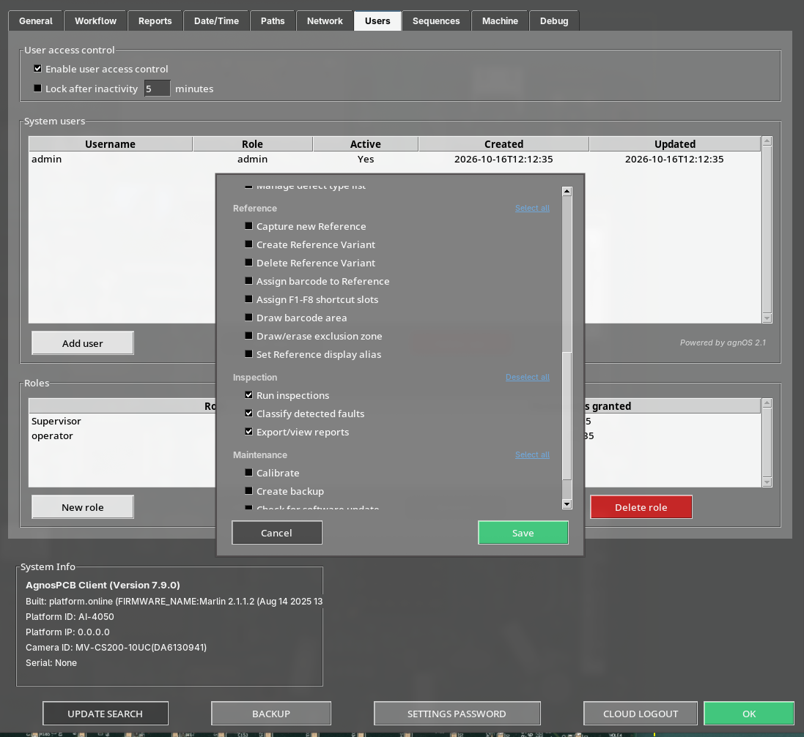{.center}

La columna **Permissions granted** muestra cuántos de los permisos disponibles tiene cada rol, por ejemplo **23/35**.

Un rol personalizado aparece entonces junto a **admin** y **operator** en el campo **Role** al añadir o editar un usuario.

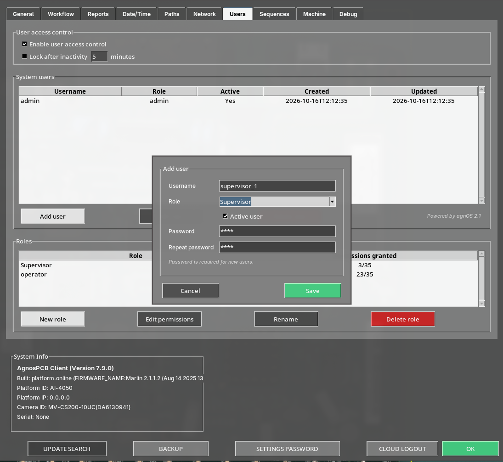{.center}

Un rol nuevo empieza solo con los permisos necesarios para ejecutar inspecciones, clasificar detecciones y exportar informes. Todo lo demás debe concederse desde **Edit permissions**.

Cuando una actualización del software añade un permiso nuevo, el rol **operator** lo recibe automáticamente. Los roles personalizados no: un administrador tiene que concedérselo explícitamente. Entre otros, las actualizaciones recientes han añadido:

| Permiso | Permite |
| --- | --- |
| **Classify detected faults** | Reportar detecciones como errores reales o falsos positivos. Sin él, se muestra el mensaje **Permission denied**. Marcar una detección como vista siempre está permitido. |
| **Max. variants per Reference** | Cambiar [Máx. variantes por Referencia](../how_to/Settings_menu.md#max-variantes-por-referencia). |
| **Reference statistics and heatmap option** | Cambiar [Mostrar estadísticas y mapa de calor de errores por Referencia](../how_to/Settings_menu.md#mostrar-estadisticas-y-mapa-de-calor-de-errores-por-referencia). |
| **Analysis preference** | Cambiar [Preferencia de análisis](../how_to/Settings_menu.md#preferencia-de-analisis). |
| **Edit Reference options** | Cambiar los niveles de revisión obligatoria de una REFERENCIA en sus [opciones de la Referencia](../how_to/Screen-layout.md#opciones-de-la-referencia). |

!!! note "Nota"
    Los roles integrados **admin** y **operator** no se pueden renombrar, no se les pueden editar los permisos, ni se pueden eliminar.

### Revisión obligatoria por rol

Con el control de acceso de usuarios habilitado, los [niveles de revisión obligatoria](../how_to/Inspection_workflow.md#niveles-de-revision-obligatoria) se establecen para cada rol en lugar de globalmente: la lista **Roles** tiene una columna para cada nivel (**Mandatory review**, **Mandatory report** y **Final report**), y la ventana **Edit permissions** del rol tiene una casilla para cada uno. Cambiarlos requiere acceso a la pestaña **Users**.

Las opciones globales de *Settings → Workflow* aparecen atenuadas mientras el control de acceso de usuarios está habilitado, y conservan su valor para cuando se vuelva a deshabilitar.

- El rol **admin** nunca se ve afectado por estos ajustes; solo le afecta una REFERENCIA que exija un nivel.
- Los roles nuevos empiezan con los tres niveles deshabilitados.
- La primera vez que se cargan los roles tras actualizar a la 7.11, cada rol existente toma el valor que tenía la opción global **Revisión obligatoria de errores**, de modo que no se pierde ninguna obligación existente. Los niveles de **reporte** e **informe final** empiezan deshabilitados para todos los roles existentes.

## Configurarlo

### 1. Abrir la pestaña Users

Abra el [menú de configuración](../how_to/Settings_menu.md) y vaya a la pestaña **Users**. En una máquina que nunca se ha configurado, la lista está vacía y el control de acceso está deshabilitado.

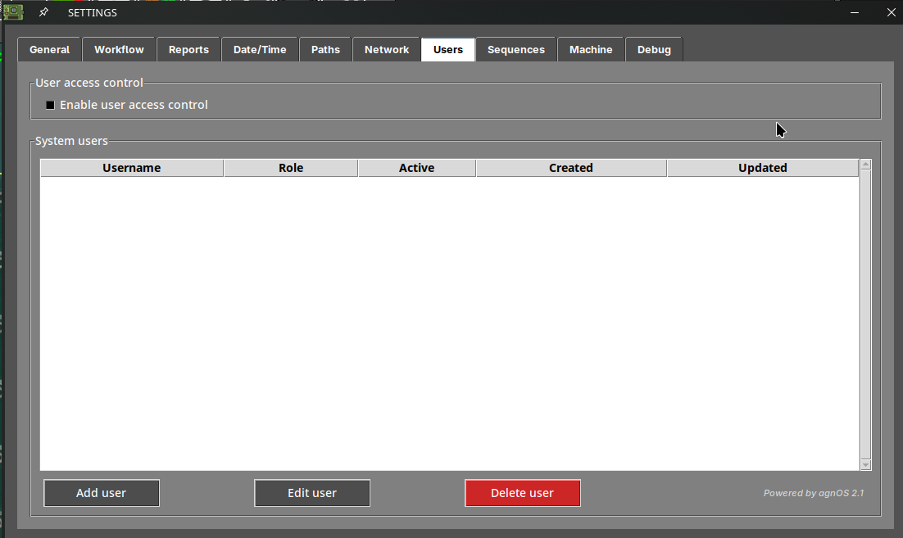{.center}

### 2. Crear primero un administrador

Antes de nada necesita una cuenta **admin**. Si intenta habilitar el control de acceso sin una, el software se lo impide:

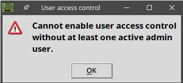{width=350px .center}

Pulse **Add user**, rellene el nombre de usuario, seleccione el rol **admin**, deje marcado **Active user** y escriba la contraseña dos veces.

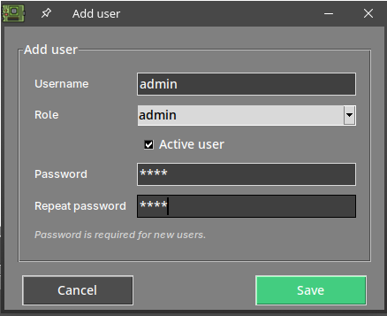{width=400px .center}

Pulse **Save**. La nueva cuenta aparece en la lista, con la fecha en que se creó.

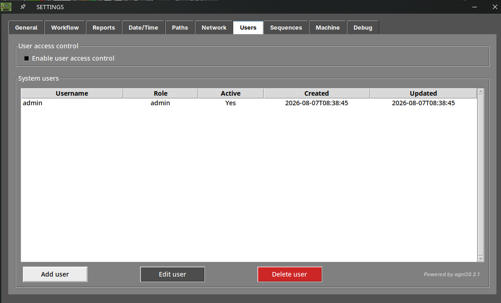{.center}

!!! warning "Importante"

    Guarde la contraseña del administrador en un lugar seguro. Una vez habilitado el control de acceso, esta es la cuenta que le permite volver a entrar en el menú de configuración.

### 3. Habilitar el control de acceso

Con una cuenta admin activa en la lista, habilite **Enable user access control**.

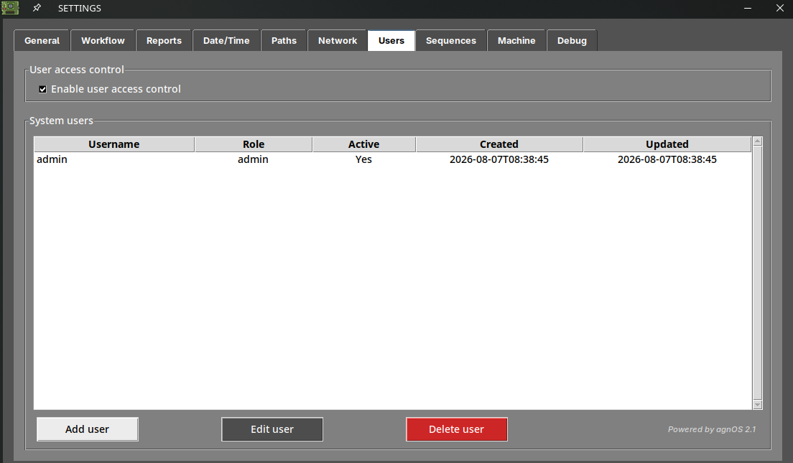{.center}

### 4. Añadir el resto de usuarios

Añada una cuenta para cada persona que vaya a usar la máquina, dándole el rol **operator** a menos que necesite cambiar la configuración.

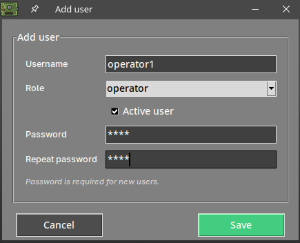{width=400px .center}

La lista muestra cada cuenta con su rol, si está activa, y las fechas en que se creó y se modificó por última vez.

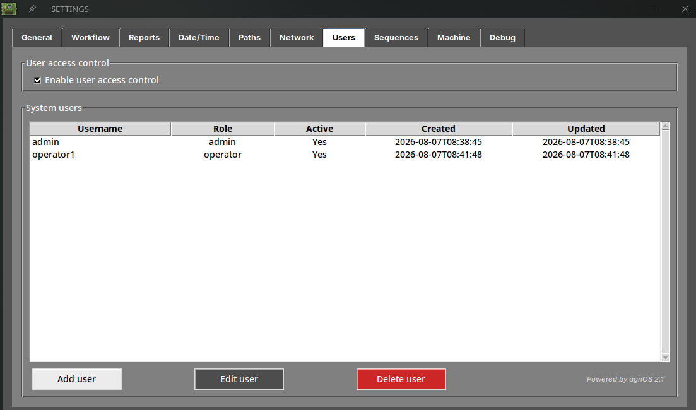{.center}

Pulse **OK** para guardar y cerrar el menú de configuración.

## Iniciar sesión

A partir del siguiente inicio del software, el diálogo **User access required** solicita las credenciales de una de las cuentas que ha creado.

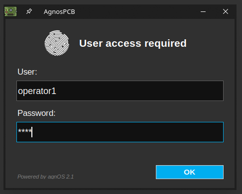{width=400px .center}

El software se abre entonces con los permisos de esa cuenta.

El usuario que ha iniciado sesión se muestra en el [registro de actividad](../how_to/Screen-layout.md#registro-de-actividad).

Para cerrar la sesión y dejar que otro usuario inicie sesión, use el botón **logout** del [área de estado de la plataforma](../how_to/Screen-layout.md#cerrar-sesion). Pide confirmación y después limpia el espacio de trabajo (REFERENCIA cargada y resultados de inspección), de modo que el siguiente usuario empiece desde cero.

## Gestionar las cuentas

Seleccione una cuenta en la lista para trabajar con ella:

- **Edit user** — cambia el rol, la contraseña o el estado activo de la cuenta seleccionada.
- **Delete user** — la elimina permanentemente. Se solicita confirmación.

!!! tip "Desactivar en lugar de eliminar"

    Para impedir que alguien use la máquina sin perder el registro de su cuenta, edite el usuario y desmarque la casilla **Active user**. La cuenta permanece en la lista, pero ya no puede iniciar sesión.

!!! note "Nota"
    Siempre debe haber al menos una cuenta **admin activa**. Téngalo en cuenta antes de desactivar o eliminar a un administrador.

## Bloqueo por inactividad

Con el control de acceso de usuarios habilitado, el panel **User access control** de la pestaña **Users** también ofrece un bloqueo por inactividad opcional: active **Lock after inactivity** y establezca el número de minutos de inactividad del teclado y el ratón tras los cuales la aplicación debe bloquearse.

{.center}

Transcurrido ese tiempo, vuelve a aparecer el diálogo **User access required**, igual que al iniciar, sin cerrar la REFERENCIA actual ni perder los resultados de la inspección en curso. Cualquier usuario activo puede desbloquearla, no solo el que había iniciado sesión. El bloqueo nunca se activa mientras hay una inspección en curso ni mientras el [modo Demo / Loop](../how_to/Settings_menu.md#modo-demo-loop) está en marcha.

!!! note "Nota"
    Esta opción solo aparece cuando el control de acceso de usuarios está habilitado, ya que bloquear la aplicación requiere una cuenta con la que desbloquearla.
