# Controllo di accesso utenti

## Cos'è il controllo di accesso utenti?

Per impostazione predefinita, chiunque abbia accesso all'AOI può usare il software e modificare qualsiasi impostazione.

Il **controllo di accesso utenti** consente di creare account individuali e di richiedere un **nome utente e una password** a ogni avvio del software. Ogni account ha un ruolo che determina cosa può fare il relativo utente, permettendo così a un operatore di eseguire ispezioni mantenendo protetta la configurazione della macchina.

## I due ruoli

Ogni account ha uno di questi due ruoli **integrati**, oppure un [ruolo personalizzato](#ruoli-personalizzati-e-permessi) creato da un amministratore:

| | **admin** | **operator** |
| --- | --- | --- |
| Opzioni General, Workflow e Report | Sì | Sì |
| Opzioni Date/time, Path e Share | Sì | No |
| Users, Sequences, Machine e Debug | Sì | No |
| Acquisire un'immagine di RIFERIMENTO | Sì | Solo se la modalità operatore è disabilitata |
| Gestire gli utenti | Sì | No |
| Calibrare la piattaforma | Sì | No |
| Impostare la password delle impostazioni | Sì | No |
| Generare un backup | Sì | No |

!!! note "Il ruolo operatore e la modalità operatore non sono la stessa cosa"

    Il **ruolo operatore** qui descritto limita quali schede del [menu Impostazioni](../how_to/Settings_menu.md) l'utente può aprire.

    La **modalità operatore**, in *Settings → Workflow*, semplifica l'interfaccia e blocca l'acquisizione di immagini di RIFERIMENTO. Si applica a chiunque stia usando la macchina, indipendentemente dal ruolo.

    Possono essere usate insieme: un account operatore con la modalità operatore abilitata ottiene sia l'interfaccia semplificata sia le impostazioni ristrette.

## Ruoli personalizzati e permessi

Oltre ai ruoli integrati **admin** e **operator** descritti sopra, gli amministratori possono creare ruoli aggiuntivi dall'elenco **Roles** in fondo alla scheda **Users** del [menu Impostazioni](../how_to/Settings_menu.md).

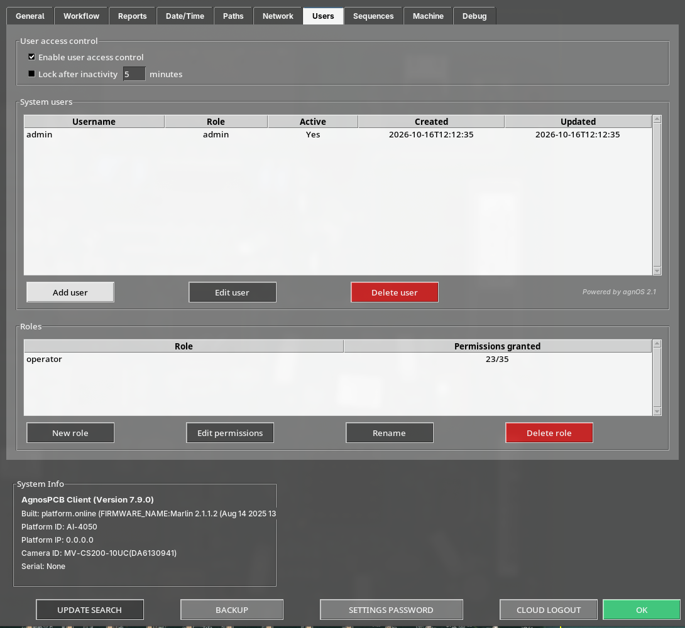{.center}

Premete **New role**, assegnategli un nome e premete **Create**.

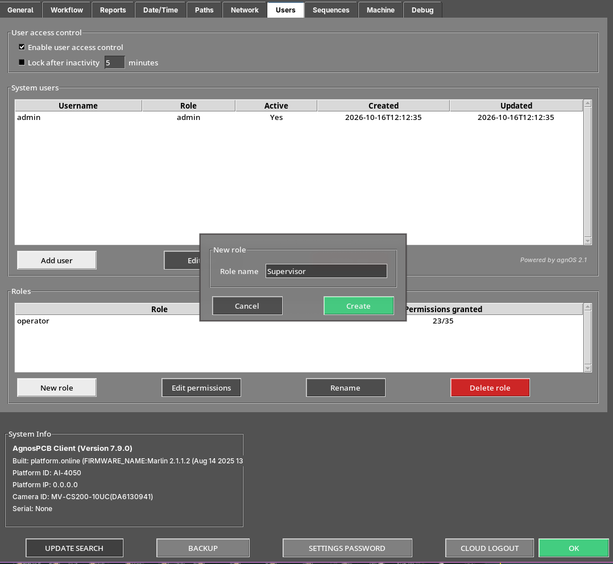{.center}

Selezionate il nuovo ruolo nell'elenco e premete **Edit permissions** per scegliere esattamente cosa concede. I permessi sono raggruppati in categorie come **Reference**, **Inspection** e **Maintenance** — ad esempio creare o eliminare una variante di riferimento, eseguire ispezioni o calibrare la piattaforma — e ogni categoria ha la propria scorciatoia **Select all** / **Deselect all**.

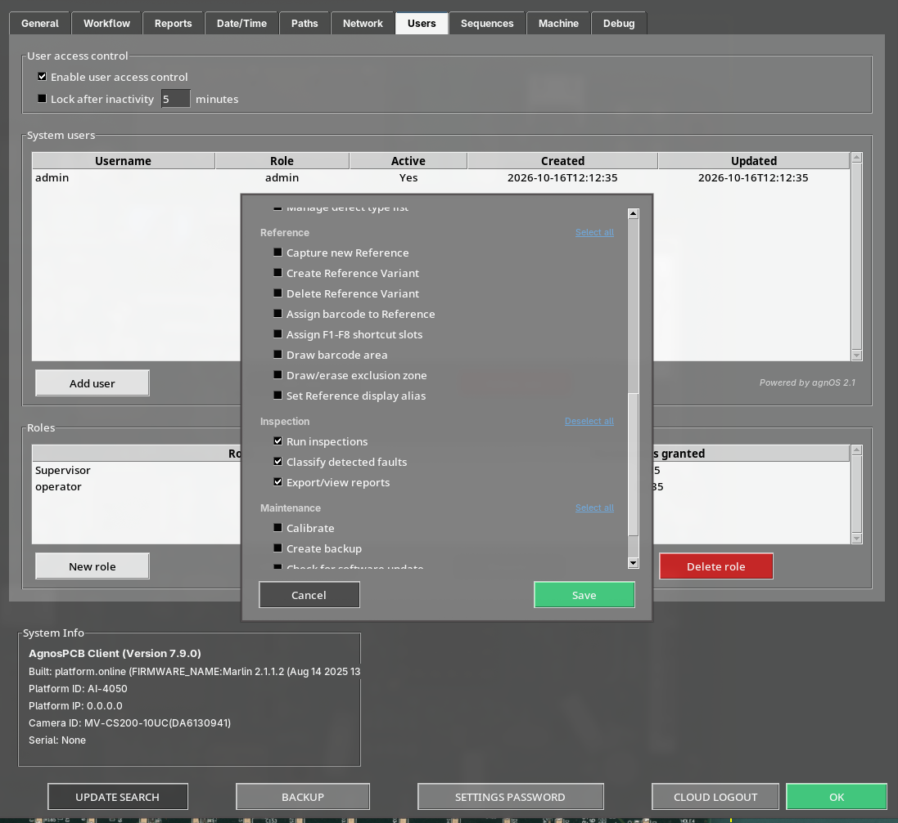{.center}

La colonna **Permissions granted** mostra quanti dei permessi disponibili ha attualmente ciascun ruolo, ad esempio **23/35**.

Un ruolo personalizzato compare quindi accanto a **admin** e **operator** nel campo **Role** quando si crea o si modifica un utente.

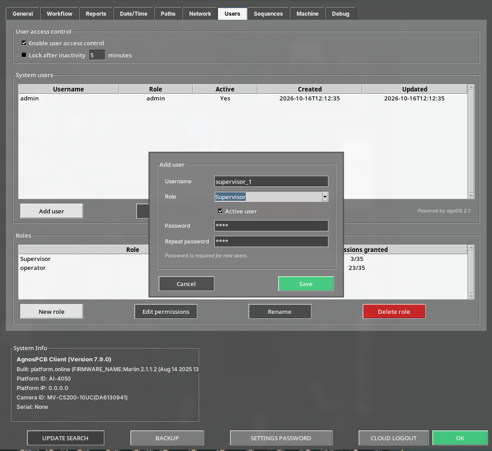{.center}

!!! note "Nota"
    I ruoli integrati **admin** e **operator** non possono essere rinominati, non è possibile modificarne i permessi, né possono essere eliminati.

## Configurazione

### 1. Aprire la scheda Users

Aprite il [menu Impostazioni](../how_to/Settings_menu.md) e andate alla scheda **Users**. Su una macchina mai configurata, l'elenco è vuoto e il controllo di accesso è disabilitato.

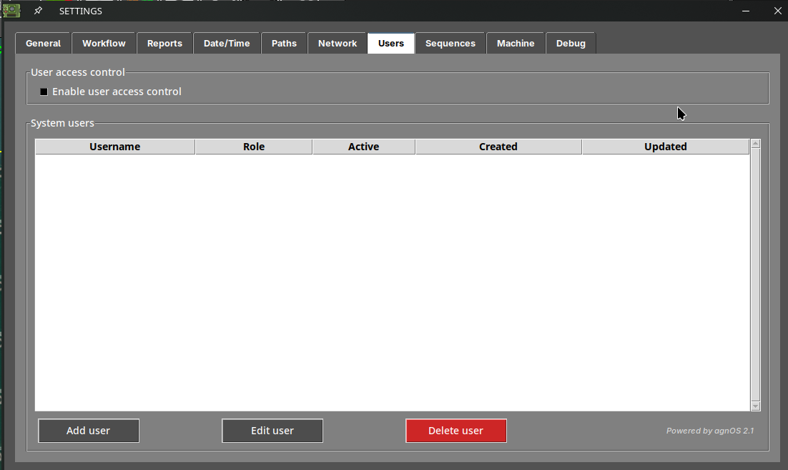{.center}

### 2. Creare prima un amministratore

Prima di tutto serve un account **admin**. Se provate ad abilitare il controllo di accesso senza averne uno, il software lo rifiuta:

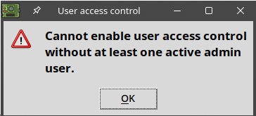{width=350px .center}

Premete **Add user**, inserite il nome utente, selezionate il ruolo **admin**, lasciate spuntato **Active user** e digitate la password due volte.

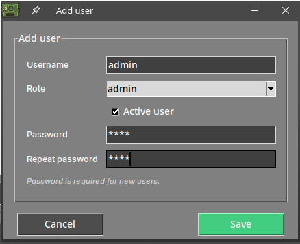{width=400px .center}

Premete **Save**. Il nuovo account compare nell'elenco, con la data in cui è stato creato.

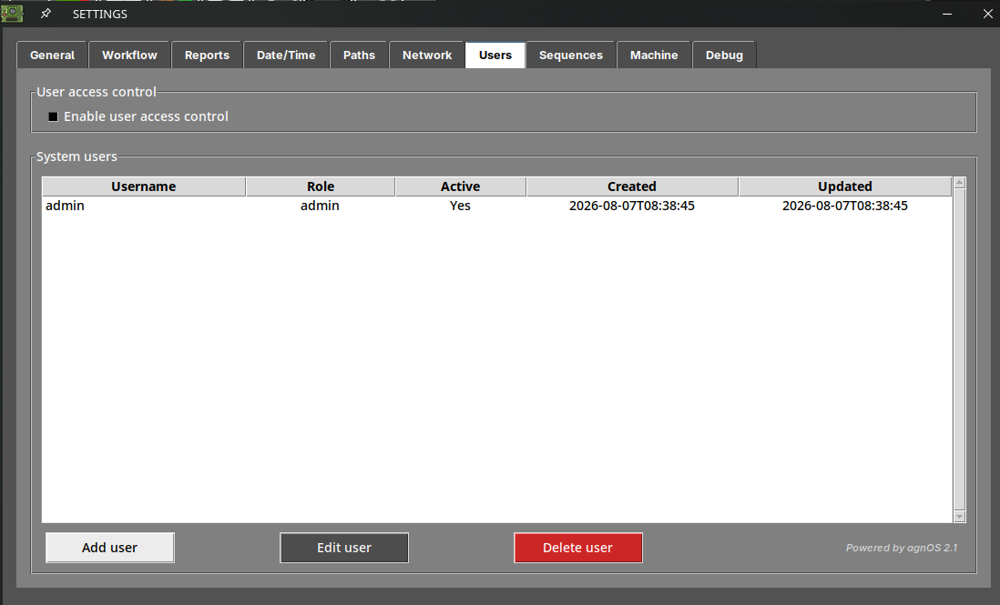{.center}

!!! warning "Importante"

    Conservate la password dell'amministratore in un luogo sicuro. Una volta abilitato il controllo di accesso, questo è l'account che consente di rientrare nel menu Impostazioni.

### 3. Abilitare il controllo di accesso

Con un account admin attivo nell'elenco, abilitate **Enable user access control**.

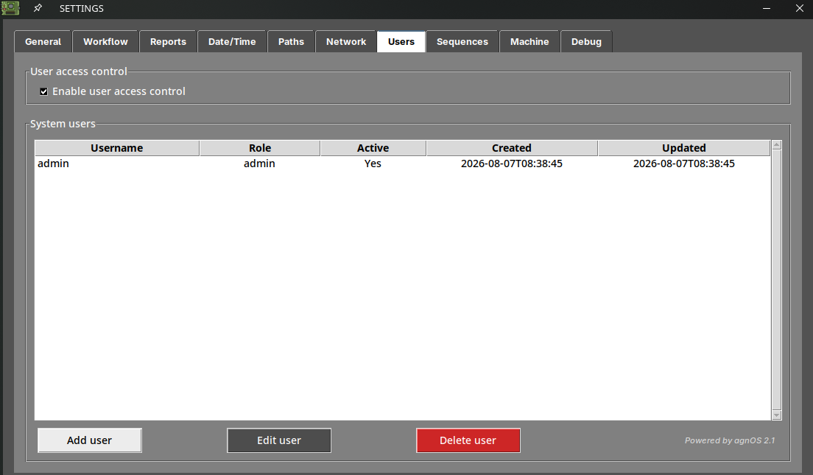{.center}

### 4. Aggiungere gli altri utenti

Aggiungete un account per ogni persona che utilizzerà la macchina, assegnando il ruolo **operator** a meno che non debba modificare la configurazione.

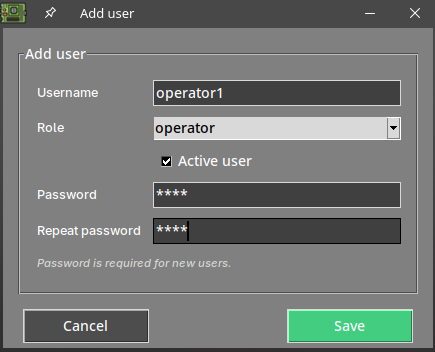{width=400px .center}

L'elenco mostra ogni account con il relativo ruolo, se è attivo e le date di creazione e ultima modifica.

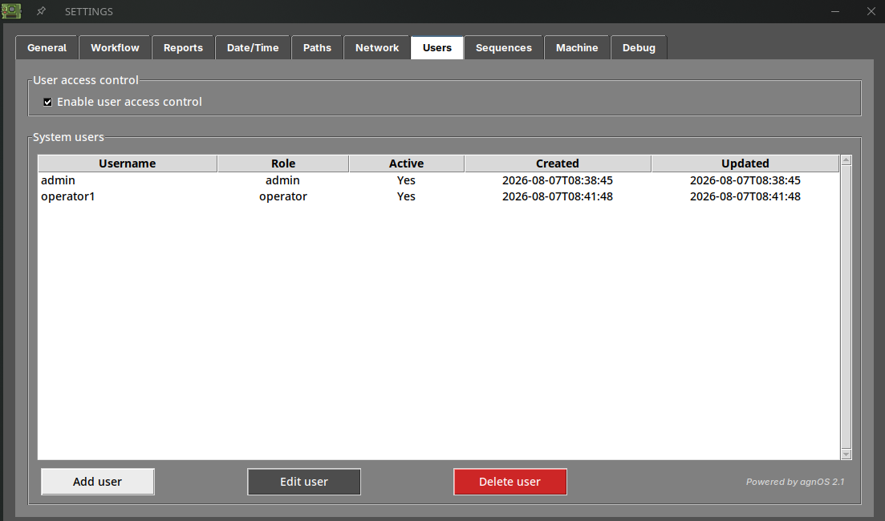{.center}

Premete **OK** per salvare e chiudere il menu Impostazioni.

## Accesso

Dal successivo avvio del software, la finestra **User access required** richiede le credenziali di uno degli account creati.

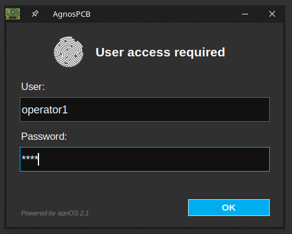{width=400px .center}

Il software si apre quindi con i permessi di quell'account.

Per chiudere la sessione e permettere a un altro utente di accedere, usate il pulsante **logout** nell'[area di stato della piattaforma](../how_to/Screen-layout.md).

## Gestire gli account

Selezionate un account nell'elenco per operare su di esso:

- **Edit user** — modifica il ruolo, la password o lo stato attivo dell'account selezionato.
- **Delete user** — lo elimina definitivamente. Viene richiesta una conferma.

!!! tip "Disattivare invece di eliminare"

    Per impedire a qualcuno di usare la macchina senza perdere la registrazione del suo account, modificate l'utente e deselezionate la casella **Active user**. L'account resta nell'elenco ma non può più accedere.

!!! note "Nota"
    Deve sempre esistere almeno un account **admin attivo**. Tenetelo presente prima di disattivare o eliminare un amministratore.

## Blocco per inattività

Con il controllo di accesso utenti abilitato, il pannello **User access control** della scheda **Users** offre anche un blocco per inattività opzionale: abilitate **Lock after inactivity** e impostate il numero di minuti di inattività di tastiera e mouse trascorsi i quali l'applicazione si blocca.

{.center}

Trascorso quel tempo, ricompare la finestra **User access required**, come all'avvio, senza chiudere il RIFERIMENTO corrente né perdere i risultati dell'ispezione in corso.

!!! note "Nota"
    Questa opzione compare solo quando il controllo di accesso utenti è abilitato, poiché bloccare l'applicazione richiede un account con cui sbloccarla.
