# User access control

## What is user access control?

By default, anyone with access to the AOI can use the software and change any of its settings.

**User access control** lets you create individual accounts and require a **username and password** every time the software starts. Each account has a role that determines what its user is allowed to do, so you can let an operator run inspections while keeping the configuration of the machine protected.

## The two roles

Every account has one of these two **built-in** roles, or a [custom role](#custom-roles-and-permissions) created by an administrator:

| | **admin** | **operator** |
| --- | --- | --- |
| General, Workflow and Report options | Yes | Yes |
| Date/time, Path and Share options | Yes | No |
| Users, Sequences, Machine and Debug | Yes | No |
| Take a REFERENCE image | Yes | Only if operator mode is disabled |
| Manage users | Yes | No |
| Calibrate the platform | Yes | No |
| Set the settings password | Yes | No |
| Generate a backup | Yes | No |

!!! note "The operator role and operator mode are not the same thing"

    The **operator role** described here limits which tabs of the [settings menu](../how_to/Settings_menu.md) the user can open.

    **Operator mode**, in *Settings → Workflow*, simplifies the interface and blocks the capture of REFERENCE images. It applies to whoever is using the machine, regardless of their role.

    They can be used together: an operator account with operator mode enabled gets both the simplified interface and the restricted settings.

## Custom roles and permissions

Beyond the built-in **admin** and **operator** roles described above, administrators can create additional roles from the **Roles** list at the bottom of the **Users** tab of the [settings menu](../how_to/Settings_menu.md).

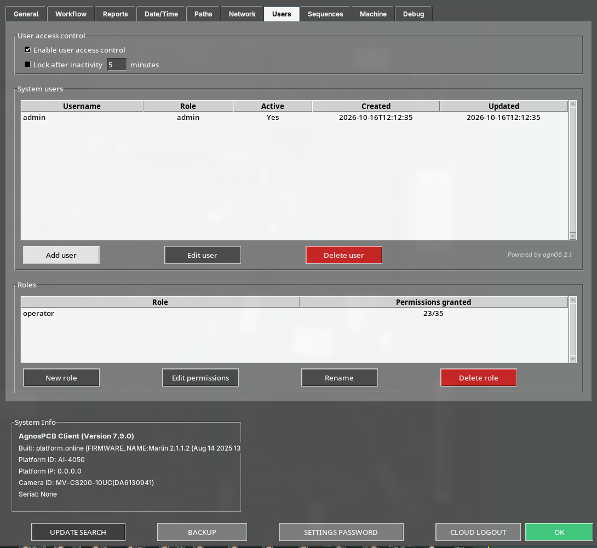{.center}

Press **New role**, give it a name and press **Create**.

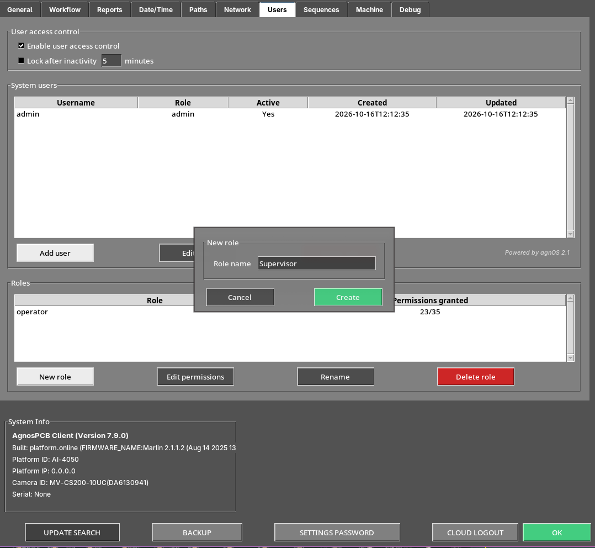{.center}

Select the new role in the list and press **Edit permissions** to choose exactly what it grants. Permissions are grouped into categories such as **Reference**, **Inspection** and **Maintenance** — for example creating or deleting a reference variant, running inspections, or calibrating the platform — and each category has its own **Select all** / **Deselect all** shortcut.

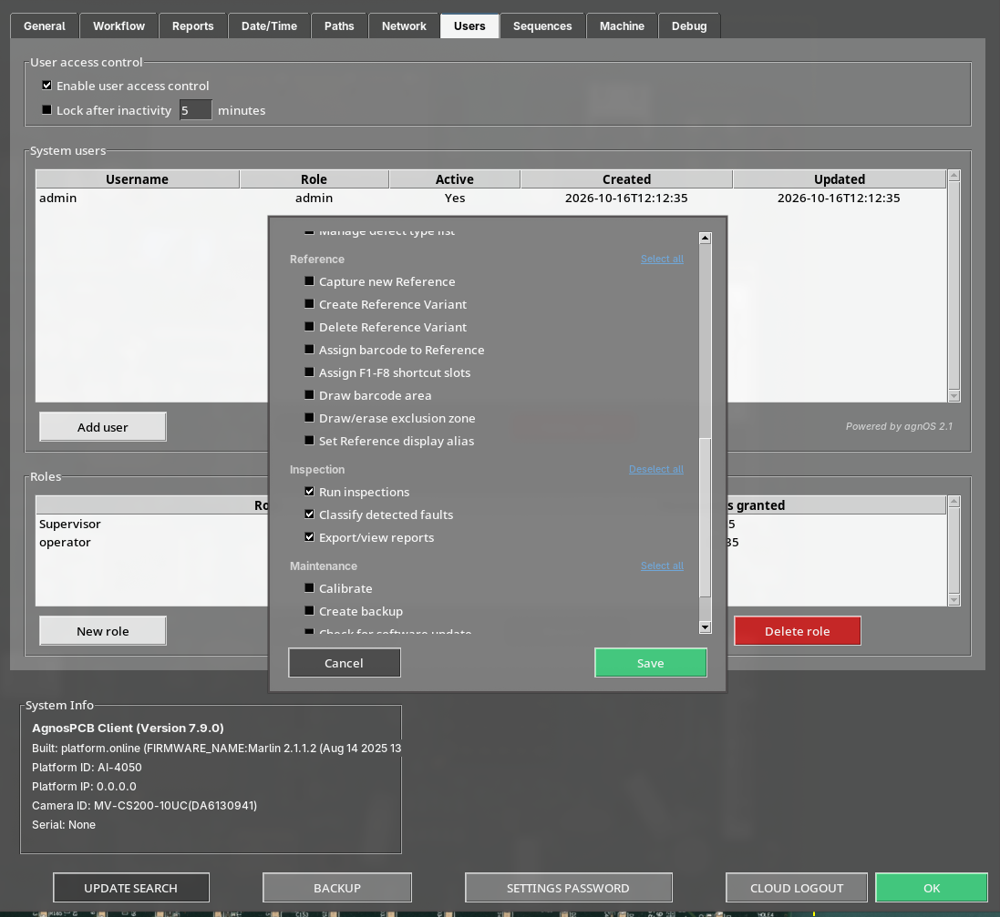{.center}

The **Permissions granted** column shows how many of the available permissions each role currently has, e.g. **23/35**.

A custom role then appears alongside **admin** and **operator** in the **Role** field when adding or editing a user.

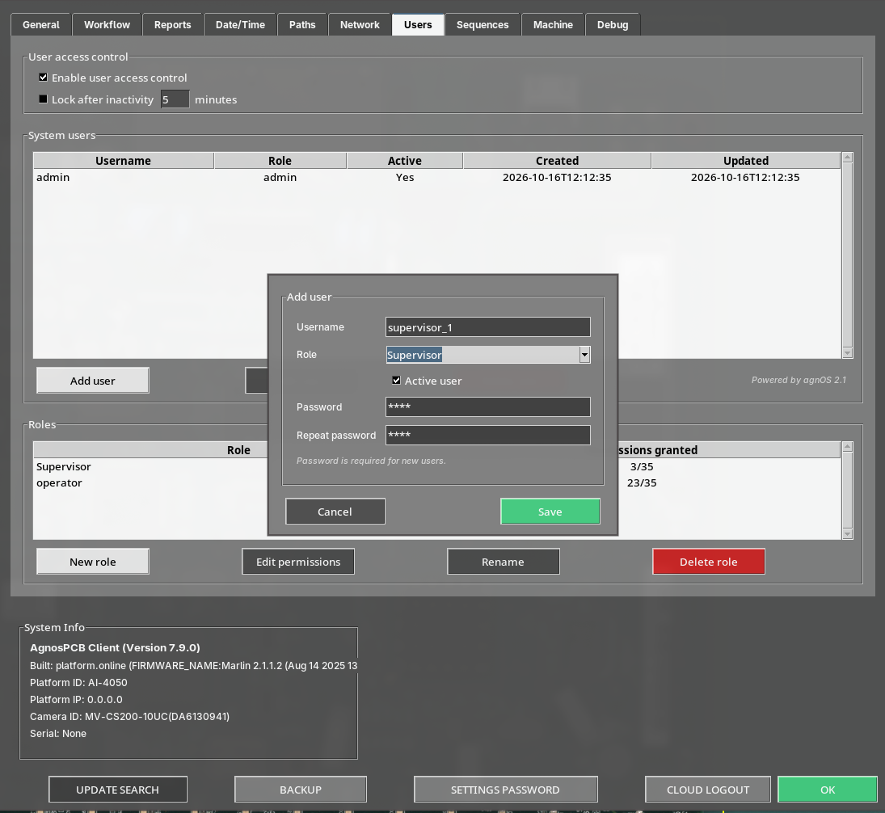{.center}

A new role starts with only the permissions needed to run inspections, classify detections and export reports. Everything else has to be granted from **Edit permissions**.

When a software update adds a new permission, the **operator** role receives it automatically. Custom roles do not: an administrator has to grant it to them explicitly. Recent updates added, among others:

| Permission | Allows |
| --- | --- |
| **Classify detected faults** | Reporting detections as actual errors or false positives. Without it, a **Permission denied** message is shown. Marking a detection as seen is always allowed. |
| **Max. variants per Reference** | Changing [Max. variants per Reference](../how_to/Settings_menu.md#max-variants-per-reference). |
| **Reference statistics and heatmap option** | Changing [Show statistics and error heatmap per Reference](../how_to/Settings_menu.md#show-statistics-and-error-heatmap-per-reference). |
| **Analysis preference** | Changing [Analysis preference](../how_to/Settings_menu.md#analysis-preference). |
| **Edit Reference options** | Changing the mandatory review levels of a REFERENCE in its [Reference options](../how_to/Screen-layout.md#reference-options). |

!!! note "Note"
    The built-in **admin** and **operator** roles cannot be renamed, have their permissions edited, or be deleted.

### Mandatory review per role

With user access control enabled, the [mandatory review levels](../how_to/Inspection_workflow.md#mandatory-review-levels) are set for each role instead of globally: the **Roles** list has a column for each level (**Mandatory review**, **Mandatory report** and **Final report**), and the **Edit permissions** window of the role has a checkbox for each one. Changing them requires access to the **Users** tab.

The global options in *Settings → Workflow* are grayed out while user access control is enabled, and keep their value for when it is disabled again.

- The **admin** role is never affected by these settings; only a REFERENCE that requires a level applies to it.
- New roles start with the three levels disabled.
- The first time the roles are loaded after updating to 7.11, each existing role takes the value that the global **Mandatory errors review** option had, so no existing obligation is lost. The **report** and **final report** levels start disabled for every existing role.

## Setting it up

### 1. Open the Users tab

Open the [settings menu](../how_to/Settings_menu.md) and go to the **Users** tab. On a machine that has never been configured, the list is empty and the access control is disabled.

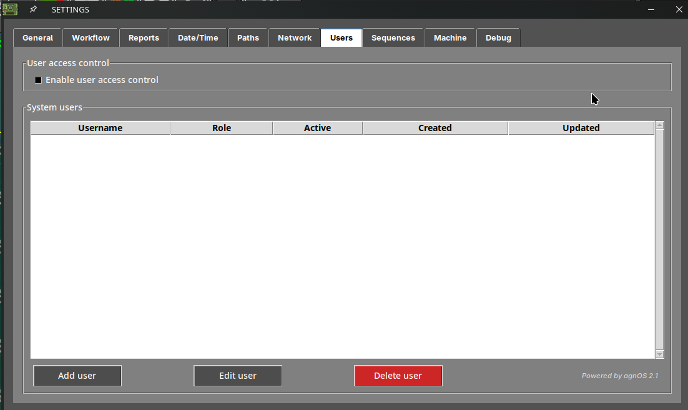{.center}

### 2. Create an administrator first

Before anything else you need an **admin** account. If you try to enable the access control without one, the software refuses:

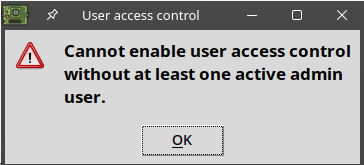{width=350px .center}

Press **Add user**, fill in the username, select the **admin** role, leave **Active user** checked and type the password twice.

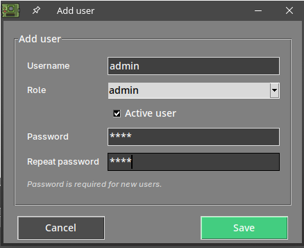{width=400px .center}

Press **Save**. The new account appears in the list, with the date it was created.

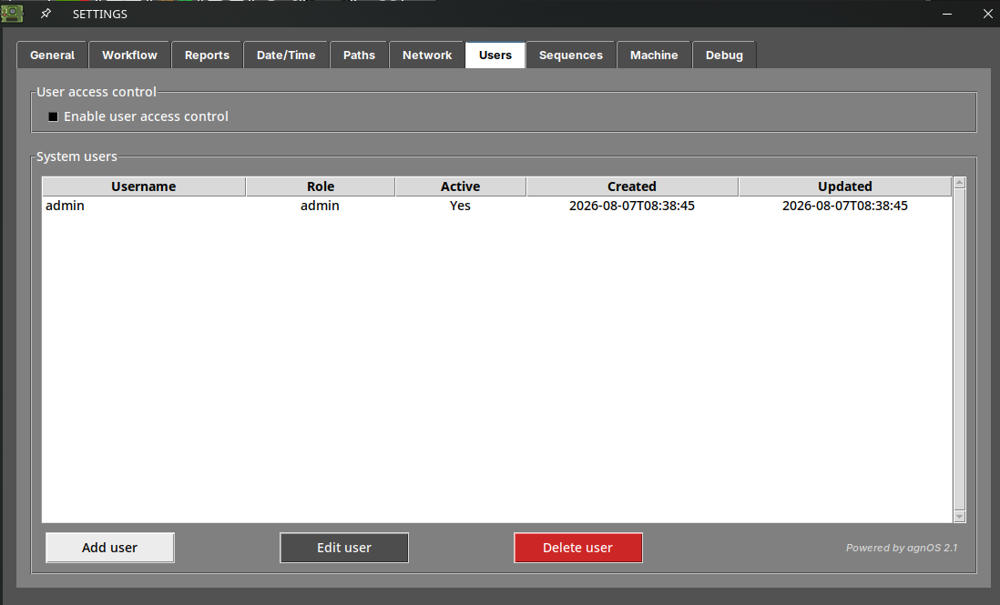{.center}

!!! warning "Important"

    Store the administrator password somewhere safe. Once the access control is enabled, this is the account that lets you back into the settings menu.

### 3. Enable the access control

With an active admin account in the list, enable **Enable user access control**.

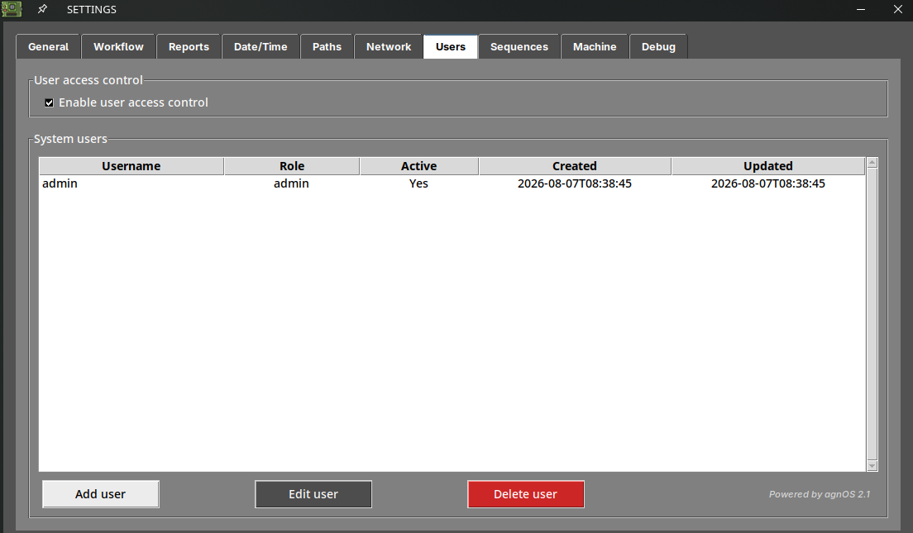{.center}

### 4. Add the rest of the users

Add an account for each person who will use the machine, giving them the **operator** role unless they need to change the configuration.

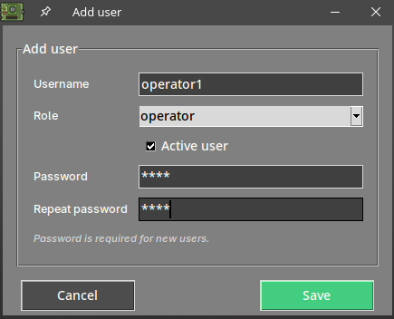{width=400px .center}

The list shows every account with its role, whether it is active, and the dates on which it was created and last modified.

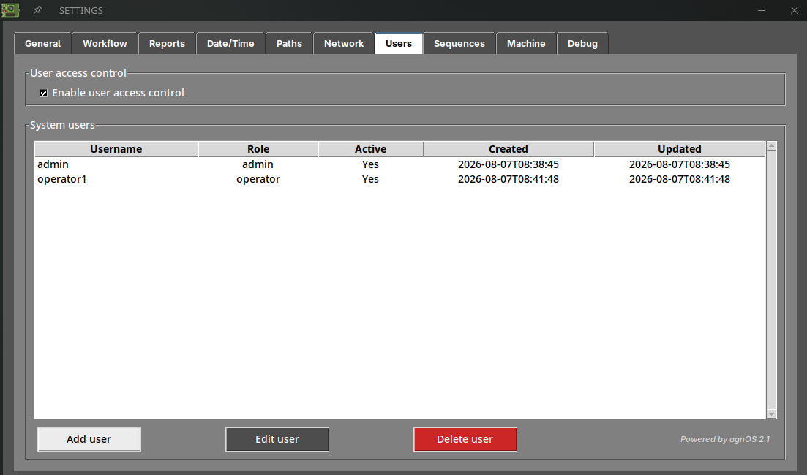{.center}

Press **OK** to save and close the settings menu.

## Logging in

From the next start of the software, the **User access required** dialog asks for the credentials of one of the accounts you created.

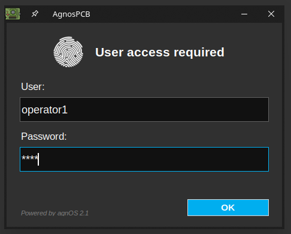{width=400px .center}

The software then opens with the permissions of that account.

The logged-in user is shown in the [activity log](../how_to/Screen-layout.md#activity-log).

To close the session and let a different user log in, use the **logout** button of the [platform status area](../how_to/Screen-layout.md#logout). It asks for confirmation and then clears the workspace (loaded REFERENCE and inspection results), so the next user starts fresh.

## Managing the accounts

Select an account in the list to work with it:

- **Edit user** — changes the role, the password or the active state of the selected account.
- **Delete user** — permanently deletes it. A confirmation is requested.

!!! tip "Deactivate instead of deleting"

    To stop someone from using the machine without losing the record of their account, edit the user and clear the **Active user** checkbox. The account stays in the list but can no longer log in.

!!! note "Note"
    There must always be at least one **active admin** account. Keep this in mind before deactivating or deleting an administrator.

## Inactivity lock

With user access control enabled, the **User access control** panel of the **Users** tab also offers an optional inactivity lock: enable **Lock after inactivity** and set the number of minutes of keyboard and mouse inactivity after which the application should lock itself.

{.center}

Once that time elapses, the **User access required** dialog appears again, the same as at startup, without closing the current REFERENCE or losing the results of the inspection in progress. Any active user can unlock it, not only the one who was logged in. The lock never triggers while an inspection is in progress or while [Demo / Loop mode](../how_to/Settings_menu.md#demo-loop-mode) is running.

!!! note "Note"
    This option only appears once user access control is enabled, since locking the application requires an account to unlock it with.
