# Inspektions-Workflow

### Starten der Software

- Schließen Sie das Netzteil an die Inspektionsplattform an der Rückseite an
- Schalten Sie den Monitor ein
- Schließen Sie das Netzteil an den Computer an und schalten Sie ihn ein
- Sobald das System gestartet ist, öffnen Sie die App durch Doppelklick auf das Desktopsymbol
- **Nur für ONLINE-Einheiten**: Es wird ein Anmeldefenster angezeigt, das Ihre AgnosPCB-Kontodaten abfragt. Die Anmeldedaten werden für die zukünftige Verwendung in der Einheit gespeichert und es ist keine erneute Anmeldung erforderlich.

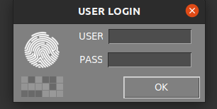{.center}

## Inspektionsprozedur

<iframe width="100%" height="400" src="https://www.youtube.com/embed/FirteJF0U1E?si=IiWu4CkiELWYecYR" title="YouTube video player" frameborder="0" allow="accelerometer; autoplay; clipboard-write; encrypted-media; gyroscope; picture-in-picture; web-share" referrerpolicy="strict-origin-when-cross-origin" allowfullscreen></iframe>
___

### Generieren einer REFERENZ

Die AgnosPCB Inspektions-Software wird das Foto Ihrer **REFERENZ**-Leiterplatte/Ihres Panels ("golden sample") mit allen Fotos **"vergleichen"**, die Sie von der zu inspizierenden Schaltung aufnehmen (Fotos zum "ANALYSEN").

!!! warning "Wichtig"
    Wir empfehlen Ihnen, unsere [Tipps](../help/Tips.md)-Sektion zu besuchen, bevor Sie Ihr erstes Bild aufnehmen.

Um mit der Aufnahme der REFERENZ fortzufahren, klicken Sie im Hauptmenü auf das Referenzsymbol:

{.center}

Ein neues Fenster wird mit mehreren Werkzeugen geöffnet:

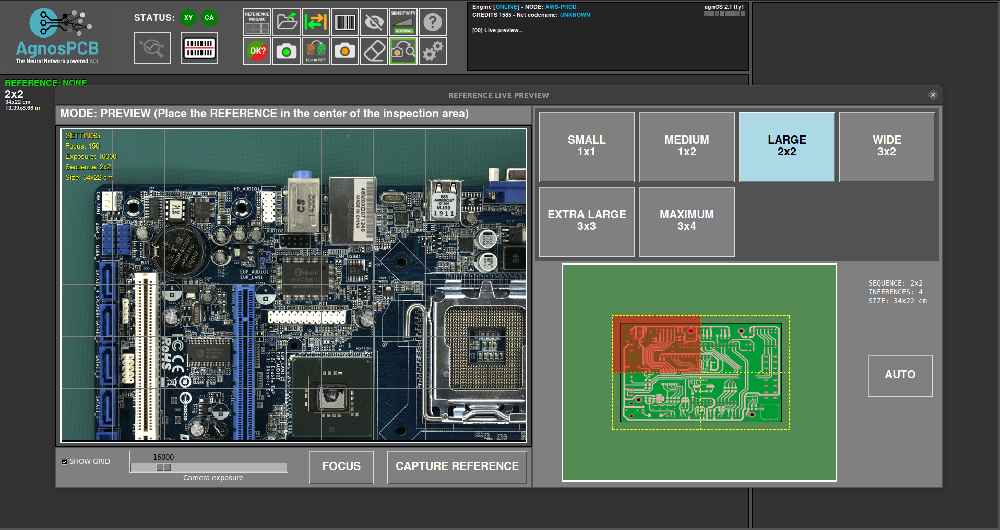{.center}

In diesem Fenster müssen wir die Bilder einstellen, die zur Abdeckung der gesamten PCBA erforderlich sind.

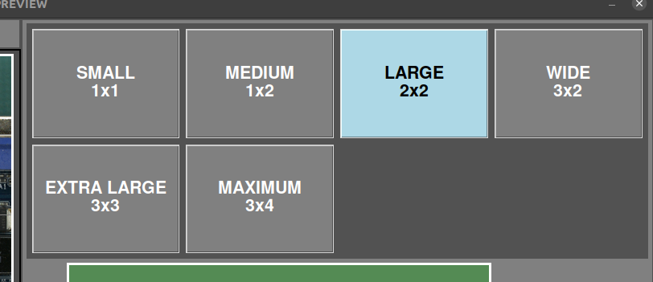{.center}

---

#### Erfassung der PCB-Größe

Bei größeren PCBAs reicht das Sichtfeld der Kamera möglicherweise nicht aus, um die gesamte Leiterplatte in einer einzigen Aufnahme zu erfassen. In solchen Fällen nimmt das System mehrere Bilder auf und fügt sie mithilfe von KI automatisch zu einem einzigen, für die Inspektion geeigneten Bild zusammen.

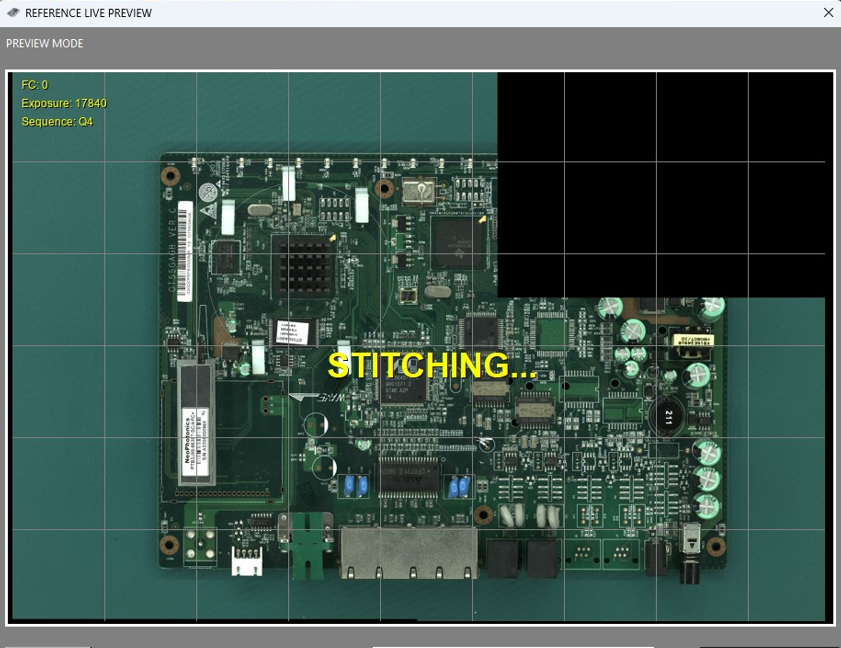{width=600 .center}

Wenn Sie sich nicht sicher sind, wie viele Bilder benötigt werden, platzieren Sie das PCBA in der Mitte des Inspektionsbereichs und drücken Sie die Taste **AUTO**. Das System scannt die Leiterplatte und stellt automatisch die optimalen Parameter ein.

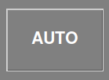{.center}

Sie können die Kamera auch in jeden Quadranten des PCBAs bewegen, indem Sie im Miniaturbild auf den gewünschten Bereich klicken.

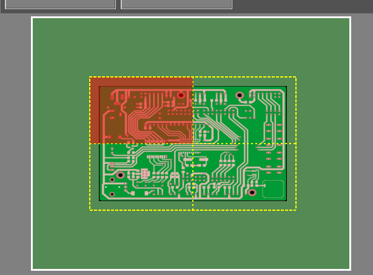{.center}

---

#### TOP/BOTTOM-Inspektion

Die Software kann beide Seiten einer PCBA inspizieren. Diese Funktion muss während der Aufnahme der REFERENZ im Live-Vorschaufenster aktiviert werden.

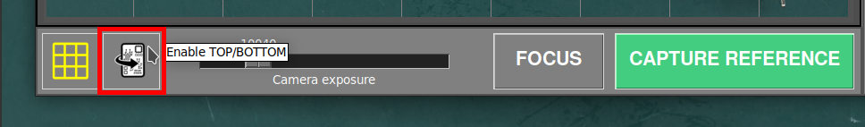{width=600 .center}

Sobald die richtige Sequenz eingestellt und die PCBA korrekt platziert ist, drücken Sie die Schaltfläche **CAPTURE TOP**, um die Oberseite der PCBA aufzunehmen.

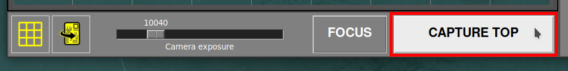{width=600 .center}

Nach Abschluss des Vorgangs erscheint das Mosaikfenster und die REFERENZ kann in einem der Speicherplätze abgelegt werden. Anschließend können Sie fortfahren, indem Sie die Platine umdrehen und die Unterseite aufnehmen.

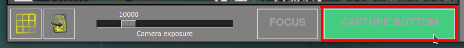{width=600 .center}

Verwenden Sie die Schaltfläche im Hauptfenster, um zwischen dem **TOP**- und dem **BOTTOM**-Bild zu wechseln.

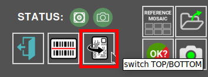{width=400 .center}

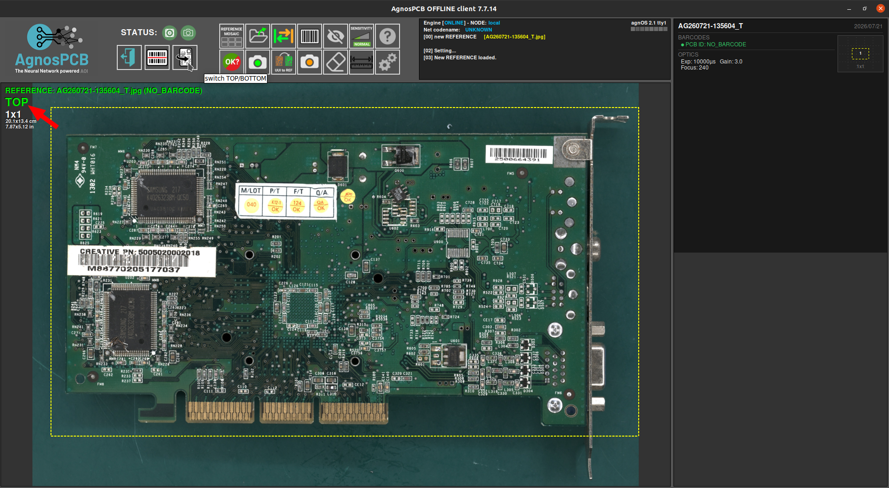{.center}

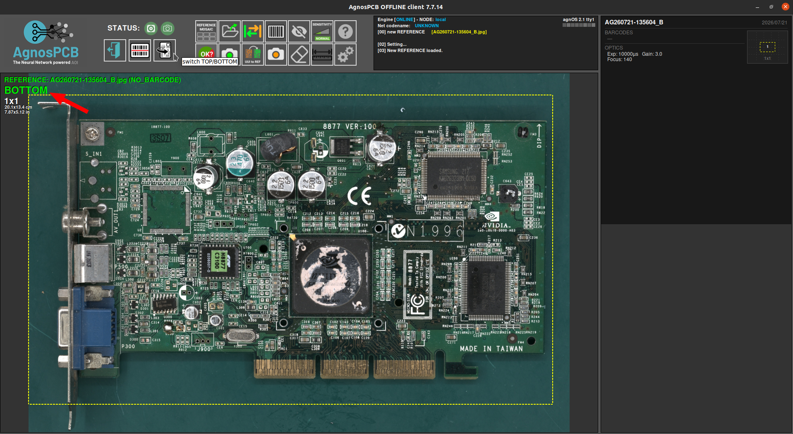{.center}

Auch die Tasten **Page Up** und **Page Down** wechseln zur **TOP**- bzw. **BOTTOM**-Seite.

Unter [Beide Seiten einer Platine inspizieren](#beide-seiten-einer-platine-inspizieren) erfahren Sie, wie Sie eine doppelseitige PCBA inspizieren, sobald ihre REFERENZ bereit ist.

---

#### Fokussierung

Das System ermöglicht eine manuelle Fokussierung des PCBs vor dem Start des Aufnahmeprozesses. Drücken Sie die Taste **FOCUS**, um die Optik einzustellen und zu überprüfen, ob der ausgewählte Bereich korrekt fokussiert ist.

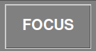{.center}

Standardmäßig fokussiert die Kamera automatisch auf die Mitte des PCBs. Dies ist jedoch aufgrund hoher Bauteile nicht immer der optimale Bereich.

Für eine präzise Inspektion ist es entscheidend, auf die **Basis des PCBs** zu fokussieren, wo die Bauteile montiert sind. Vermeiden Sie es, auf hohe Bauteile zu fokussieren, da dies die Inspektionsgenauigkeit verringern kann.

Das PCB muss während der manuellen Fokussierung nicht zentriert sein. Der Bediener kann es frei bewegen und einen geeigneten Bereich auswählen, solange die Basis des PCBs klar fokussiert ist.

Nach Abschluss der Fokussierung muss das PCB wieder in die Mitte des Inspektionsbereichs positioniert werden, bevor das Referenzbild aufgenommen wird.

!!! warning "Wichtig"
    Wählen Sie einen Bereich ohne hohe Bauteile und stellen Sie sicher, dass die PCB-Basis scharf fokussiert ist.

Der untere Bereich des Fensters ermöglicht das Ein- und Ausblenden des Rasters in der Live-Ansicht sowie die Anpassung der Belichtung.

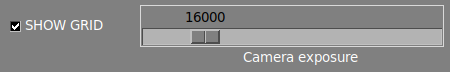{.center}

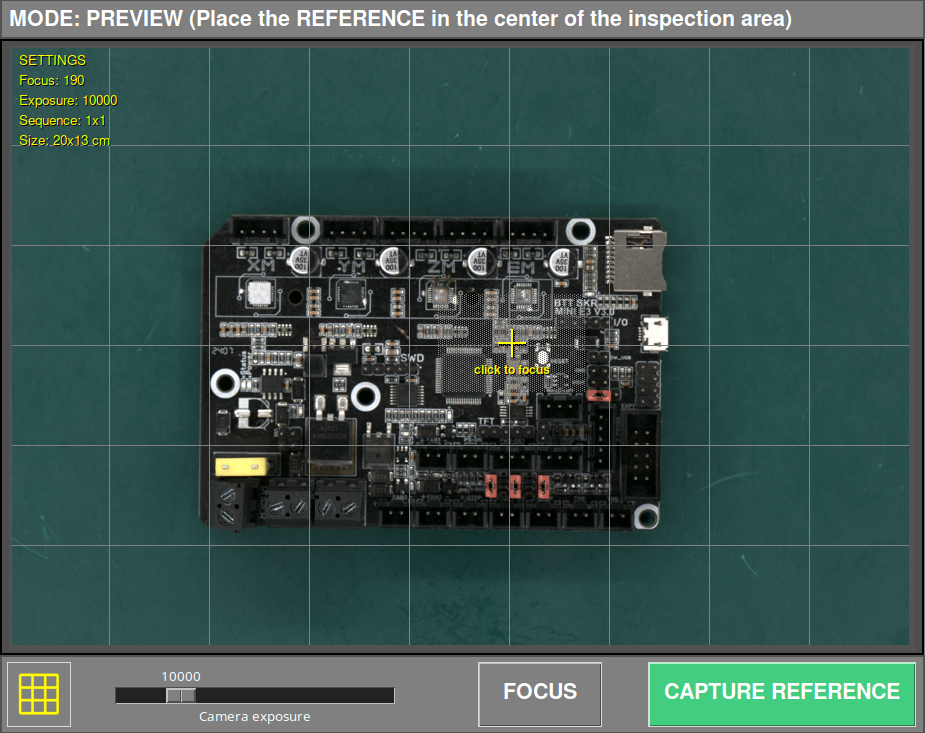{.center}

---

Um die Aufnahmeverarbeitung zu starten, klicken Sie einfach auf die Schaltfläche **REFERENZ AUFNEHMEN**. Das AOI fokussiert automatisch auf den ausgewählten Quadranten und beginnt innerhalb von Sekunden mit der Aufnahme der gesamten PCBA.

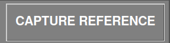{.center}

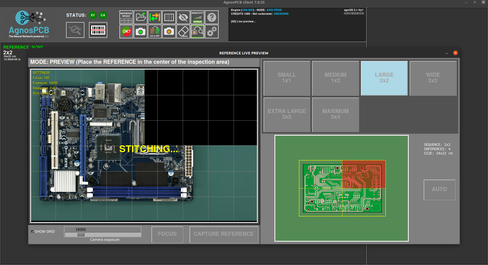{.center}

Nach der Aufnahme der PCBA wird das Mosaik-Fenster geöffnet, das es ermöglicht, das Bild zur schnellen Verwendung zu speichern.

!!! note "Hinweis"
    Alle aufgenommenen REFERENZEN werden automatisch gespeichert. Das Mosaik hilft dabei, die am häufigsten verwendeten REFERENZEN schnell zu laden.

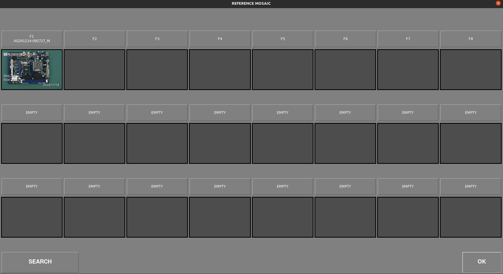{.center}

Sobald der Aufnahmeprozess beendet ist, wird das REFERENZ-Bild im Hauptfenster angezeigt und ermöglicht es Ihnen, [Ausschlussmasken](Set_exclusion_area.md) festzulegen oder [einen Barcode-Bereich](../features/Barcode_reader.md) zum Lesen zu zeichnen.

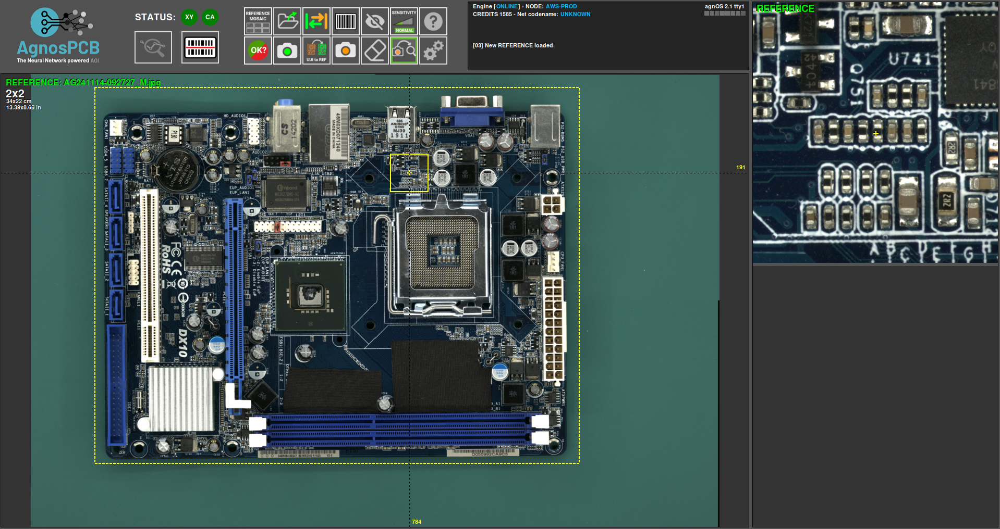{.center}

### Aufnehmen einer UUI

Nach dem Generieren oder Hochladen eines vorherigen REFERENZ-Bildes können wir mit der Aufnahme des **UUI** (Unit Under Inspection)-Bildes fortfahren, indem wir auf die Schaltfläche drücken.

{.center}

Ein Live-Vorschaufenster wird geöffnet, das ein Geisterbild des REFERENZ-Bildes zeigt. Dies hilft, die UUI PCBA mit der REFERENZ auszurichten.

!!! warning "Wichtig"
    Die **AgnosPCB**-Software ist in der Lage, beide Bilder (**REFERENZ** und **UUI**) automatisch auszurichten. Es ist jedoch wichtig, die UUI PCBA korrekt zu positionieren, um geometrische Verformungen zu vermeiden, die Falsch-Positiv-Erkennungen verursachen können.

{.center}

Der Aufnahmeprozess beginnt durch Klicken auf die Schaltfläche **INSPEKTION STARTEN**.

!!! note "Hinweis"
    Eine Fokussierung ist nicht erforderlich, da der Fokusparameter bereits mit dem REFERENZ-Bild gespeichert ist, was die Inspektion sehr schnell macht.

Der Inspektionsprozess wird im Falle einer Multi-Bild-Inspektion parallel ausgeführt.

Sobald der Aufnahmeprozess beendet ist, wird das Endergebnis zurückgegeben, das die erkannten Fehler anzeigt, falls vorhanden. Es ist möglich, die [Erkennungsempfindlichkeit](Set_sensitivity.md) durch Drücken der Schaltfläche im Hauptfenster oder durch Drücken der **Tasten 1, 2 oder 3** zu ändern.

{.center}

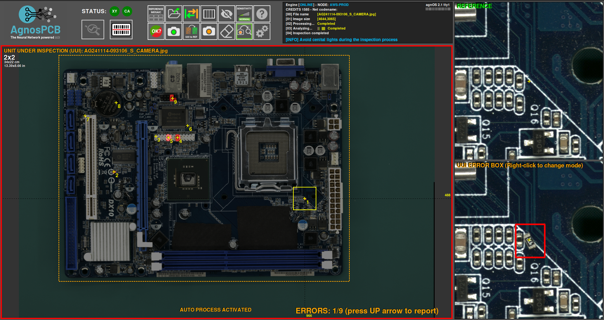{.center}

Wenn Fehler erkannt werden, erscheint ein **roter Rahmen** um das Hauptfenster. Ein **grüner Rahmen**, wenn keine Fehler vorliegen.

### Beide Seiten einer Platine inspizieren

Mit einer doppelseitigen REFERENZ können Sie die **TOP**- und die **BOTTOM**-Seite derselben Platine nacheinander inspizieren:

1. Inspizieren Sie die erste Seite wie gewohnt. In der Live-Vorschau zeigt die Schaltfläche **INSPEKTION STARTEN** in einer zweiten Zeile an, welche Seite Sie gleich inspizieren. Prüfen Sie, dass die Platine mit dieser Seite nach oben liegt.
2. Drehen Sie die Platine um, wechseln Sie zur anderen Seite (mit der [TOP/BOTTOM-Schaltfläche](Screen-layout.md#topbottom-umschalten), den Tasten **Page Up** / **Page Down** oder automatisch mit [TOP/BOTTOM automatisch umschalten](Settings_menu.md#topbottom-automatisch-umschalten)) und inspizieren Sie sie.
3. Sobald beide Seiten inspiziert wurden, wechseln die TOP/BOTTOM-Schaltfläche und die Tasten **Page Up** / **Page Down** direkt zwischen den **Ergebnissen** der beiden Seiten, sodass Sie eine Seite weiter prüfen können, nachdem Sie die andere aufgenommen haben. Jede Seite behält ihre eigenen Erkennungen, Klassifizierungen und ihre eigene [Empfindlichkeit](Set_sensitivity.md).

Die Ergebnisse werden im Hintergrund gespeichert, während Sie arbeiten. Während eine Seite wiederhergestellt wird, erscheint ein Ladehinweis auf dem Bild.

Sobald beide Seiten einen Bericht haben, wird ein einziger [kombinierter Bericht](#kombinierter-topbottom-bericht) für die gesamte Platine erzeugt.

!!! note "UV-Inspektionen"
    Eine [UV-Inspektion](../features/UV_conformal_coating_inspection.md) ist unabhängig von der laufenden TOP/BOTTOM-Platine: Sie verwirft die bereits inspizierten Seiten nicht und ist nicht Teil des kombinierten Berichts.

### Melden von Fehlern

Sobald die Inspektion abgeschlossen ist, muss der Bediener die markierten Fehler überwachen und sie entweder als **tatsächlichen Fehler** oder als **Falsch-Positiv-Erkennung** kennzeichnen.
Dazu blättern Sie einfach mit den **linken und rechten Pfeiltasten** auf der Tastatur durch die Fehler.

!!! note "Analysepräferenz"
    Bei Neuinstallationen beginnt die Prüfung standardmäßig in der [Erkennungsliste](Screen-layout.md#erkennungsliste): Die Pfeiltasten **links** und **rechts** bewegen sich von Zeile zu Zeile der Liste, und die Pfeiltasten **nach oben** und **nach unten** klassifizieren die Zeile unter dem Cursor. Um die Erkennungen wie in früheren Versionen direkt auf dem Bild zu prüfen, stellen Sie die [Analysepräferenz](Settings_menu.md#analysepraferenz) auf **CANVAS**.

Fehler können auch direkt mit der Maus gemeldet werden: **Linksklick** auf eine Erkennung meldet sie als tatsächlichen Fehler, **Rechtsklick** meldet sie als Falsch-Positiv — entsprechend den unten beschriebenen Pfeiltasten **nach oben** und **nach unten**. Jede Zeile der [Erkennungsliste](Screen-layout.md#erkennungsliste) hat außerdem eine Schaltfläche mit **rotem Kreuz** (Fehler) und eine mit **grünem Haken** (Falsch-Positiv).

Ein Linksklick auf eine Erkennung, die bereits als tatsächlicher Fehler gemeldet ist, fragt nach einer Bestätigung, bevor die Meldung rückgängig gemacht wird.

Um einen echten Fehler zu markieren, bewegen Sie sich einfach zum Fehler und drücken Sie die **Pfeiltaste nach oben** auf Ihrer Tastatur. Ein neues Fenster wird angezeigt, das den Fehler detailliert zeigt und es Ihnen ermöglicht, ihn zu kategorisieren, indem Sie einen Fehlertyp aus der Liste auswählen.

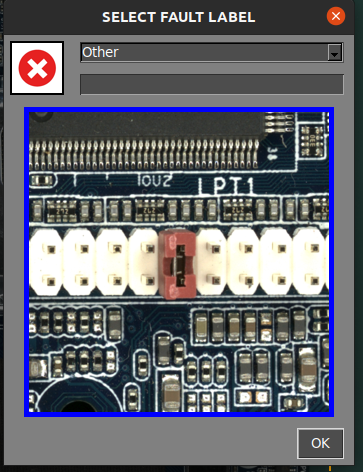{.center}

Zusätzlich gibt es ein leeres Feld zum **Hinzufügen eines Kommentars.**

Falls der Bediener einen von der Software **nicht erkannten** Fehler findet, ist es möglich, diesen zu markieren und zu melden, indem der Cursor auf den Fehlerbereich bewegt und die **Pfeiltaste nach oben** gedrückt wird. Das Meldefenster wird wie gewohnt angezeigt. 

Wenn die Software einen Bereich markiert, der kein tatsächlicher Fehler ist, kann der Bediener ihn als **Falsch-Positiv** kennzeichnen, indem er die **Pfeiltaste nach unten** drückt. Es erscheint ein Fenster, in dem standardmäßig **Reference variant** ausgewählt ist — siehe [Referenzvarianten](../features/Multivariant_feature.md), um zu erfahren, wie Sie es ausfüllen. Um stattdessen einen einfachen Falsch-Positiv zu melden, wählen Sie im Dropdown-Menü **False positive**, bevor Sie bestätigen.

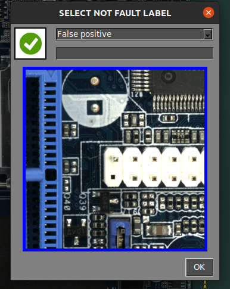{.center}

!!! note "Hinweis"
    Beachten Sie, dass das **rote Symbol** {width=20px} die tatsächlichen Fehler und das **grüne Symbol** {width=20px} die Falsch-Positiv-Fehler kennzeichnet.

!!! note "Berechtigungen"
    Bei aktivierter [Benutzerzugriffskontrolle](../features/User_control.md) ist zum Melden einer Erkennung die Berechtigung **Classify detected faults** erforderlich. Ohne sie wird die Meldung **Permission denied** angezeigt und nichts gemeldet.

Eine Erkennung, die auf keine der beiden Arten gemeldet wurde, gilt weiterhin als **ungeprüft** (gelb). Bleibt der Mauszeiger etwa **eine Sekunde** lang ruhig über ihr, wird sie als **gesehen** (cyan) markiert: Während Sie warten, füllt sich ein kleiner Ring um die Erkennung, und wenn Sie den Zeiger wegbewegen, bevor er sich schließt, wird nichts markiert. So werden beim Überstreichen der Platine mit der Maus keine Erkennungen markiert, die Sie nicht angesehen haben. Dasselbe gilt, wenn Sie eine Erkennung mit den Pfeiltasten oder über die Erkennungsliste erreichen. Eine als gesehen markierte Erkennung kann danach weiterhin gemeldet werden.

### Verpflichtende Prüfstufen

Die Software kann drei Prüfstufen verlangen, bevor eine neue Inspektion gestartet werden kann. Sie sind voneinander unabhängig und können kombiniert werden:

| Stufe | Was sie verlangt |
| --- | --- |
| **Pflichtprüfung der Fehler** | Jede Erkennung geprüft oder zumindest als **gesehen** markiert. |
| **Pflichtmeldung der Fehler** | Jede Erkennung als tatsächlicher Fehler oder Falsch-Positiv **gemeldet**. Sie nur als gesehen zu markieren, genügt nicht. |
| **Verpflichtender Abschlussbericht** | Der [endgültige OK-/NICHT-OK-Bericht](#generieren-eines-endgultigen-pdf-berichts) vom Bediener bestätigt. Ein automatisch erzeugter Bericht zählt nicht. |

Ist eine Stufe beim Versuch, die nächste Inspektion zu starten, nicht erfüllt, teilt Ihnen eine Warnung mit, was noch fehlt.

Eine Stufe gilt, wenn **eine beliebige** der folgenden Stellen sie aktiviert hat:

- Die geladene **REFERENZ**, in ihrem Fenster [Referenzoptionen](Screen-layout.md#referenzoptionen).
- Die **Rolle** des angemeldeten Benutzers, wenn die [Benutzerzugriffskontrolle](../features/User_control.md#pflichtprufung-pro-rolle) aktiviert ist. Die Rolle **admin** ist nur von der REFERENZ betroffen.
- Die globalen Optionen in den [Workflow-Einstellungen](Settings_menu.md#pflichtprufung-der-fehler), wenn die Benutzerzugriffskontrolle deaktiviert ist.

Solange der [Demo-/Loop-Modus](Settings_menu.md#demo-loop-modus) aktiv ist, wird keine der Stufen verlangt.

Bei einer doppelseitigen Platine wird die Inspektion der anderen Seite derselben Platine nie durch das blockiert, was auf der ersten Seite noch aussteht. Um die **nächste Platine** zu starten, müssen die geltenden Stufen auf **beiden** Seiten erfüllt sein. Um den Abschlussbericht der anderen Seite zu bestätigen, wechseln Sie zu ihr und erzeugen Sie ihren Abschlussbericht.

Ist mindestens eine Stufe aktiviert, gibt jeder Bericht (PDF und JSON) an, wie weit die Prüfung zum Zeitpunkt seiner Erstellung fortgeschritten war, zum Beispiel `MANDATORY REVIEW - Detections: 5 (3 classified, 2 seen, 0 pending)`, und ob der Abschlussbericht bestätigt wurde. Die Zeile wird rot angezeigt, wenn noch etwas ausstand.

#### Warnung bei einer nicht geprüften Seite

Unabhängig von den obigen Stufen warnt Sie die Software vor dem Start der nächsten Platine, wenn eine Seite Erkennungen hat, aber **keine** davon geprüft oder gemeldet wurde. Das Fenster nennt die Seite und lässt Sie trotzdem fortfahren (**OK**) oder zurückgehen, um sie zu prüfen (**CANCEL**).

Diese Warnung wird nicht angezeigt, wenn die nächste Aufnahme die andere Seite derselben Platine ist, bei UV-Inspektionen oder im Demo-/Loop-Modus. Sie kann unter [Settings → Workflow](Settings_menu.md#warnung-bei-nicht-geprufter-seite) deaktiviert werden.

### Generieren eines endgültigen PDF-Berichts

Nach Abschluss der Meldung kann der Bediener einen endgültigen PDF-Bericht generieren, indem er auf die folgende Schaltfläche drückt:

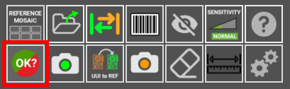{.center}

Ein Fenster erscheint, das es Ihnen ermöglicht, die Inspektion als **OK** oder **NICHT OK** zu markieren. Wenn die PCBA die Qualitätsprüfung erfolgreich besteht, drücken Sie das grüne Symbol.

{.center}

Es ist möglich, Kommentare hinzuzufügen, die in den Bericht aufgenommen werden. Das PDF wird im Ordner **REPORTS** generiert.

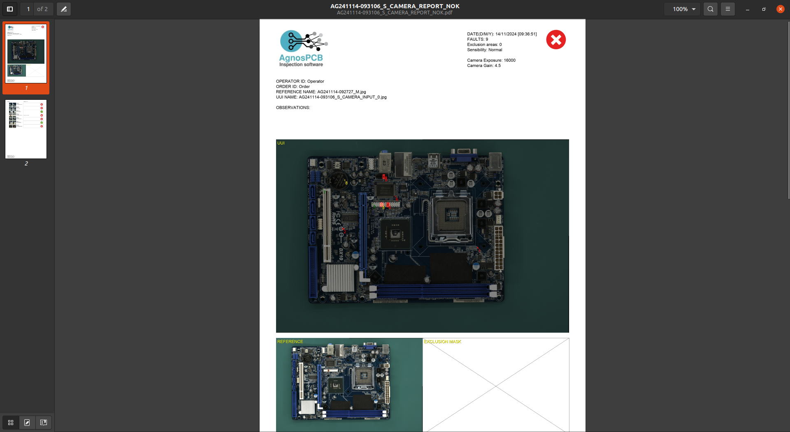{.center}

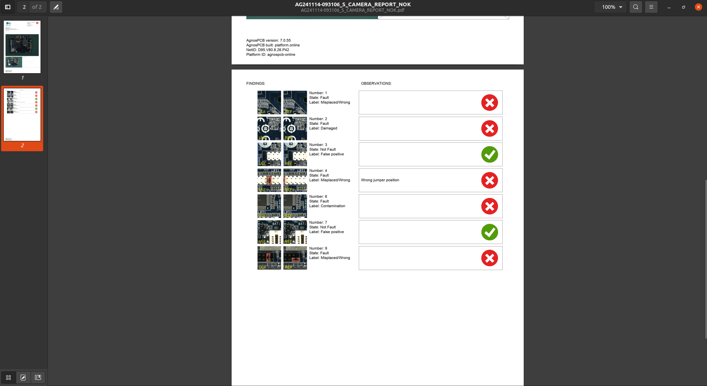{.center}

#### Kombinierter TOP/BOTTOM-Bericht

Sobald beide Seiten einer Platine einen Bericht haben, wird im Berichtsordner der TOP-Seite ein einziges kombiniertes PDF erzeugt: ein Deckblatt mit dem Gesamtergebnis und den Daten jeder Seite, gefolgt vom TOP-Bericht und vom BOTTOM-Bericht. Sind [JSON-Berichte](Settings_menu.md#json-bericht-erstellen) aktiviert, wird außerdem ein kombiniertes JSON geschrieben, mit den Daten jeder Seite unter `sides.TOP` und `sides.BOTTOM`.

Sobald der kombinierte Bericht geschrieben wurde, werden die einzelnen PDF- und JSON-Berichte jeder Seite gelöscht, sodass pro Platine nur ein PDF und ein JSON übrig bleiben. Eine Platine, bei der nur eine Seite inspiziert wurde, behält ihren eigenen Bericht, und es wird nichts gelöscht, wenn der kombinierte Bericht nicht geschrieben werden konnte. Die Inspektionsdateien in **PCB_OUT** sind nicht betroffen.

!!! note "Hinweis"
    Der JSON-Bericht gibt außerdem für jede Erkennung an, ob der Bediener sie als Fehler oder als Falsch-Positiv eingestuft hat oder ob sie noch aussteht (Feld `verdict`).
