# Flujo de trabajo de inspección

### Lanzamiento del software

- Conecte la fuente de alimentación a la plataforma de inspección en el panel trasero
- Encienda el monitor
- Conecte la fuente de alimentación al ordenador y enciéndalo
- Una vez que el sistema haya arrancado, abra la aplicación haciendo doble clic en el icono del escritorio
- **Solo para unidades ONLINE**: aparecerá una ventana de inicio de sesión pidiendo sus credenciales de cuenta de AgnosPCB. Las credenciales se almacenarán en la unidad para uso futuro y no requerirá iniciar sesión de nuevo.

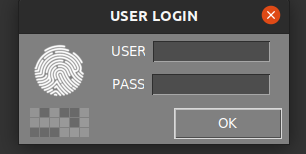{.center}

## Procedimiento de inspección

<iframe width="100%" height="400" src="https://www.youtube.com/embed/FirteJF0U1E?si=IiWu4CkiELWYecYR" title="YouTube video player" frameborder="0" allow="accelerometer; autoplay; clipboard-write; encrypted-media; gyroscope; picture-in-picture; web-share" referrerpolicy="strict-origin-when-cross-origin" allowfullscreen></iframe>
___

### Generación de una REFERENCIA

El software de la herramienta de inspección AgnosPCB **"comparará"** la fotografía de su circuito/panel de **REFERENCIA** ("muestra dorada") con todas las fotos que tome del circuito a inspeccionar (fotos para "ANALIZAR").

!!! warning "Importante"
    Le recomendamos visitar nuestra sección de [consejos](../help/Tips.md) antes de tomar su primera imagen.

Para proceder con la toma de la REFERENCIA, haga clic en el icono de referencia en el menú principal:

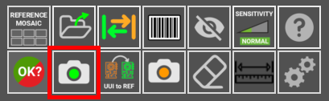{.center}

Aparecerá una nueva ventana con múltiples herramientas:

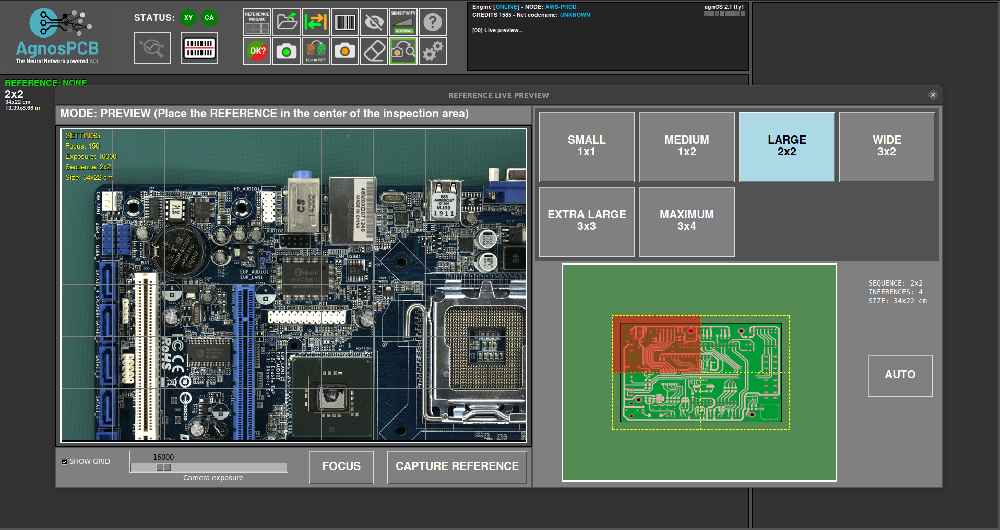{.center}

En esta ventana tenemos que configurar las imágenes necesarias para cubrir toda la PCBA.

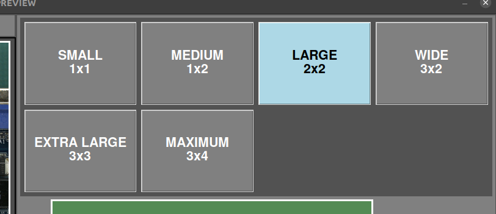{.center}

---
#### Captura del tamaño del PCB

En PCBAs de mayor tamaño, el campo de visión de la cámara puede no ser suficiente para capturar toda la placa en una sola imagen. En estos casos, el sistema captura múltiples imágenes y las une automáticamente mediante IA en una única imagen lista para la inspección.

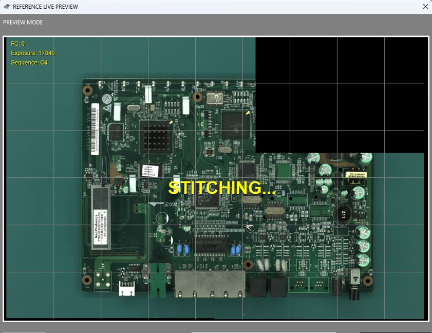{width=600 .center}

Si no está seguro de cuántas imágenes son necesarias, coloque el PCBA en el centro del área de inspección y pulse el botón **AUTO**. El sistema escaneará la placa y configurará automáticamente los parámetros óptimos.

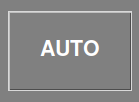{.center}

También puede mover la cámara a cualquier cuadrante del PCBA haciendo clic en el área deseada en la vista en miniatura.

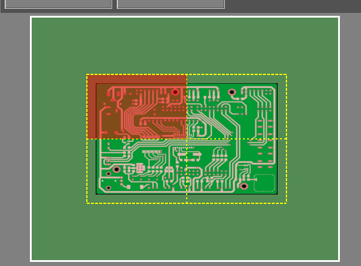{.center}

---

#### Inspección TOP/BOTTOM

El software puede inspeccionar ambas caras de una PCBA. Esta función debe habilitarse durante la captura de la REFERENCIA, desde la ventana de vista en vivo.

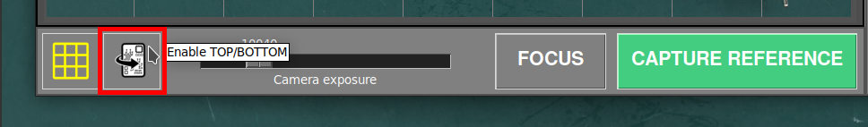{width=600 .center}

Una vez establecida la secuencia correcta y colocada correctamente la PCBA, presione el botón **CAPTURE TOP** para capturar la cara superior de la PCBA.

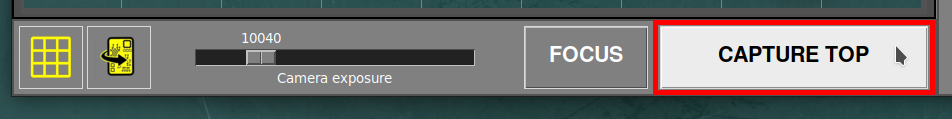{width=600 .center}

Cuando el proceso haya finalizado, aparecerá la ventana de mosaico y la REFERENCIA podrá guardarse en uno de los espacios. A continuación puede seguir dando la vuelta al panel y capturando la cara inferior.

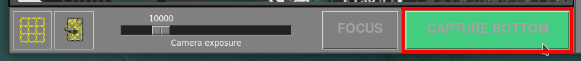{width=600 .center}

Utilice el botón de la ventana principal para alternar entre las imágenes **TOP** y **BOTTOM**.

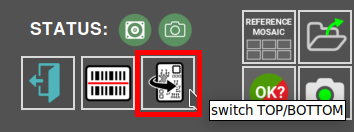{width=400 .center}

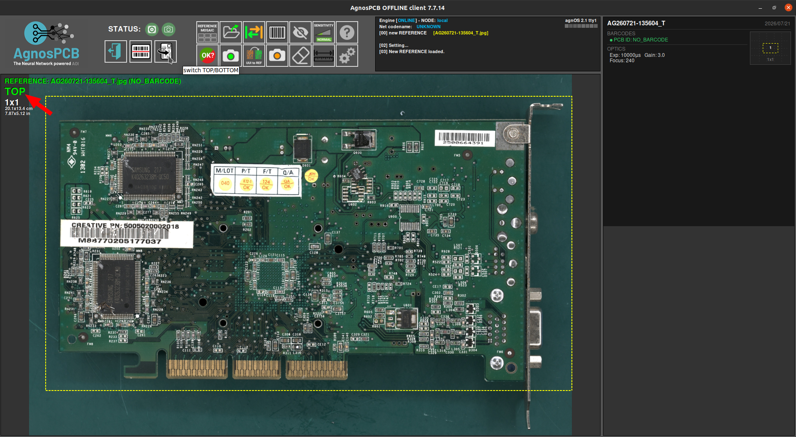{.center}

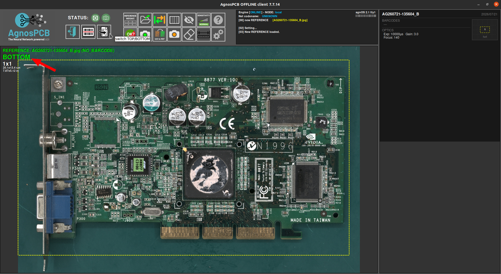{.center}

Las teclas **Page Up** y **Page Down** también cambian a la cara **TOP** y **BOTTOM** respectivamente.

Consulte [Inspección de ambas caras de una placa](#inspeccion-de-ambas-caras-de-una-placa) para saber cómo inspeccionar una PCBA de doble cara una vez que su REFERENCIA está lista.

---

#### Enfoque

El sistema permite el enfoque manual del PCB antes de iniciar el proceso de captura. Pulse el botón **FOCUS** para ajustar la óptica y verificar que el área seleccionada esté correctamente enfocada.

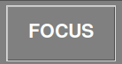{.center}

Por defecto, la cámara enfoca automáticamente el centro del PCB. Sin embargo, esta no siempre es la zona óptima debido a la presencia de componentes altos.

Para una inspección precisa, es esencial enfocar la **base del PCB**, donde están montados los componentes. Evite enfocar componentes altos, ya que esto puede reducir la precisión de la inspección.

El PCB no necesita estar centrado durante el enfoque manual. El operador puede moverlo libremente y seleccionar cualquier área adecuada para lograr un buen enfoque, siempre que la base del PCB esté claramente enfocada.

Una vez finalizado el proceso de enfoque, el PCB debe volver a colocarse en el centro del área de inspección antes de capturar la imagen de referencia.

!!! warning "Importante"
    Seleccione un área sin componentes altos y asegúrese de que la base del PCB esté perfectamente enfocada.

La parte inferior de la ventana permite activar o desactivar la cuadrícula en la vista en vivo y ajustar la exposición.

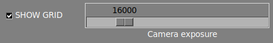{.center}

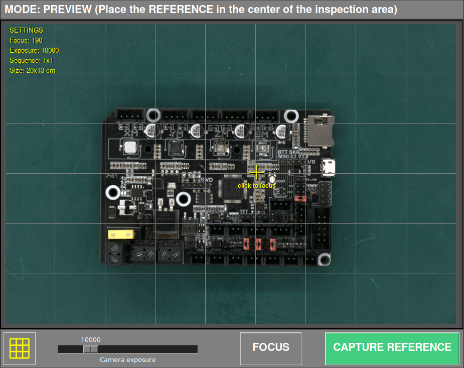{.center}

---

Para iniciar el procesamiento de la captura, simplemente haga clic en el botón **CAPTURAR REFERENCIA**. El AOI enfoca automáticamente en el cuadrante seleccionado y comienza a capturar toda la PCBA en cuestión de segundos.

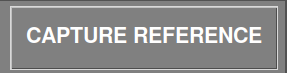{.center}

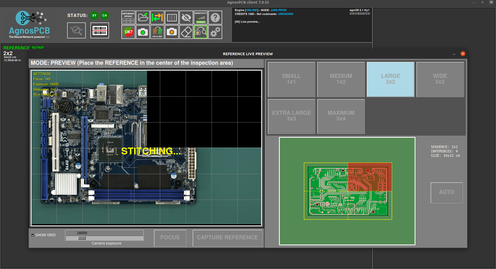{.center}

Después de capturar la PCBA, aparecerá la ventana de mosaico que permite almacenar la imagen para un uso rápido.

!!! note "Nota"
    Todas las REFERENCIAS tomadas se almacenarán automáticamente. El mosaico ayuda a cargar rápidamente las REFERENCIAS más utilizadas.

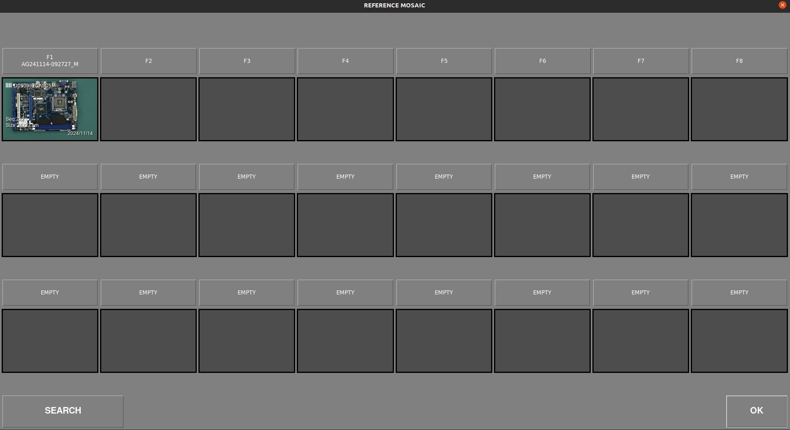{.center}

Una vez que el proceso de captura haya finalizado, la imagen de REFERENCIA se mostrará en la ventana principal y le permitirá establecer [máscara de exclusión](Set_exclusion_area.md) o [dibujar un área de código de barras](../features/Barcode_reader.md) para la lectura.

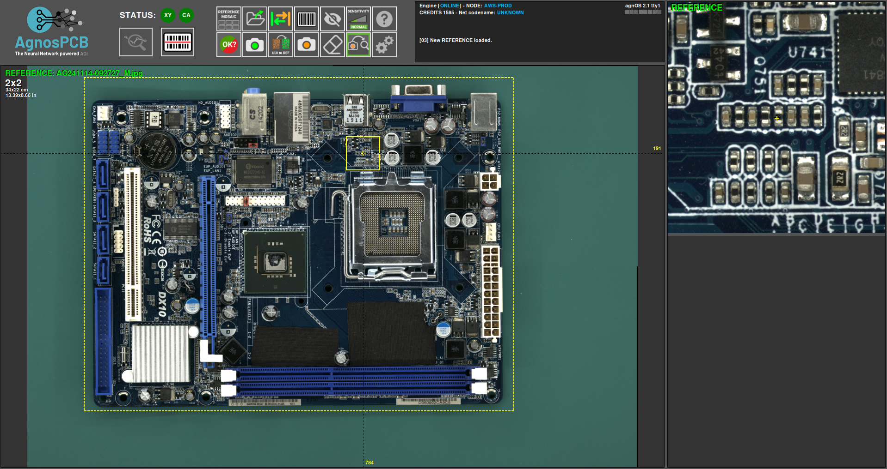{.center}

### Capturando una UUI

Después de generar o cargar una imagen de REFERENCIA previa, podemos proceder con la captura de la imagen **UUI** (Unidad Bajo Inspección) presionando el botón.

{.center}

Aparecerá una ventana de vista previa en vivo que muestra una imagen fantasma de la imagen de REFERENCIA. Esto ayuda a alinear la PCBA UUI con la REFERENCIA.

!!! warning "Importante"
    El software **AgnosPCB** es capaz de alinear ambas imágenes (**REFERENCIA** y **UUI**) automáticamente. Sin embargo, es importante posicionar la PCBA UUI correctamente para evitar deformaciones geométricas que puedan causar detecciones de falsos positivos.

{.center}

El proceso de captura comenzará haciendo clic en el botón **INICIAR INSPECCIÓN**.

!!! note "Nota"
    No es necesario enfocar, ya que el parámetro de enfoque ya está almacenado con la imagen de REFERENCIA, lo que hace que la inspección sea realmente rápida.

El proceso de inspección se ejecutará en paralelo en caso de una inspección de múltiples imágenes.

Una vez que el proceso de captura haya finalizado, se devolverá el resultado final mostrando los errores detectados si los hay. Es posible cambiar la [sensibilidad de detección](Set_sensitivity.md) presionando el botón en la ventana principal o presionando la **tecla 1, 2 o 3.**

{.center}

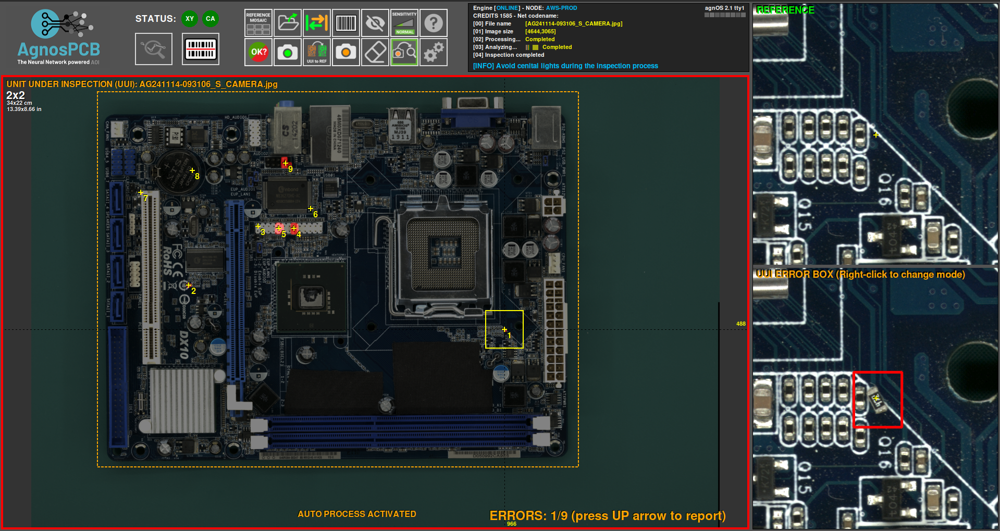{.center}

Si se detectan errores, aparecerá un **marco rojo** alrededor de la ventana principal. **Marco verde** si no hay errores.

### Inspección de ambas caras de una placa

Con una REFERENCIA de doble cara puede inspeccionar la cara **TOP** y la **BOTTOM** de la misma placa una tras otra:

1. Inspeccione la primera cara como de costumbre. En la vista previa en vivo, el botón **INICIAR INSPECCIÓN** muestra en una segunda línea qué cara va a inspeccionar. Compruebe que la placa está colocada con esa cara hacia arriba.
2. Dé la vuelta a la placa, cambie a la otra cara (con el [botón TOP/BOTTOM](Screen-layout.md#alternar-topbottom), las teclas **Page Up** / **Page Down**, o automáticamente con el [cambio automático TOP/BOTTOM](Settings_menu.md#cambio-automatico-topbottom)) e inspecciónela.
3. Una vez inspeccionadas ambas caras, el botón TOP/BOTTOM y las teclas **Page Up** / **Page Down** alternan directamente entre los **resultados** de las dos caras, de modo que puede seguir revisando una cara después de capturar la otra. Cada cara conserva sus propias detecciones, clasificaciones y [sensibilidad](Set_sensitivity.md).

Los resultados se guardan en segundo plano mientras trabaja. Mientras se restaura una cara, se muestra un aviso de carga sobre la imagen.

Cuando ambas caras tienen informe, se genera un único [informe combinado](#informe-combinado-topbottom) para toda la placa.

!!! note "Inspecciones UV"
    Una [inspección UV](../features/UV_conformal_coating_inspection.md) es independiente de la placa TOP/BOTTOM en curso: no descarta las caras ya inspeccionadas y no forma parte del informe combinado.

### Reporte de errores

Una vez que la inspección ha finalizado, el operador debe supervisar los errores marcados, clasificándolos como **error real** o **detección de falso positivo**.
Para hacer esto, simplemente desplácese por los errores usando las **flechas izquierda y derecha** en el teclado.

!!! note "Preferencia de análisis"
    Por defecto, en las instalaciones nuevas la revisión empieza en la [lista de detecciones](Screen-layout.md#lista-de-detecciones): las flechas **izquierda** y **derecha** pasan de una fila a otra de la lista y las flechas **arriba** y **abajo** clasifican la fila bajo el cursor. Para revisar las detecciones directamente sobre la imagen, como en versiones anteriores, establezca [Preferencia de análisis](Settings_menu.md#preferencia-de-analisis) en **CANVAS**.

Los errores también pueden reportarse directamente con el ratón: haga **clic izquierdo** en una detección para reportarla como error real, o **clic derecho** para reportarla como falso positivo, de forma equivalente a las teclas de flecha **arriba** y **abajo** descritas a continuación. Cada fila de la [lista de detecciones](Screen-layout.md#lista-de-detecciones) tiene además un botón con una **cruz roja** (error) y otro con un **tic verde** (falso positivo).

Al hacer clic izquierdo en una detección que ya está reportada como error real, se pide confirmación antes de deshacerlo.

Para marcar un error real, simplemente muévase a la falla y presione la **flecha arriba** en su teclado. Aparecerá una nueva ventana que muestra el error en detalle y le permite categorizarlo seleccionando un tipo de falla de la lista.

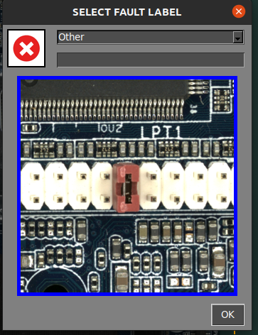{.center}

Además, hay un campo vacío para **agregar un comentario.**

En caso de que el operador encuentre un error **no detectado** por el software, es posible marcarlo y reportarlo moviendo el cursor al área de la falla y presionando la **tecla flecha arriba**. La ventana de reporte aparecerá como de costumbre. 

Cuando el software marca un área que no es un error real, el operador puede marcarla como **falso positivo** presionando la **tecla flecha abajo**. Aparecerá una ventana con **Reference variant** seleccionada por defecto; consulte [Variantes de Referencia](../features/Multivariant_feature.md) para saber cómo completarla. Para reportar un falso positivo simple, seleccione **False positive** en el desplegable antes de confirmar.

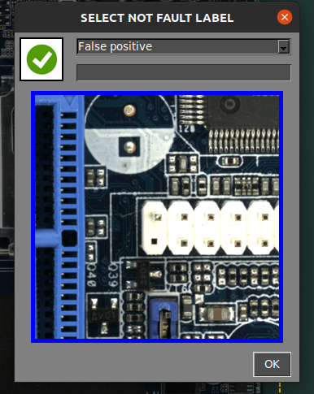{.center}

!!! note "Nota"
    Tenga en cuenta que el **icono rojo** {width=20px} marca las fallas reales y el **icono verde** {width=20px} las fallas de falso positivo.

!!! note "Permisos"
    Con el [control de acceso de usuarios](../features/User_control.md) habilitado, reportar una detección requiere el permiso **Classify detected faults**. Sin él, se muestra el mensaje **Permission denied** y no se reporta nada.

Una detección que no ha sido reportada de ninguna de las dos formas sigue **sin revisar** (amarillo). Mantener el puntero quieto sobre ella durante aproximadamente **un segundo** la marca como **vista** (cian): mientras espera, se rellena un pequeño anillo alrededor de la detección, y no se marca nada si se aparta antes de que se cierre, de modo que barrer la placa con el ratón no marca detecciones que no ha mirado. Funciona igual cuando llega a una detección con las teclas de flecha o desde la lista de detecciones. Una detección marcada como vista puede reportarse después.

### Niveles de revisión obligatoria

El software puede exigir tres niveles de revisión antes de que pueda empezar una nueva inspección. Son independientes y pueden combinarse:

| Nivel | Qué exige |
| --- | --- |
| **Revisión obligatoria de errores** | Todas las detecciones revisadas, o al menos marcadas como **vistas**. |
| **Reporte obligatorio de errores** | Todas las detecciones **reportadas** como error real o falso positivo. Marcarlas como vistas no basta. |
| **Informe final obligatorio** | El [informe final OK / NO OK](#generacion-de-un-informe-pdf-final) confirmado por el operador. Un informe generado automáticamente no cuenta. |

Si al intentar iniciar la siguiente inspección no se cumple algún nivel, un aviso le indica lo que falta.

Un nivel se aplica cuando **cualquiera** de los siguientes lo tiene habilitado:

- La **REFERENCIA** cargada, en su ventana de [opciones de la Referencia](Screen-layout.md#opciones-de-la-referencia).
- El **rol** del usuario que ha iniciado sesión, cuando el [control de acceso de usuarios](../features/User_control.md#revision-obligatoria-por-rol) está habilitado. Al rol **admin** solo le afecta la REFERENCIA.
- Las opciones globales de la [configuración de Workflow](Settings_menu.md#revision-obligatoria-de-errores), cuando el control de acceso de usuarios está deshabilitado.

Ninguno de los niveles se exige mientras el [modo Demo / Loop](Settings_menu.md#modo-demo-loop) está activado.

En una placa de doble cara, inspeccionar la otra cara de la misma placa nunca se bloquea por lo que quede pendiente en la primera. Para empezar la **siguiente placa**, los niveles aplicables deben cumplirse en **ambas** caras. Para confirmar el informe final de la otra cara, cambie a ella y genere su informe final.

Cuando hay al menos un nivel habilitado, cada informe (PDF y JSON) indica hasta dónde había llegado la revisión cuando se generó, por ejemplo `MANDATORY REVIEW - Detections: 5 (3 classified, 2 seen, 0 pending)`, y si el informe final fue confirmado. La línea se muestra en rojo si quedaba algo pendiente.

#### Aviso de cara no revisada

Independientemente de los niveles anteriores, antes de que empiece la siguiente placa el software le avisa si una cara tiene detecciones pero **ninguna** de ellas ha sido revisada ni reportada. La ventana indica la cara y le permite continuar de todos modos (**OK**) o volver a revisarla (**CANCEL**).

Este aviso no se muestra cuando la siguiente captura es la otra cara de la misma placa, en las inspecciones UV ni en el modo Demo / Loop. Puede deshabilitarse en [Settings → Workflow](Settings_menu.md#avisar-de-una-cara-no-revisada).

### Generación de un informe PDF final

Una vez que el reporte ha finalizado, el operador puede generar un informe PDF final presionando el siguiente botón:

{.center}

Aparece una ventana que le permite marcar la inspección como **OK** o **NO OK**. Si la PCBA pasa el control de calidad con éxito, presione el icono verde.

{.center}

Es posible agregar comentarios que se incluirán en el informe. El PDF se generará en la carpeta **REPORTS**.

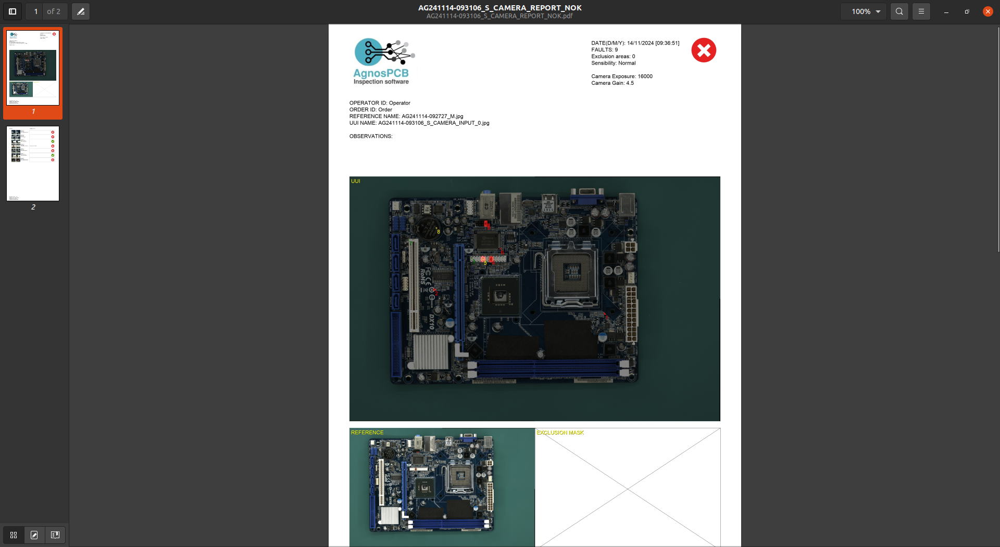{.center}

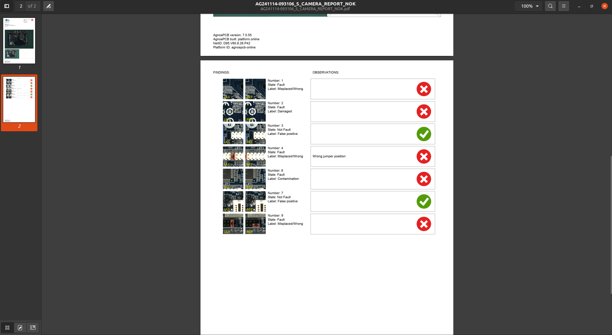{.center}

#### Informe combinado TOP/BOTTOM

Cuando ambas caras de una placa tienen informe, se genera un único PDF combinado en la carpeta de informes de la cara TOP: una portada con el resultado global y los datos de cada cara, seguida del informe TOP y del informe BOTTOM. Cuando los [informes JSON](Settings_menu.md#crear-informe-json) están habilitados, también se escribe un JSON combinado, con los datos de cada cara en `sides.TOP` y `sides.BOTTOM`.

Una vez escrito el informe combinado, se eliminan los informes PDF y JSON individuales de cada cara, de modo que solo quedan un PDF y un JSON por placa. Una placa con una sola cara inspeccionada conserva su propio informe, y no se elimina nada si no se pudo escribir el informe combinado. Los archivos de inspección de **PCB_OUT** no se ven afectados.

!!! note "Nota"
    El informe JSON también indica, para cada detección, si el operador decidió que es un error, un falso positivo o si sigue pendiente (campo `verdict`).
