# Flusso di lavoro dell'ispezione

### Avvio del software

- Collegare l'alimentazione alla piattaforma di ispezione sul pannello posteriore
- Accendere il monitor
- Collegare l'alimentazione al computer e accenderlo
- Una volta che il sistema si è avviato, aprire l'app facendo doppio clic sull'icona del desktop
- **Solo per unità ONLINE**: apparirà una finestra di accesso che richiederà le credenziali dell'account AgnosPCB. Le credenziali verranno memorizzate nell'unità per usi futuri e non sarà richiesto di accedere nuovamente.

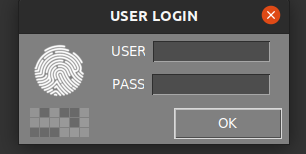{.center}

## Procedura di ispezione

<iframe width="100%" height="400" src="https://www.youtube.com/embed/FirteJF0U1E?si=IiWu4CkiELWYecYR" title="YouTube video player" frameborder="0" allow="accelerometer; autoplay; clipboard-write; encrypted-media; gyroscope; picture-in-picture; web-share" referrerpolicy="strict-origin-when-cross-origin" allowfullscreen></iframe>
___

### Generazione di un RIFERIMENTO

Il software AgnosPCB Inspection tool **"confronterà"** la fotografia del circuito/pannello di **RIFERIMENTO** ("golden sample") con tutte le foto che scatterai del circuito da ispezionare (foto da "ANALIZZARE").

!!! warning "Importante"
    Si consiglia di visitare la nostra sezione [suggerimenti](../help/Tips.md) prima di scattare la prima immagine.

Per procedere con l'acquisizione del RIFERIMENTO, fare clic sull'icona del riferimento nel menu principale:

{.center}

Apparirà una nuova finestra con diversi strumenti:

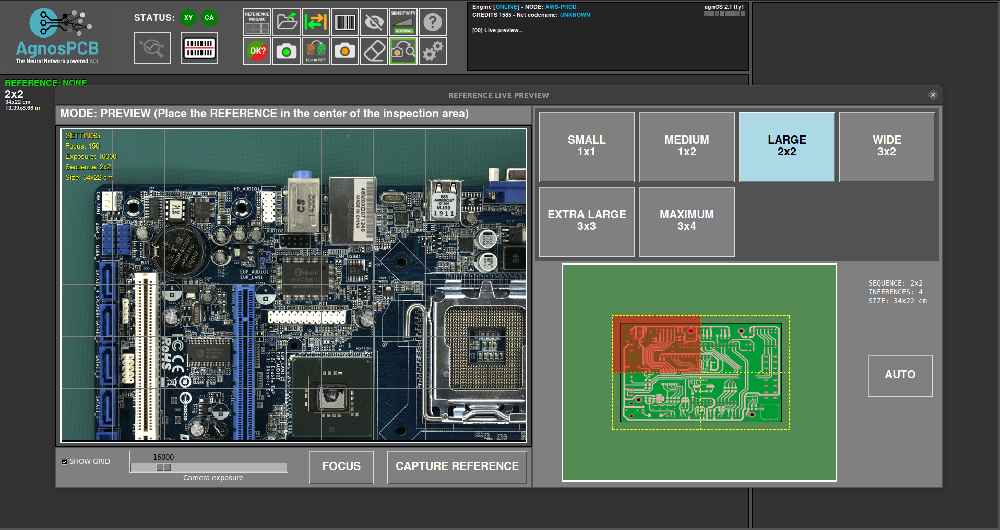{.center}

In questa finestra dobbiamo impostare le immagini necessarie per coprire l'intera PCBA.

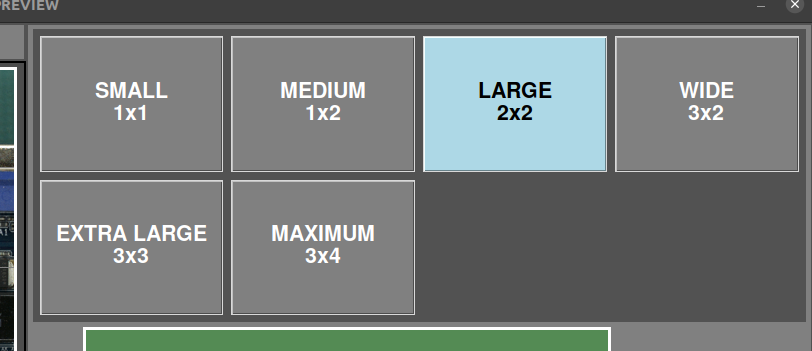{.center}

---
#### Acquisizione delle dimensioni del PCB

Per PCBAs di grandi dimensioni, il campo visivo della telecamera potrebbe non essere sufficiente per catturare l'intera scheda in una singola immagine. In questi casi, il sistema acquisisce più immagini e le unisce automaticamente tramite IA in un'unica immagine pronta per l'ispezione.

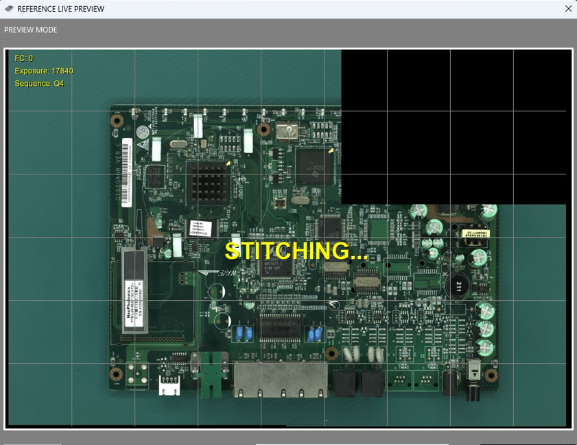{width=600 .center}

Se non sei sicuro di quante immagini siano necessarie, posiziona il PCBA al centro dell'area di ispezione e premi il pulsante **AUTO**. Il sistema eseguirà la scansione della scheda e configurerà automaticamente i parametri ottimali.

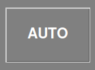{.center}

Puoi anche spostare la telecamera in qualsiasi quadrante del PCBA facendo clic sull'area desiderata nella vista in miniatura.

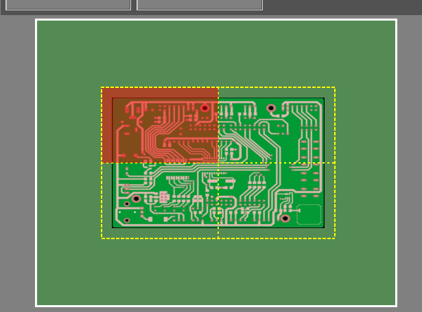{.center}

---

#### Ispezione TOP/BOTTOM

Il software può ispezionare entrambi i lati di una PCBA. Questa funzione deve essere abilitata durante l'acquisizione del RIFERIMENTO, dalla finestra di anteprima dal vivo.

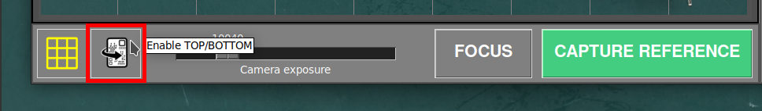{width=600 .center}

Una volta impostata la sequenza corretta e posizionata correttamente la PCBA, premete il pulsante **CAPTURE TOP** per acquisire il lato superiore della PCBA.

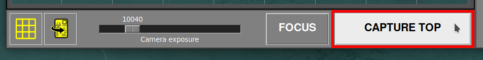{width=600 .center}

Al termine del processo comparirà la finestra a mosaico e il RIFERIMENTO potrà essere salvato in uno degli slot. Potete quindi continuare girando il pannello e acquisendo il lato inferiore.

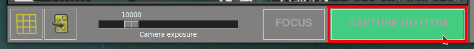{width=600 .center}

Utilizzate il pulsante nella finestra principale per passare tra le immagini **TOP** e **BOTTOM**.

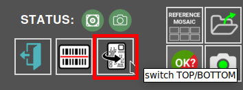{width=400 .center}

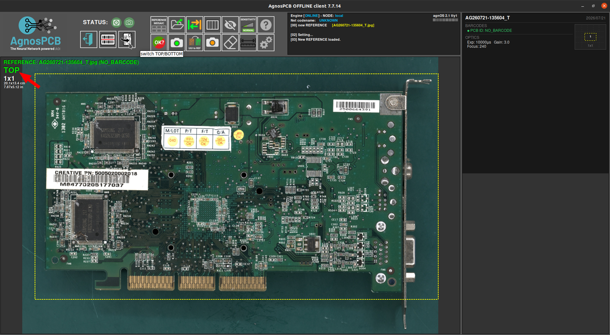{.center}

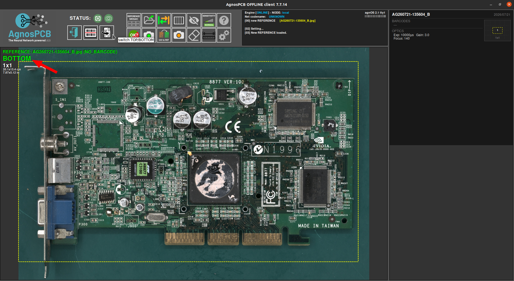{.center}

Anche i tasti **Page Up** e **Page Down** passano rispettivamente al lato **TOP** e al lato **BOTTOM**.

Consultate [Ispezionare entrambi i lati di una scheda](#ispezionare-entrambi-i-lati-di-una-scheda) per sapere come ispezionare una PCBA a doppia faccia una volta pronto il suo RIFERIMENTO.

---

#### Messa a fuoco

Il sistema consente la messa a fuoco manuale del PCB prima di avviare il processo di acquisizione. Premi il pulsante **FOCUS** per regolare l'ottica e verificare che l'area selezionata sia correttamente a fuoco.

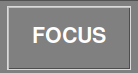{.center}

Per impostazione predefinita, la telecamera mette a fuoco automaticamente il centro del PCB. Tuttavia, questa non è sempre l'area ottimale a causa della presenza di componenti alti.

Per un'ispezione accurata, è essenziale mettere a fuoco la **base del PCB**, dove sono montati i componenti. Evita di mettere a fuoco componenti alti, poiché ciò può ridurre la precisione dell'ispezione.

Il PCB non deve essere centrato durante la messa a fuoco manuale. L'operatore può spostarlo liberamente e selezionare qualsiasi area adatta per ottenere una corretta messa a fuoco, purché la base del PCB sia chiaramente a fuoco.

Una volta completato il processo di messa a fuoco, il PCB deve essere riposizionato al centro dell'area di ispezione prima di acquisire l'immagine di riferimento.

!!! warning "Importante"
    Seleziona un'area senza componenti alti e assicurati che la base del PCB sia perfettamente a fuoco.

La parte inferiore della finestra consente di attivare o disattivare la griglia nella vista live e di regolare l'esposizione.

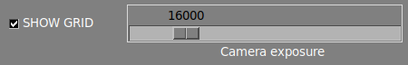{.center}

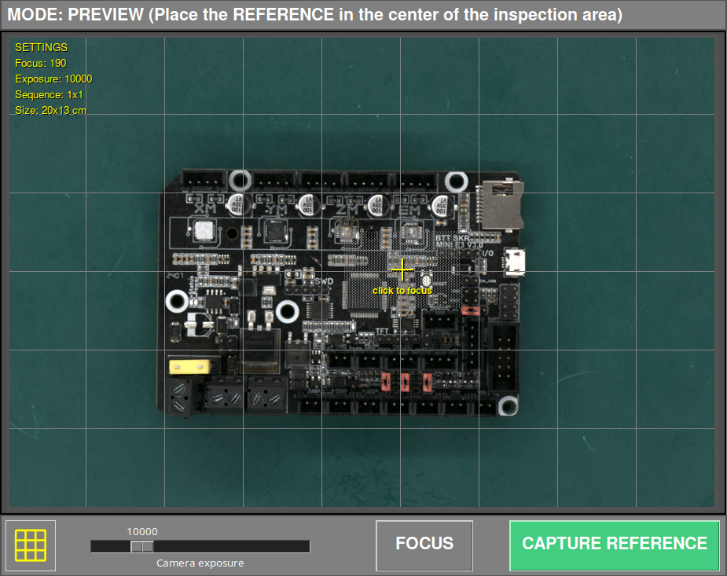{.center}

---

Per avviare l'elaborazione dell'acquisizione, è sufficiente fare clic sul pulsante **CATTURA RIFERIMENTO**. L'AOI metterà a fuoco automaticamente nel quadrante selezionato e inizierà a catturare l'intera PCBA in pochi secondi.

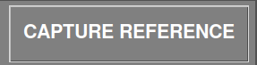{.center}

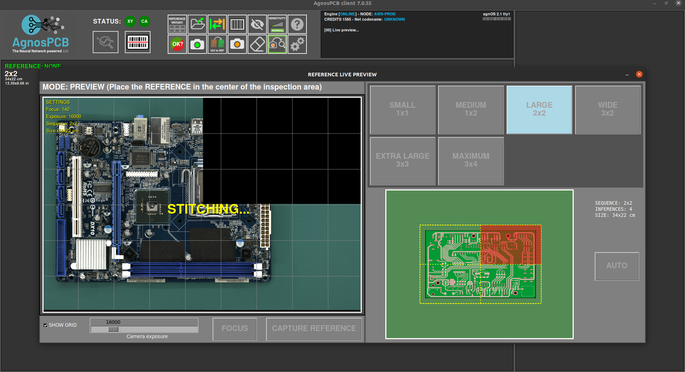{.center}

Dopo aver catturato la PCBA, apparirà la finestra del mosaico che consente di archiviare l'immagine per un utilizzo rapido.

!!! note "Nota"
    Tutti i RIFERIMENTI acquisiti verranno archiviati automaticamente. Il mosaico aiuta a caricare rapidamente i RIFERIMENTI più utilizzati.

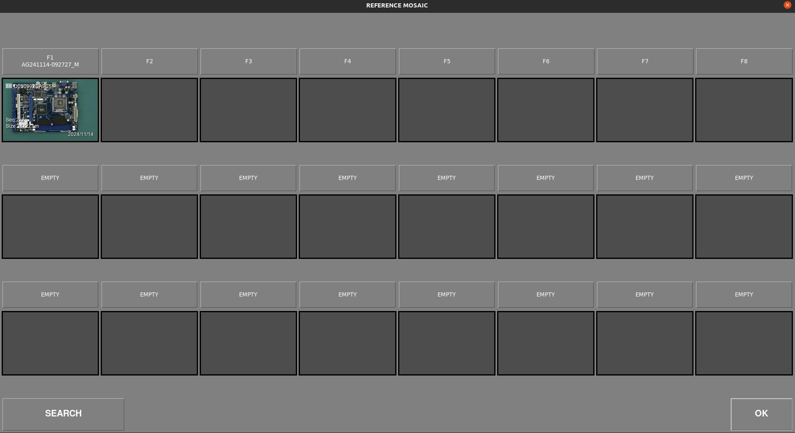{.center}

Una volta terminato il processo di acquisizione, l'immagine di RIFERIMENTO verrà visualizzata nella finestra principale e ti consentirà di impostare [maschere di esclusione](Set_exclusion_area.md) o [disegnare un'area codice a barre](../features/Barcode_reader.md) per la lettura.

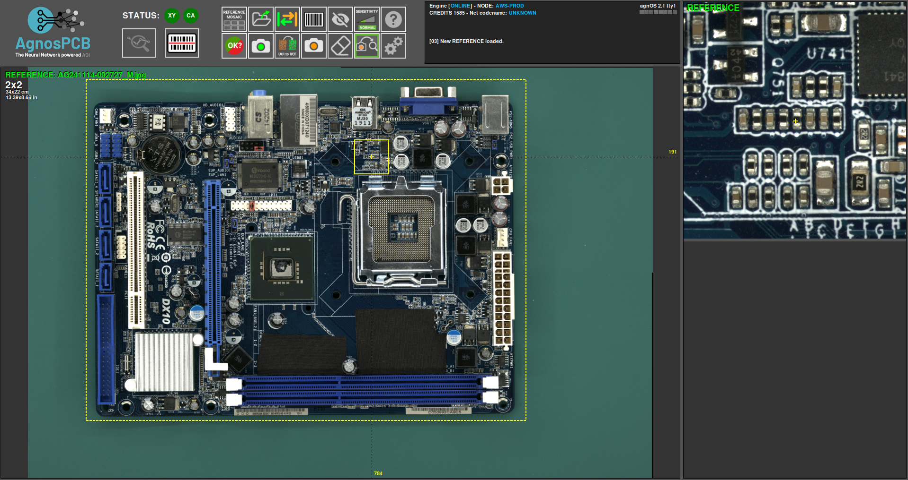{.center}

### Acquisizione di una UUI

Dopo aver generato o caricato una precedente immagine di RIFERIMENTO, possiamo procedere con l'acquisizione dell'immagine **UUI** (Unità Sotto Ispezione) premendo il pulsante.

{.center}

Apparirà una finestra di anteprima live che mostra un'immagine fantasma dell'immagine di RIFERIMENTO. Questo aiuta ad allineare la PCBA UUI con il RIFERIMENTO.

!!! warning "Importante"
    Il software **AgnosPCB** è in grado di allineare automaticamente entrambe le immagini (**RIFERIMENTO** e **UUI**). Tuttavia, è importante posizionare correttamente la PCBA UUI per evitare deformazioni geometriche che possono causare rilevamenti di falsi positivi.

{.center}

Il processo di acquisizione inizierà facendo clic sul pulsante **AVVIA ISPEZIONE**.

!!! note "Nota"
    La messa a fuoco non è necessaria poiché il parametro di messa a fuoco è già memorizzato con l'immagine di RIFERIMENTO, rendendo l'ispezione molto veloce.

Il processo di ispezione sarà eseguito in parallelo in caso di ispezione multi-immagine.

Una volta terminato il processo di acquisizione, verrà restituito il risultato finale che mostra gli errori rilevati, se presenti. È possibile modificare la [sensibilità di rilevamento](Set_sensitivity.md) premendo il pulsante nella finestra principale o premendo il **tasto 1, 2 o 3.**

{.center}

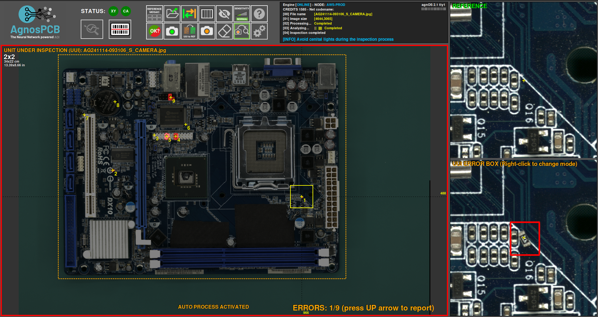{.center}

Se vengono rilevati errori, apparirà una **cornice rossa** attorno alla finestra principale. **Cornice verde** se non ci sono errori.

### Ispezionare entrambi i lati di una scheda

Con un RIFERIMENTO a doppia faccia potete ispezionare il **TOP** e il **BOTTOM** della stessa scheda uno dopo l'altro:

1. Ispezionate il primo lato come di consueto. Nell'anteprima dal vivo, il pulsante **AVVIA ISPEZIONE** mostra su una seconda riga il lato che state per ispezionare. Verificate che la scheda sia posizionata con quel lato rivolto verso l'alto.
2. Girate la scheda, passate all'altro lato (con il [pulsante TOP/BOTTOM](Screen-layout.md#alterna-topbottom), con i tasti **Page Up** / **Page Down**, oppure automaticamente con il [Cambio automatico TOP/BOTTOM](Settings_menu.md#cambio-automatico-topbottom)) e ispezionatelo.
3. Una volta ispezionati entrambi i lati, il pulsante TOP/BOTTOM e i tasti **Page Up** / **Page Down** passano direttamente tra i **risultati** dei due lati, così potete continuare a esaminare un lato dopo aver acquisito l'altro. Ogni lato conserva le proprie rilevazioni, classificazioni e [sensibilità](Set_sensitivity.md).

I risultati vengono salvati in background mentre lavorate. Durante il ripristino di un lato, sull'immagine viene mostrato un avviso di caricamento.

Quando entrambi i lati hanno un report, viene generato un unico [report combinato](#report-combinato-topbottom) per l'intera scheda.

!!! note "Ispezioni UV"
    Un'[ispezione UV](../features/UV_conformal_coating_inspection.md) è indipendente dalla scheda TOP/BOTTOM in corso: non scarta i lati già ispezionati e non fa parte del report combinato.

### Segnalazione degli errori

Una volta completata l'ispezione, l'operatore deve monitorare gli errori segnalati, contrassegnandoli come **errore effettivo** o **rilevamento falso positivo**.
Per fare ciò, è sufficiente scorrere gli errori utilizzando le **frecce sinistra e destra** sulla tastiera.

!!! note "Analysis preference"
    Per impostazione predefinita, sulle nuove installazioni la revisione inizia dall'[elenco delle rilevazioni](Screen-layout.md#elenco-delle-rilevazioni): le frecce **sinistra** e **destra** si spostano da una riga all'altra dell'elenco e le frecce **su** e **giù** classificano la riga sotto il cursore. Per esaminare le rilevazioni direttamente sull'immagine, come nelle versioni precedenti, impostate la [Preferenza di analisi](Settings_menu.md#preferenza-di-analisi) su **CANVAS**.

Gli errori possono anche essere segnalati direttamente con il mouse: **clic sinistro** su una rilevazione per segnalarla come errore reale, oppure **clic destro** per segnalarla come falso positivo — equivalente ai tasti freccia **su** e **giù** descritti di seguito. Ogni riga dell'[elenco delle rilevazioni](Screen-layout.md#elenco-delle-rilevazioni) dispone inoltre di un pulsante **croce rossa** (errore) e di un pulsante **spunta verde** (falso positivo).

Facendo clic sinistro su una rilevazione già segnalata come errore reale, viene chiesta una conferma prima di annullare la segnalazione.

Per contrassegnare un errore reale, basta spostarsi sul difetto e premere la **freccia su** sulla tastiera. Apparirà una nuova finestra che mostra il difetto in dettaglio e consente di classificarlo selezionando un tipo di difetto dall'elenco.

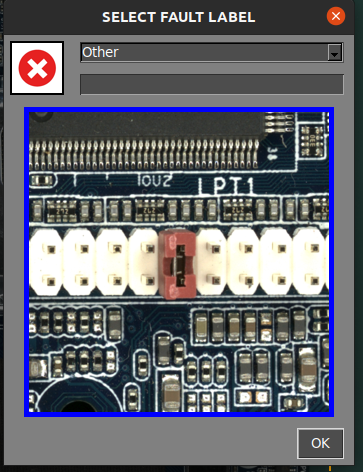{.center}

Inoltre, c'è un campo vuoto per **aggiungere un commento.**

Nel caso in cui l'operatore trovi un errore **non rilevato** dal software, è possibile segnalarlo e riportarlo spostando il cursore sull'area del difetto e premendo il **tasto freccia su**. La finestra di segnalazione apparirà come di consueto. 

Quando il software segnala un'area che non è un errore effettivo, l'operatore può contrassegnarla come **falso positivo** premendo il **tasto freccia giù**. Apparirà una finestra con **Reference variant** selezionato per impostazione predefinita — vedi [Varianti di riferimento](../features/Multivariant_feature.md) per sapere come completarla. Per segnalare invece un semplice falso positivo, selezionate **False positive** dal menu a tendina prima di confermare.

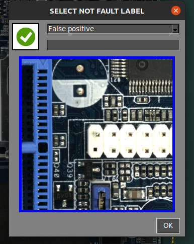{.center}

!!! note "Nota"
    Si noti che l'**icona rossa** {width=20px} contrassegna i difetti effettivi e l'**icona verde** {width=20px} i difetti falsi positivi.

!!! note "Permessi"
    Con il [controllo di accesso utenti](../features/User_control.md) abilitato, segnalare una rilevazione richiede il permesso **Classify detected faults**. Senza di esso, viene mostrato il messaggio **Permission denied** e non viene segnalato nulla.

Una rilevazione non segnalata in nessuno dei due modi resta **non esaminata** (gialla). Tenendo il puntatore fermo sopra di essa per circa **un secondo** la si contrassegna come **seen** (ciano): mentre attendete, un piccolo anello si riempie attorno alla rilevazione, e se vi spostate prima che si chiuda non viene contrassegnato nulla, così passare il mouse sulla scheda non contrassegna rilevazioni che non avete guardato. Funziona allo stesso modo quando si raggiunge una rilevazione con i tasti freccia o dall'elenco delle rilevazioni. Una rilevazione contrassegnata come seen può comunque essere segnalata in seguito.

### Livelli di revisione obbligatoria

Il software può richiedere tre livelli di revisione prima che possa iniziare una nuova ispezione. Sono indipendenti e possono essere combinati:

| Livello | Cosa richiede |
| --- | --- |
| **Mandatory errors review** | Ogni rilevazione esaminata, o almeno contrassegnata come **seen**. |
| **Mandatory errors report** | Ogni rilevazione **segnalata** come errore reale o come falso positivo. Contrassegnarla come seen non è sufficiente. |
| **Mandatory final report** | Il [report finale OK / NON OK](#generazione-di-un-report-pdf-finale) confermato dall'operatore. Un report generato automaticamente non viene conteggiato. |

Se un livello non è soddisfatto quando cercate di avviare l'ispezione successiva, un avviso indica cosa manca.

Un livello si applica quando **uno qualsiasi** dei seguenti lo ha abilitato:

- Il **RIFERIMENTO** caricato, nella sua finestra [Opzioni del Riferimento](Screen-layout.md#opzioni-del-riferimento).
- Il **ruolo** dell'utente connesso, quando il [controllo di accesso utenti](../features/User_control.md#revisione-obbligatoria-per-ruolo) è abilitato. Il ruolo **admin** è influenzato solo dal RIFERIMENTO.
- Le opzioni globali nelle [impostazioni del flusso di lavoro](Settings_menu.md#revisione-obbligatoria-degli-errori), quando il controllo di accesso utenti è disabilitato.

Nessuno dei livelli è richiesto mentre la [Modalità Demo / Loop](Settings_menu.md#modalita-demo-loop) è attiva.

Su una scheda a doppia faccia, l'ispezione dell'altro lato della stessa scheda non viene mai bloccata da ciò che è ancora in sospeso sul primo. Per avviare la **scheda successiva** i livelli applicabili devono essere soddisfatti su **entrambi** i lati. Per confermare il report finale dell'altro lato, passate a quel lato e generatene il report finale.

Quando almeno un livello è abilitato, ogni report (PDF e JSON) indica a che punto era la revisione al momento della sua creazione, ad esempio `MANDATORY REVIEW - Detections: 5 (3 classified, 2 seen, 0 pending)`, e se il report finale è stato confermato. La riga viene mostrata in rosso se qualcosa era ancora in sospeso.

#### Avviso per un lato non esaminato

Indipendentemente dai livelli descritti sopra, prima che inizi la scheda successiva il software vi avvisa se un lato presenta rilevazioni ma **nessuna** di esse è stata esaminata o segnalata. La finestra indica il lato e vi permette di continuare comunque (**OK**) o di tornare indietro per esaminarlo (**CANCEL**).

Questo avviso non viene mostrato quando l'acquisizione successiva è l'altro lato della stessa scheda, nelle ispezioni UV o in modalità Demo / Loop. Può essere disabilitato in [Impostazioni → Flusso di lavoro](Settings_menu.md#avvisa-se-un-lato-non-e-stato-esaminato).

### Generazione di un report PDF finale

Una volta terminata la segnalazione, l'operatore può generare un report PDF finale premendo il seguente pulsante:

{.center}

Appare una finestra che consente di contrassegnare l'ispezione come **OK** o **NON OK**. Se la PCBA supera il controllo qualità con successo, premere l'icona verde.

{.center}

È possibile aggiungere commenti che verranno inclusi nel report. Il PDF verrà generato nella cartella **REPORTS**.

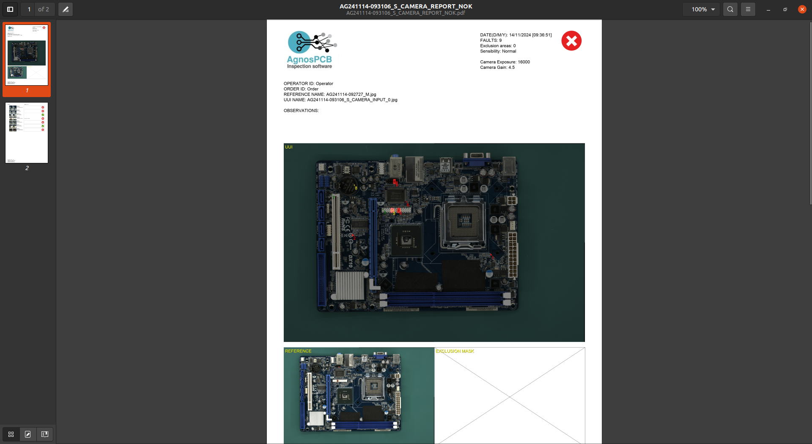{.center}

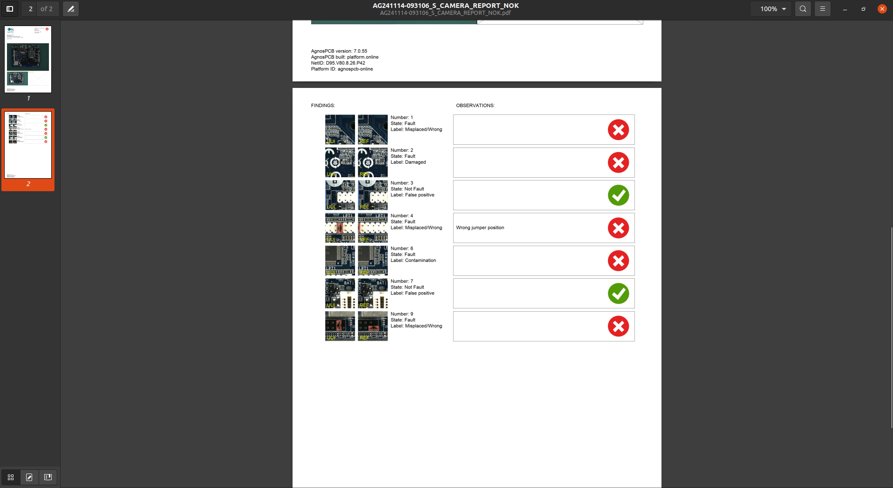{.center}

#### Report combinato TOP/BOTTOM

Quando entrambi i lati di una scheda hanno un report, viene generato un unico PDF combinato nella cartella dei report del lato TOP: una pagina di copertina con il risultato complessivo e i dati di ciascun lato, seguita dal report TOP e dal report BOTTOM. Quando i [report JSON](Settings_menu.md#crea-report-json) sono abilitati, viene scritto anche un JSON combinato, con i dati di ciascun lato in `sides.TOP` e `sides.BOTTOM`.

Una volta scritto il report combinato, i singoli report PDF e JSON di ciascun lato vengono eliminati, in modo che rimangano un solo PDF e un solo JSON per scheda. Una scheda con un solo lato ispezionato conserva il proprio report, e non viene eliminato nulla se non è stato possibile scrivere il report combinato. I file di ispezione in **PCB_OUT** non vengono modificati.

!!! note "Nota"
    Il report JSON indica inoltre, per ogni rilevazione, se l'operatore ha deciso che si tratta di un errore, di un falso positivo o se è ancora in sospeso (campo `verdict`).
