# Inspection workflow

### Launching the software

- Connect the power supply to the inspection platform on the rear panel
- Turn on the monitor
- Connect the power supply to the computer and turn on it
- Once the system has started, open the app by double-clicking the desktop icon
- **For ONLINE units only**: a login window will pop up asking for your AgnosPCB's account credentials. The credentials will be stored on the unit for future use, and you will not need to log in again.

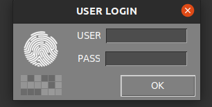{.center}

## Inspection procedure

<iframe width="100%" height="400" src="https://www.youtube.com/embed/FirteJF0U1E?si=IiWu4CkiELWYecYR" title="YouTube video player" frameborder="0" allow="accelerometer; autoplay; clipboard-write; encrypted-media; gyroscope; picture-in-picture; web-share" referrerpolicy="strict-origin-when-cross-origin" allowfullscreen></iframe>
___

### Generating a REFERENCE

The AgnosPCB Inspection tool software will **“compare”** the photograph of your **REFERENCE** circuit or panel (“golden sample”) with all the [UUI](terminology.md#uui).

!!! warning "Important"
    We recommend you to visit our [tips](../help/Tips.md) section before taking your first image.

To proceed with the REFERENCE taken, click in the reference icon in the main menu:

{.center}

A new window will pop up with multiple tools:

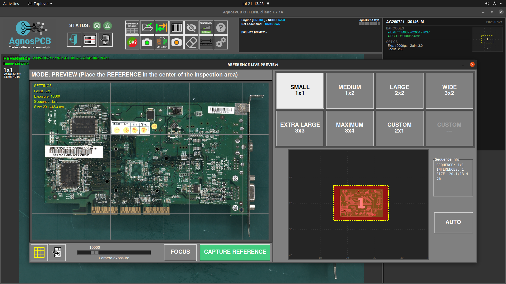{width=600 .center}

---

#### Capturing the PCB Size

For larger PCBAs, the camera field of view may not be sufficient to capture the entire board in a single image. In these cases, the system captures multiple images and automatically stitches them together using AI into a single image ready for inspection.In this window we have to set the proper capturing sequence needed to cover all the PCBA or panel.

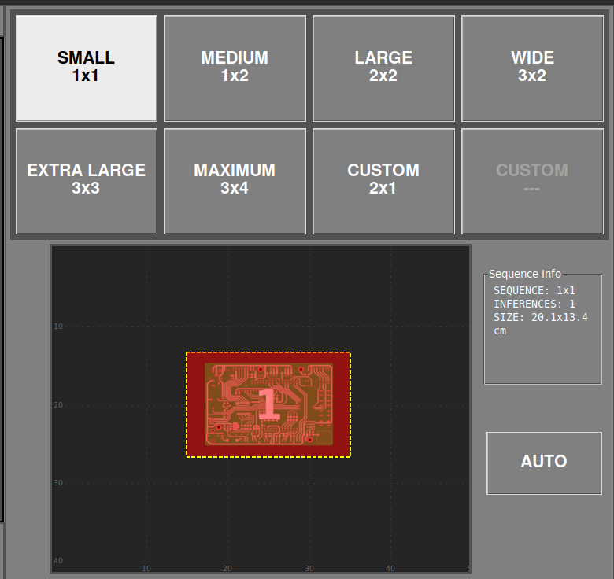{width=600 .center}

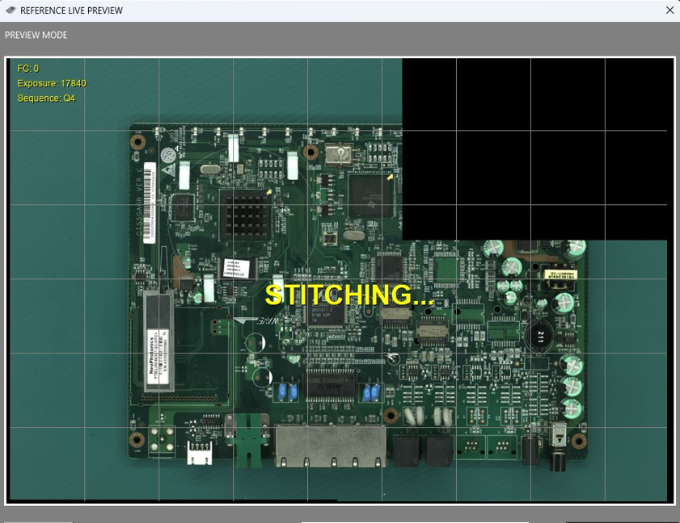{width=600 .center}

If you are unsure how many images are required, place the PCBA in the center of the inspection area and press the **AUTO** button. The system will scan the board and automatically set the optimal configuration for the current PCBA or panel.

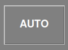{.center}

You can also move the camera to any quadrant of the PCBA by clicking on the desired area in the miniature view.

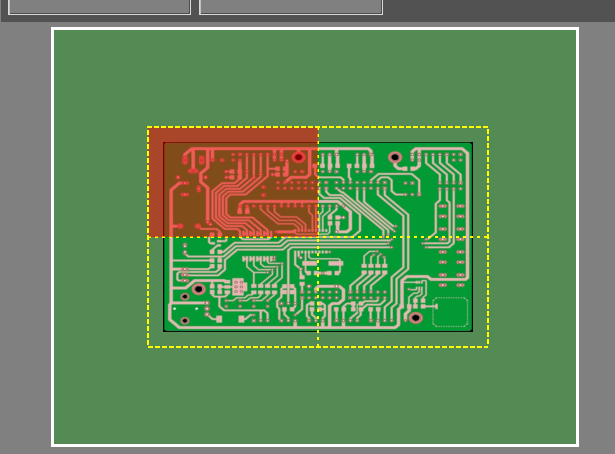{.center}

---

#### TOP/BOTTOM inspection

The software can inspect both sides of a PCBA. This feature has to be enabled while capturing the REFERENCE, from the live preview window.

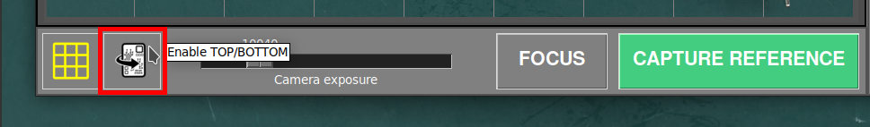{width=600 .center}

Once the correct sequence has been set and the PCBA is correctly placed, press the **CAPTURE TOP** button to capture the top side of the PCBA.

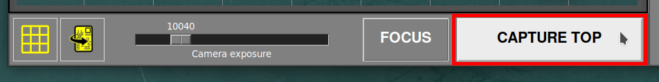{width=600 .center}

Once the process has finished, the mosaic window pops up and the REFERENCE can be stored in one of the slots. You can then continue by flipping the panel and capturing the bottom side.

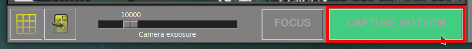{width=600 .center}

Use the button in the main window to switch between the **TOP** and **BOTTOM** images.

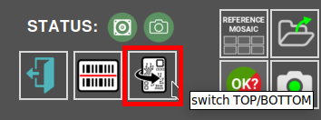{width=400 .center}

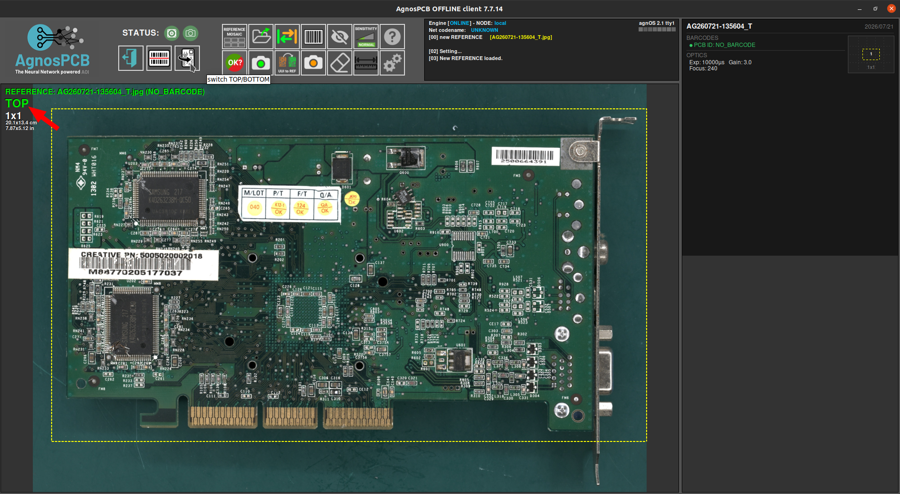{.center}

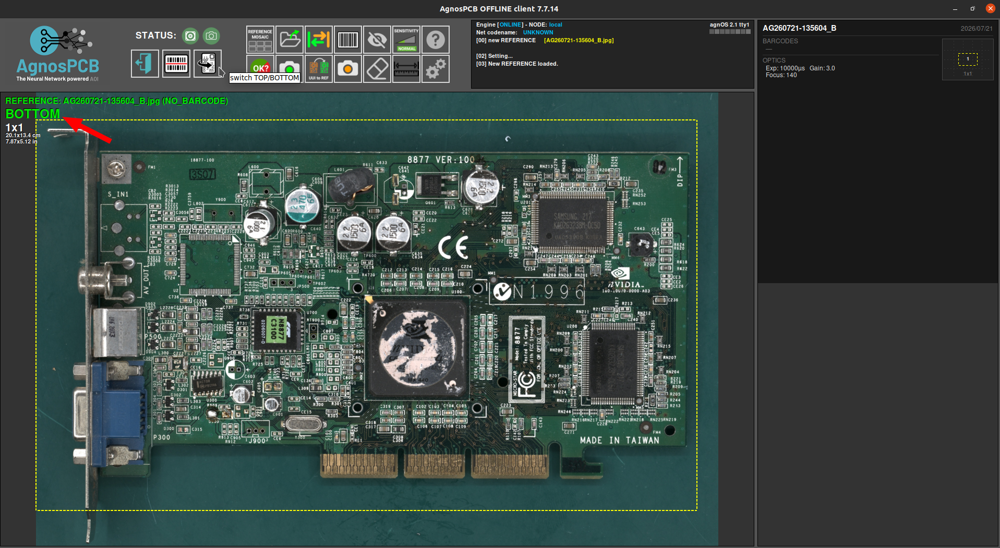{.center}

The **Page Up** and **Page Down** keys also switch to the **TOP** and **BOTTOM** side respectively.

See [Inspecting both sides of a board](#inspecting-both-sides-of-a-board) for how to inspect a double-sided PCBA once its REFERENCE is ready.

---

#### Focus

The system allows manual focusing of the PCB before starting the capture process. Press the **FOCUS** button to adjust the optics and verify that the selected area is correctly focused.

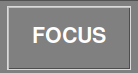{.center}

By default, the camera focuses automatically on the center of the PCB. However, this may not always be the optimal area due to the presence of tall components.

For accurate inspection, it is essential to focus on the **base of the PCB**, where the components are mounted. Avoid focusing on tall components, as this may reduce inspection accuracy.

The PCB does not need to be centered during manual focusing. The operator can move it freely and select any suitable area to achieve proper focus, as long as the base of the PCB is clearly in focus.

After completing the focusing process, the PCB must be repositioned at the center of the inspection area before capturing the reference image.

!!! warning "Important"
    Select an area without tall components and ensure that the PCB base is sharply focused.

The lower section of the window allows enabling or disabling the grid in the live preview and adjusting the exposure.

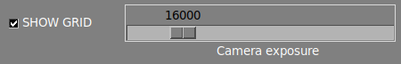{.center}

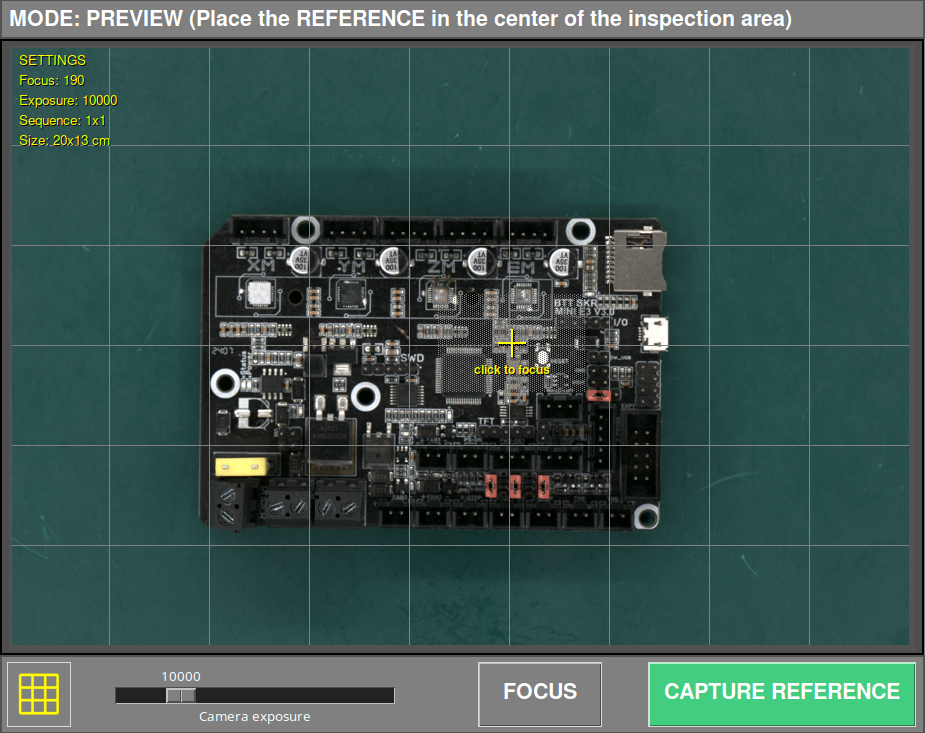{.center}

---

To start the capture process, simply click the **CAPTURE REFERENCE** button. The AOI will focus automatically on the selected quadrant and start capturing the entire PCBA in a matter of seconds.

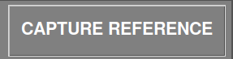{.center}

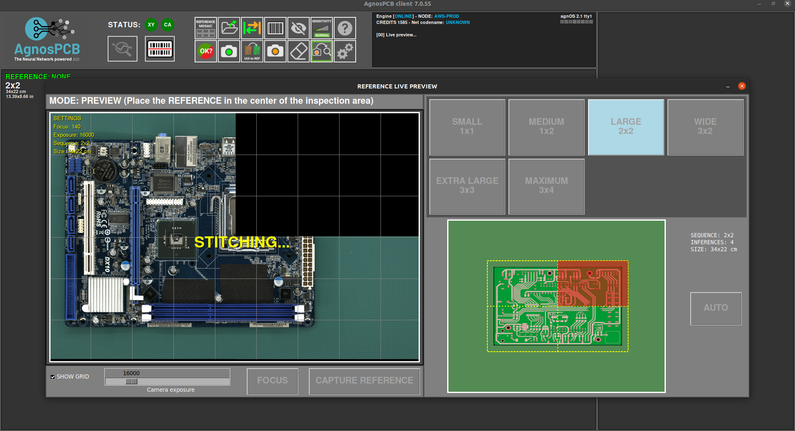{.center}

After capturing the PCBA, the mosaic window will pop up allowing you to store the image for quick access.

!!! note "Note"
    All taken REFERENCES will be stored automatically. The mosaic helps to quickly load the most used REFERENCES.

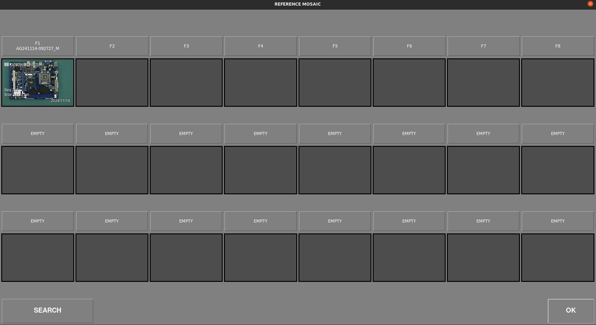{.center}

Once the capture process is finished, the REFERENCE image will be displayed in the main window and will allow you to set [exclusion mask](Set_exclusion_area.md) or [draw a barcode](../features/Barcode_reader.md) area for reading.

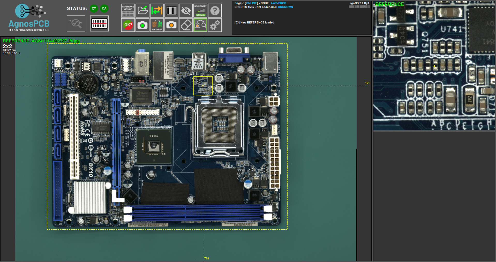{.center}

### Capturing an UUI

After generating or uploading a previous REFERENCE image, we can proceed with the capture of the **UUI** (Unit Under Inspection) image by pressing the button.

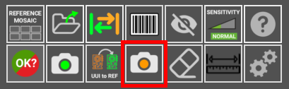{.center}

A live preview window will pop up showing a ghosted overlay of the REFERENCE image. This helps to align the UUI PCBA with the REFERENCE.

!!! warning "Important"
    The **AgnosPCB** software is capable of aligning both images (**REFERENCE** and **UUI**) automatically. However, it is important to position the UUI PCBA correctly to avoid geometric deformations that can cause false positive detections.

{.center}

The capturing process will start by clicking the **START INSPECTION** button.

!!! note "Note"
    Focusing is not necessary as the focus parameter is already stored with the REFERENCE image, making the inspection very fast.

The inspection process is executed in parallel in the case of a multi-image inspection.

Once the capturing process has ended, the final result will be returned showing the detected errors, if any. It is possible to change the [detection sensitivity](Set_sensitivity.md) by pressing the button in the main window or by pressing the **1, 2, or 3 key.**

{.center}

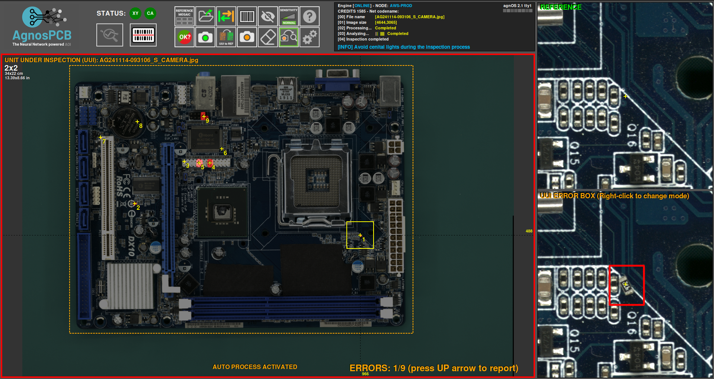{.center}

If errors are detected, a **red frame** will appear around the main window. A **green frame** will appear if there are no errors.

### Inspecting both sides of a board

With a double-sided REFERENCE you can inspect the **TOP** and the **BOTTOM** of the same board one after the other:

1. Inspect the first side as usual. In the live preview, the **START INSPECTION** button shows on a second line which side you are about to inspect. Check that the board is placed face up on that side.
2. Flip the board, switch to the other side (with the [TOP/BOTTOM button](Screen-layout.md#switch-topbottom), the **Page Up** / **Page Down** keys, or automatically with [TOP/BOTTOM auto switch](Settings_menu.md#topbottom-auto-switch)) and inspect it.
3. Once both sides have been inspected, the TOP/BOTTOM button and the **Page Up** / **Page Down** keys switch directly between the **results** of the two sides, so you can keep reviewing one side after capturing the other. Each side keeps its own detections, classifications and [sensitivity](Set_sensitivity.md).

The results are saved in the background while you work. A loading notice is shown on the image while a side is being restored.

When both sides have a report, a single [combined report](#combined-topbottom-report) is generated for the whole board.

!!! note "UV inspections"
    A [UV inspection](../features/UV_conformal_coating_inspection.md) is independent of the TOP/BOTTOM board in progress: it does not discard the sides already inspected and it is not part of the combined report.

### Reporting errors

Once the inspection is complete, the operator must monitor the flagged errors, marking them as an **actual error** or a **false positive detection**.
To do this, simply scroll through the errors using the **left and right arrows** on the keyboard.

!!! note "Analysis preference"
    By default, on new installations the review starts on the [detections list](Screen-layout.md#detections-list): the **left** and **right** arrows move from row to row of the list and the **up** and **down** arrows classify the row under the cursor. To review the detections directly on the image, as in previous versions, set [Analysis preference](Settings_menu.md#analysis-preference) to **CANVAS**.

Errors can also be reported directly with the mouse: **left-click** a detection to report it as an actual error, or **right-click** it to report it as a false positive — equivalent to the **up** and **down** arrow keys described below. Each row of the [detections list](Screen-layout.md#detections-list) also has a **red cross** (error) and a **green tick** (false positive) button.

Left-clicking a detection that is already reported as an actual error asks for confirmation before undoing it.

To mark a real error, just move to the fault and press the **up arrow** on your keyboard. A new window will appear showing the bug in detail and allowing you to categorise it by selecting a type of fault from the list.

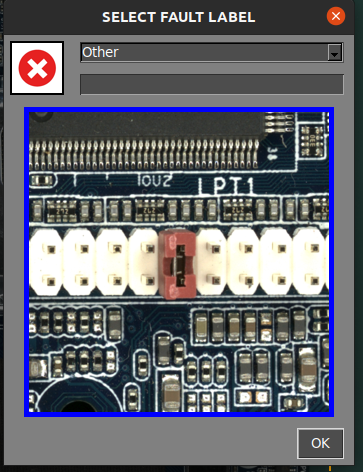{.center}

In addition, there is an empty field to **add a comment.**

In case the operator finds an error **not detected** by the software, it is possible to flag and report it by moving the cursor to the fault area and pressing the **up arrow** key. The reporting window will appear as usual. 

When the software marks an area that is not an actual error, the operator can flag it as a **false positive** by pressing the **down arrow** key. A window will appear with **Reference variant** selected by default — see [Reference Variants](../features/Multivariant_feature.md) for how to complete it. To report a plain false positive instead, choose **False positive** from the dropdown before confirming.

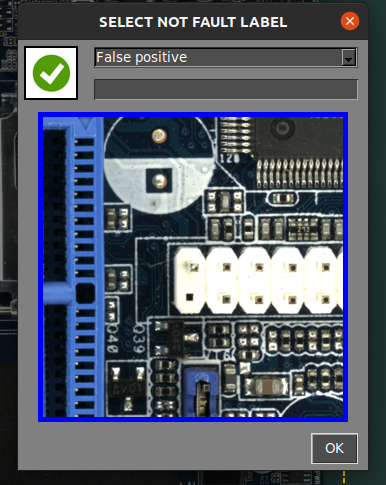{.center}

!!! note "Note"
    Note the **red icon** {width=20px} marks the actual faults and the **green icon** {width=20px} marks the false positive faults.

!!! note "Permissions"
    With [user access control](../features/User_control.md) enabled, reporting a detection requires the **Classify detected faults** permission. Without it, a **Permission denied** message is shown and nothing is reported.

A detection that has not been reported as either is still **unreviewed** (yellow). Keeping the pointer still over it for about **one second** marks it as **seen** (cyan): a small ring fills around the detection while you wait, and nothing is marked if you move away before it closes, so sweeping the mouse across the board does not mark detections you have not looked at. It works the same when you reach a detection with the arrow keys or from the detections list. A detection marked as seen can still be reported afterwards.

### Mandatory review levels

The software can require three levels of review before a new inspection can start. They are independent and can be combined:

| Level | What it requires |
| --- | --- |
| **Mandatory errors review** | Every detection reviewed, or at least marked as **seen**. |
| **Mandatory errors report** | Every detection **reported** as an actual error or a false positive. Marking it as seen is not enough. |
| **Mandatory final report** | The [final OK / NOT OK report](#generating-a-final-pdf-report) confirmed by the operator. A report generated automatically does not count. |

If a level is not met when you try to start the next inspection, a warning tells you what is missing.

A level applies when **any** of the following has it enabled:

- The loaded **REFERENCE**, in its [Reference options](Screen-layout.md#reference-options) window.
- The **role** of the logged-in user, when [user access control](../features/User_control.md#mandatory-review-per-role) is enabled. The **admin** role is only affected by the REFERENCE.
- The global options in the [Workflow settings](Settings_menu.md#mandatory-errors-review), when user access control is disabled.

None of the levels is required while [Demo / Loop mode](Settings_menu.md#demo-loop-mode) is on.

On a double-sided board, inspecting the other side of the same board is never blocked by what is still pending on the first one. Starting the **next board** requires the levels that apply to be met on **both** sides. To confirm the final report of the other side, switch to it and generate its final report.

When at least one level is enabled, every report (PDF and JSON) states how far the review had gone when it was made, for example `MANDATORY REVIEW - Detections: 5 (3 classified, 2 seen, 0 pending)`, and whether the final report was confirmed. The line is shown in red if something was still pending.

#### Warning about a side not reviewed

Independently of the levels above, before the next board starts the software warns you if a side has detections but **none** of them has been reviewed or reported. The window names the side and lets you continue anyway (**OK**) or go back to review it (**CANCEL**).

This warning is not shown when the next capture is the other side of the same board, in UV inspections or in Demo / Loop mode. It can be disabled in [Settings → Workflow](Settings_menu.md#warn-about-a-side-not-reviewed).

### Generating a final PDF report

Once the reporting has finished, the operator can generate a final PDF report by pressing the following button:

{.center}

A window appears allowing you to mark the inspection as **OK** or **NOT OK**. If the PCBA passes the quality check successfully, press the green icon.

{.center}

It is possible to add comments that will be included in the report. The PDF will be generated in the **REPORTS** folder.

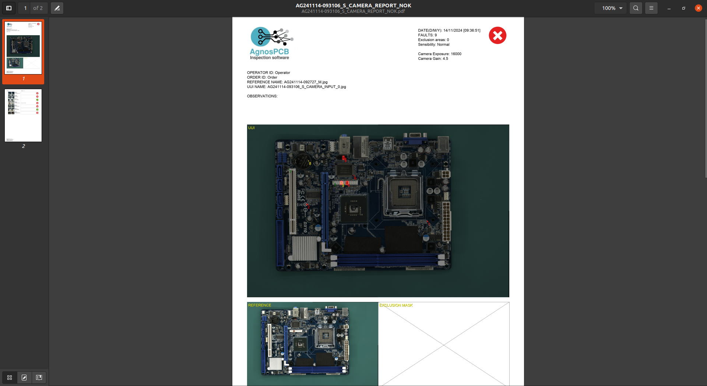{.center}

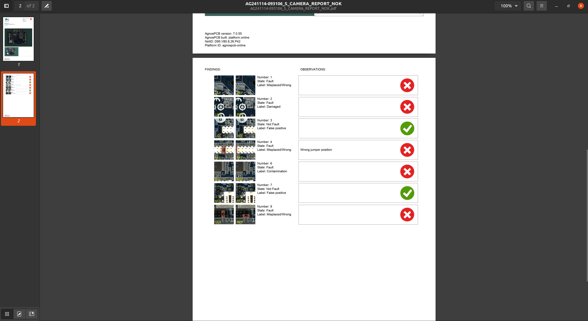{.center}

#### Combined TOP/BOTTOM report

When both sides of a board have a report, a single combined PDF is generated in the report folder of the TOP side: a cover page with the overall result and the data of each side, followed by the TOP report and the BOTTOM report. When [JSON reports](Settings_menu.md#create-json-report) are enabled, a combined JSON is written as well, with the data of each side under `sides.TOP` and `sides.BOTTOM`.

Once the combined report has been written, the individual PDF and JSON reports of each side are deleted, so only one PDF and one JSON remain per board. A board with only one side inspected keeps its own report, and nothing is deleted if the combined report could not be written. The inspection files in **PCB_OUT** are not affected.

!!! note "Note"
    The JSON report also states, for each detection, whether the operator decided it is an error, a false positive or is still pending (`verdict` field).
