# Benutzeroberfläche

## Hauptarbeitsbereiche

Die folgende Abbildung beschreibt die Hauptarbeitsbereiche der **AgnosPCB Inspektionssoftware**.

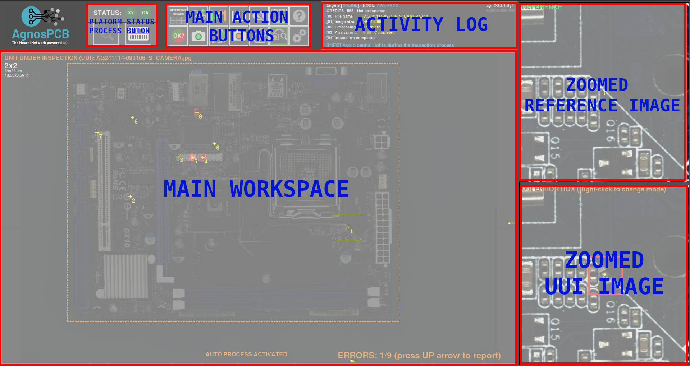{.center}

## Plattformstatus

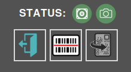{.center}

Dieser Bereich zeigt den Verbindungsstatus zur Inspektionsplattform und Kamera an. Wenn die Verbindung fehlschlägt, werden die Symbole rot. Dieser Bereich enthält auch die folgenden Aktionsschaltflächen:

### Abmelden

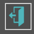{.center}

Ist die [Benutzerzugriffskontrolle](../features/User_control.md) aktiviert, kann sich der Benutzer über diese Schaltfläche abmelden. Sie fragt nach einer Bestätigung und leert dann den Arbeitsbereich (geladene REFERENZ und Inspektionsergebnisse), sodass der nächste Benutzer neu beginnt.

### REFERENZ per Barcode laden

{.center}

{.center}

Diese Schaltfläche öffnet ein Pop-up-Fenster zur Eingabe eines Codes und lädt die REFERENZ, die diesen Code als **Model ID** hat (der Code des Platinenmodells, der auf jeder Platine gleich ist). Es ist auch möglich, den Code mit einem Handscanner zu lesen und in dieses Feld einzufügen. Haben mehrere REFERENZEN diesen Code, können Sie in einer kurzen Liste auswählen, welche geladen werden soll. Weitere Informationen zu dieser Funktion finden Sie [hier](../features/Barcode_reader.md#eine-referenz-per-barcode-laden).

### TOP/BOTTOM umschalten

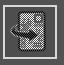{width=80 .center}

Wenn das REFERENZ-Bild sowohl die Ober- als auch die Unterseite der PCBA enthält, wechselt diese Schaltfläche zwischen den beiden Bildern. Sobald beide Seiten einer Platine inspiziert wurden, wechselt sie stattdessen zwischen den **Ergebnissen** der beiden Seiten. Die Tasten **Page Up** (TOP) und **Page Down** (BOTTOM) bewirken dasselbe. Siehe [Beide Seiten einer Platine inspizieren](Inspection_workflow.md#beide-seiten-einer-platine-inspizieren).

Dies kann auch automatisch zu Beginn jeder Inspektion geschehen — aktivieren Sie **TOP/BOTTOM automatisch umschalten** im [Einstellungsmenü](Settings_menu.md#topbottom-automatisch-umschalten).

### Messwerkzeug

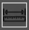{width=80 .center}

Mit dieser Schaltfläche können Sie einen Bereich der Platine auswählen, um einen interessanten Bereich zu vermessen. Weitere Informationen zu dieser Funktion finden Sie [hier](../features/Measurement_tool.md).

## Aktivitätsprotokoll

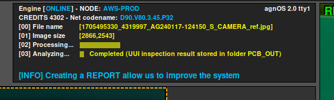{.center}

Der Bereich **Aktivitätsprotokoll** befindet sich oben rechts und zeigt die **aktuell verfügbaren Credits** sowie operative Details der Anwendung, wie den Status des Analyseprozesses. Ist die [Benutzerzugriffskontrolle](../features/User_control.md) aktiviert, wird dort auch der angemeldete Benutzer angezeigt.

## Hauptarbeitsbereich

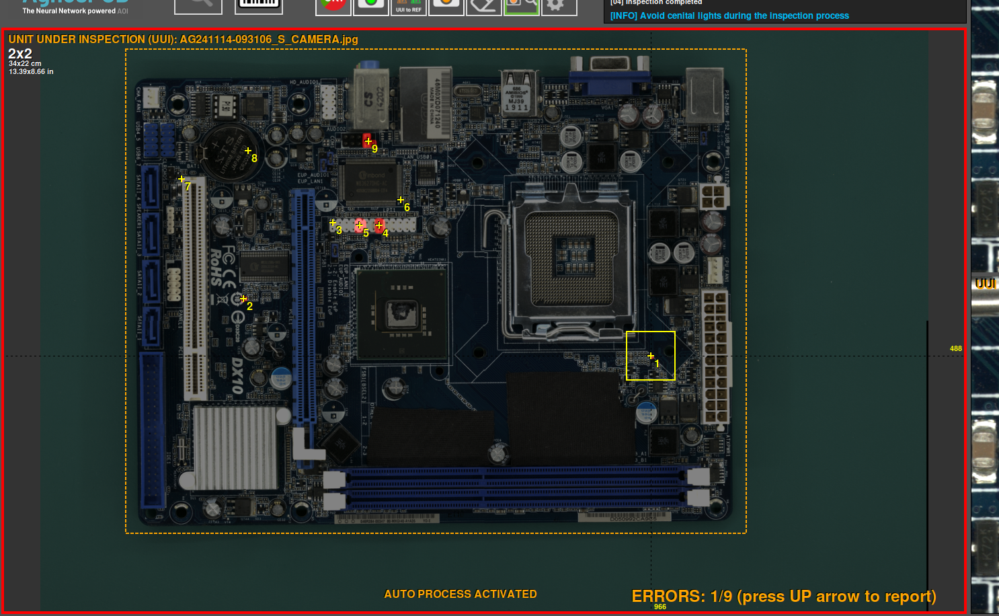{.center}

Dies ist der Hauptbereich, in dem Sie mit den **REFERENZ**- und **UUI**-Bildern arbeiten, die durch Drücken der TAB-Taste auf der Tastatur oder [der Schaltfläche in der Anwendung](#wechseln-swap) umgeschaltet werden können. Die Inspektionsergebnisse werden ebenfalls in diesem Bereich mithilfe von Fadenkreuzen und Nummern neben den erkannten Fehlern angezeigt.

## Seiten-an-Seiten-Vergleich

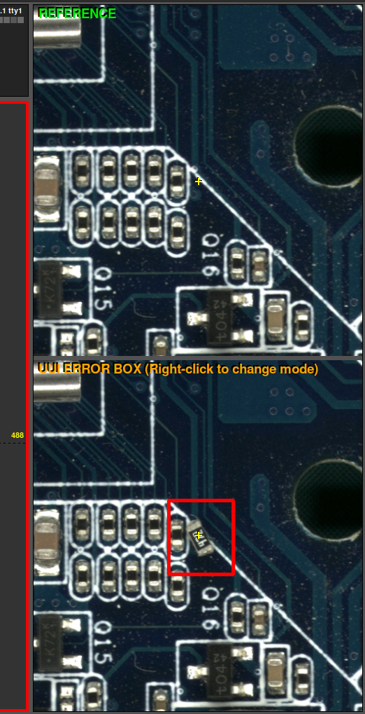{width=400px .center}

Dieser Bereich der Benutzeroberfläche ist in zwei Teile unterteilt. Der obere Teil zeigt das **REFERENZ**-Bild, das als Standard für den Vergleich dient, während der untere Teil das **UUI**-Bild zeigt. Diese Bilder werden vergrößert und bewegen sich parallel, wobei genau derselbe Bereich in der **REFERENZ** und **UUI** angezeigt wird, auf den der Cursor im Hauptarbeitsbereich zeigt.

### Erkennungsliste

Nach einer Inspektion wird die **Erkennungsliste** angezeigt, wenn Sie die Maus in diesen Bereich bewegen: eine Zeile pro Erkennung, mit ihrer Nummer, ihrem Typ und einem farbigen Streifen, der ihren Zustand anzeigt (ungeprüft, Fehler oder Falsch-Positiv).

| Aktion | Wirkung |
| --- | --- |
| Zeile mit der Maus überfahren | Hebt die Erkennung auf dem Bild hervor und zeigt daneben zwei schwebende Miniaturansichten: oben die REFERENZ, unten die UUI. Nach einem Moment werden sie größer. Bleibt der Zeiger danach etwa eine Sekunde auf der Zeile, wird die Erkennung als **gesehen** markiert. |
| Klick auf eine Zeile | Springt auf dem Bild zu dieser Erkennung. |
| Doppelklick auf eine Zeile | Springt zu dieser Erkennung und öffnet das Meldefenster. |
| **Rotes Kreuz** / **grüner Haken** am Ende einer Zeile | Meldet die Erkennung als tatsächlichen Fehler / als Falsch-Positiv, genau wie die Pfeiltasten **nach oben** / **nach unten**. Bei einer bereits gemeldeten Erkennung ist die Schaltfläche ihrer Einstufung umrandet. |
| Mausrad | Ändert den Zoom der Miniaturansichten, solange sie angezeigt werden. Andernfalls wird die Liste gescrollt. |
| **Umschalt** + Mausrad | Scrollt die Liste, auch während die Miniaturansichten angezeigt werden. |
| Mittelklick | Wechselt die Ansicht der unteren Miniaturansicht: UUI, Fehlermaske, Fehlerrahmen. |
| Zeiger am oberen oder unteren Rand der Liste | Ist die Liste länger als das Panel, scrollt sie von selbst; je näher am Rand, desto schneller. Ein dezenter Pfeil markiert den Rand, in dessen Richtung sie sich noch bewegen kann. |

Ist die [Analysepräferenz](Settings_menu.md#analysepraferenz) auf **LIST** gestellt, wirken die Pfeiltasten auf diese Liste. Siehe [Melden von Fehlern](Inspection_workflow.md#melden-von-fehlern).

### Referenz-Informationspanel

Je nach dem mit der Taste **TAB** gewählten Ansichtsmodus zeigt dieser Bereich beim Überfahren des REFERENZ-Bildes das **Referenz-Informationspanel** an: Name, Datum, Codes, Optik und Sequenz der geladenen REFERENZ sowie, ob ihre [verpflichtenden Prüfstufen](Inspection_workflow.md#verpflichtende-prufstufen) aktiviert sind.

Ist [Statistiken und Fehler-Heatmap pro Referenz anzeigen](Settings_menu.md#statistiken-und-fehler-heatmap-pro-referenz-anzeigen) aktiviert, zeigt das Panel außerdem:

- **Inspektionsstatistiken**: Gesamtzahl der Inspektionen, OK und NICHT OK, Ausbeute, bestätigte Fehler, Falsch-Positive, noch ungeprüfte Erkennungen, die häufigsten Fehlertypen und mehr.
- **Fehler-Heatmap**: die Platinenfläche der REFERENZ mit einer Wärmeüberlagerung, die zeigt, wo ihre Platinen Fehler aufweisen. Es werden nur vom Bediener bestätigte Fehler gezählt; Falsch-Positive und ungeprüfte Erkennungen erscheinen nie. Die Fehler werden anhand der Ausrichtung jeder Inspektion auf der REFERENZ platziert, sodass auch eine leicht verschobene Platine an der richtigen Stelle landet.

Eine Inspektion wird einmal gezählt, nämlich wenn ihr Bericht gespeichert wird. Wird der Bericht derselben Inspektion erneut gespeichert, ersetzt er ihren vorherigen Eintrag, statt einen neuen hinzuzufügen.

Ein Rechtsklick auf den oberen Teil des Panels öffnet die [Referenzoptionen](#referenzoptionen) der geladenen REFERENZ.

## Schaltflächen-Panel

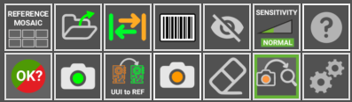{.center}

Hier befinden sich verschiedene **Funktionen und Optionen**, die darauf ausgelegt sind, Ihren Workflow zu **optimieren** und Ihre Aufgaben zu beschleunigen. Jede Funktion wird unten definiert:

### Referenz-Mosaik

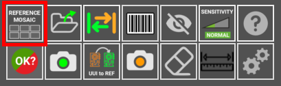{width=350px .center}

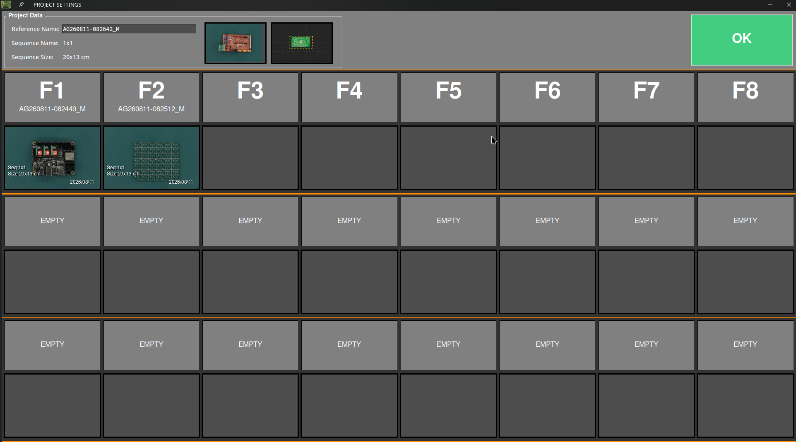{width=600px .center}

Das Referenz-Mosaik wird verwendet, um REFERENZEN als Dateien zu speichern, um jede davon schnell zu finden und zu laden. Das Mosaik-Menü wird automatisch angezeigt, nachdem eine REFERENZ mit der [Schaltfläche Foto REFERENZ aufnehmen](#ein-referenz-bild-aufnehmen) aufgenommen oder [als Datei geladen](#referenz-als-datei-laden) wurde. In diesem Fenster ist es auch möglich, die aufgenommene REFERENZ im oberen rechten Teil des Fensters zu benennen. Eine im Mosaik gespeicherte REFERENZ kann schnell durch Drücken einer **F-Taste** (F1-F8) geladen werden. Ein Rechtsklick auf einen Speicherplatz öffnet die [Referenzoptionen](#referenzoptionen) dieser REFERENZ.

### REFERENZ als Datei laden

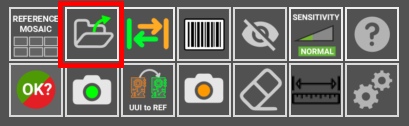{width=350px .center}

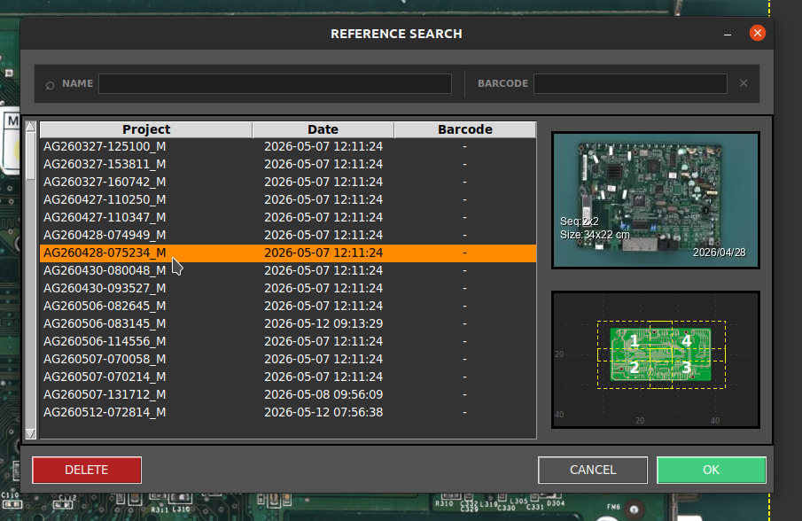{.center}

Verwenden Sie dieses Symbol, um ein zuvor als **REFERENZ** aufgenommenes Bild zu laden, und es ermöglicht Ihnen, diese nach Name oder Datum zu sortieren oder nach Name, Alias oder **Model ID** zu filtern. Alle **REFERENZ**-Bilder finden Sie innerhalb des Ordners **APP/REFERENCE** in einem Ordner, der nach der Uhrzeit der Aufnahme benannt ist.

Eine doppelseitige REFERENZ wird nur einmal aufgeführt, über ihre TOP-Seite, mit einer Markierung in der Spalte **Sides**; ihre BOTTOM-Seite erreichen Sie nach dem Laden mit der [TOP/BOTTOM-Schaltfläche](#topbottom-umschalten). REFERENZEN ohne [Model ID](../features/Barcode_reader.md#eine-referenz-per-barcode-laden) zeigen abgeblendet den Code an, unter dem sie zuvor indexiert waren.

!!! note "Hinweis"
    Seit Version 7 **erlaubt** die Software **nicht**, Bilder zu laden, die von einer anderen Quelle als der Plattform selbst stammen, da die Bilder spezifische Parameter für die Optik enthalten. Jedes REFERENZ-Bild muss mit der **AI-4050 AOI** aufgenommen werden.

#### Referenzoptionen

Das Fenster **Referenzoptionen** enthält die Einstellungen jeder REFERENZ: ihren Anzeige-Alias und ihre verpflichtenden Prüfstufen. Sie können es auf jede der folgenden Arten öffnen:

- Wählen Sie eine REFERENZ in dieser Liste aus und drücken Sie **OPTIONS**.
- Rechtsklick auf einen Speicherplatz des [Referenz-Mosaiks](#referenz-mosaik).
- Rechtsklick auf den oberen Teil des [Referenz-Informationspanels](#referenz-informationspanel).

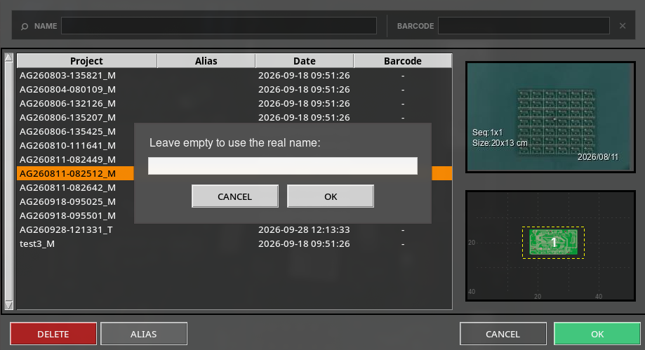{.center}

**Anzeige-Alias**

Eine REFERENZ kann einen optionalen **Anzeige-Alias** erhalten: einen freundlicheren Namen, der in der Spalte **Alias** dieser Liste anstelle des tatsächlichen Namens der REFERENZ angezeigt wird, ohne sie umzubenennen. Das ist nützlich, wenn der tatsächliche Name der REFERENZ — ein Barcode, ein Zeitstempel — auf den ersten Blick wenig aussagt. Der Alias wird auch im Mosaik und in den Inspektionsberichten (PDF und JSON) verwendet, wo er neben dem tatsächlichen Namen angezeigt wird.

Lassen Sie das Feld leer, wird der Alias entfernt, und die Liste zeigt wieder den tatsächlichen Namen der REFERENZ an.

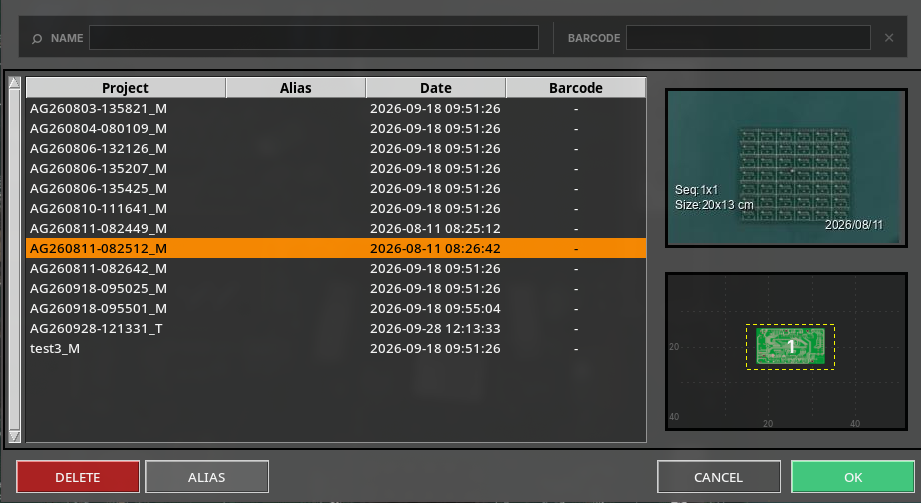{.center}

!!! note "Hinweis"
    Der Alias ist nur eine Bezeichnung. Alles, was die REFERENZ identifiziert oder lädt — ihr Dateiname, ihre Model ID — verwendet weiterhin ihren tatsächlichen Namen.

**Verpflichtende Prüfstufen**

Drei Kontrollkästchen — **Pflichtprüfung der Fehler**, **Pflichtmeldung der Fehler** und **Verpflichtender Abschlussbericht** — machen die jeweilige Stufe für jeden verpflichtend, der mit dieser REFERENZ inspiziert, unabhängig von seiner Rolle oder den globalen Einstellungen. Siehe [Verpflichtende Prüfstufen](Inspection_workflow.md#verpflichtende-prufstufen).

Bei einer doppelseitigen REFERENZ werden die Einstellungen auf beiden Seiten gespeichert. Eine mit [UUI zu REFERENZ](UUI_to_REFERENCE.md) erstellte REFERENZ übernimmt sie von der REFERENZ, aus der sie hervorgegangen ist; eine neu aufgenommene beginnt mit allen Stufen deaktiviert.

!!! note "Berechtigungen"
    Bei aktivierter [Benutzerzugriffskontrolle](../features/User_control.md) erfordert der Alias die Berechtigung **Set Reference display alias** und die verpflichtenden Stufen die Berechtigung **Edit Reference options**.

### Wechseln (Swap)

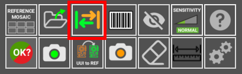{width=350px .center}

Schaltet zwischen den **REFERENZ**- und **UUI**-Bildern im [Hauptarbeitsbereich](#hauptarbeitsbereich) um.

### Barcode-Bereich zeichnen

{width=350px .center}

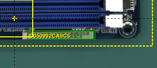{.center}

Klicken Sie auf diese Schaltfläche, um manuell ein Rechteck in das **REFERENZ**-Bild zu zeichnen, wo sich ein Barcode befindet. Die Software liest ihn und verwendet diesen Code, um die Bilder zu benennen und ihn in den endgültigen **PDF-Bericht** aufzunehmen. Weitere Informationen zur Barcode-Lesefunktion finden Sie im [folgenden Abschnitt](../features/Barcode_reader.md).

### Ausschluss

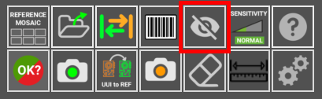{width=350px .center}

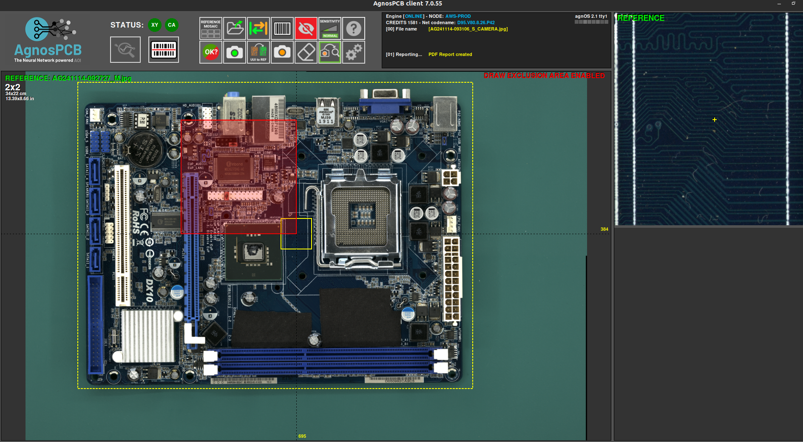{.center}

Erstellt einen Ausschlussbereich, in dem das System nicht nach Fehlern suchen wird. Sie können beliebig viele Bereiche erstellen. Diese Funktion wird im [folgenden Abschnitt](Set_exclusion_area.md) detailliert beschrieben.

### Empfindlichkeit

{width=350px .center}

Wenn der Fertigungsprozess eine strengere Qualitätskontrolle erfordert, können Sie die Empfindlichkeit der Fehlererkennung mit dieser Funktion erhöhen. Durch Erhöhen der Empfindlichkeit markiert die Software Fehler, die sie mit einer niedrigeren Empfindlichkeitseinstellung normalerweise nicht markieren würde. Es gibt drei Empfindlichkeitsstufen: Normal, Hoch und Sehr Hoch. Sie kann mit den Tasten 1, 2, 3 der Tastatur eingestellt werden. Diese Funktion wird im [folgenden Abschnitt](./Set_sensitivity.md) detailliert beschrieben.

### Hilfe

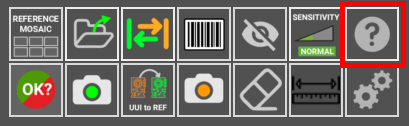{width=350px .center}

Diese Schaltfläche führt Sie zu dieser Dokumentation.

### Endergebnis

{.center}

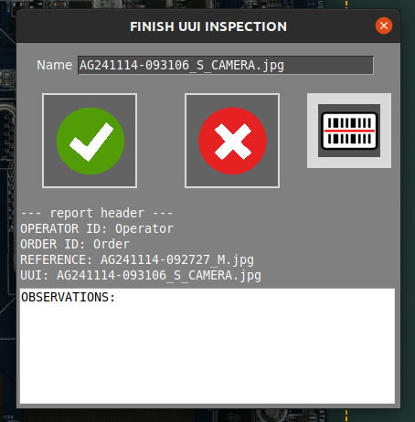{.center}

Nachdem die erkannten Fehler vom Bediener überwacht wurden, kann die Inspektion durch Drücken dieser Schaltfläche abgeschlossen und die inspizierte PCBA je nach Fertigungskriterien als **OK** oder **NICHT OK** markiert werden. Danach erstellt die Software einen Bericht, der die vom Bediener gemeldeten Fehler in einem PDF-Dokument enthält. Um mehr über diese Funktion zu erfahren, gehen Sie zum [folgenden Abschnitt](./Inspection_workflow.md#generieren-eines-endgultigen-pdf-berichts).

### Ein REFERENZ-Bild aufnehmen

{.center}

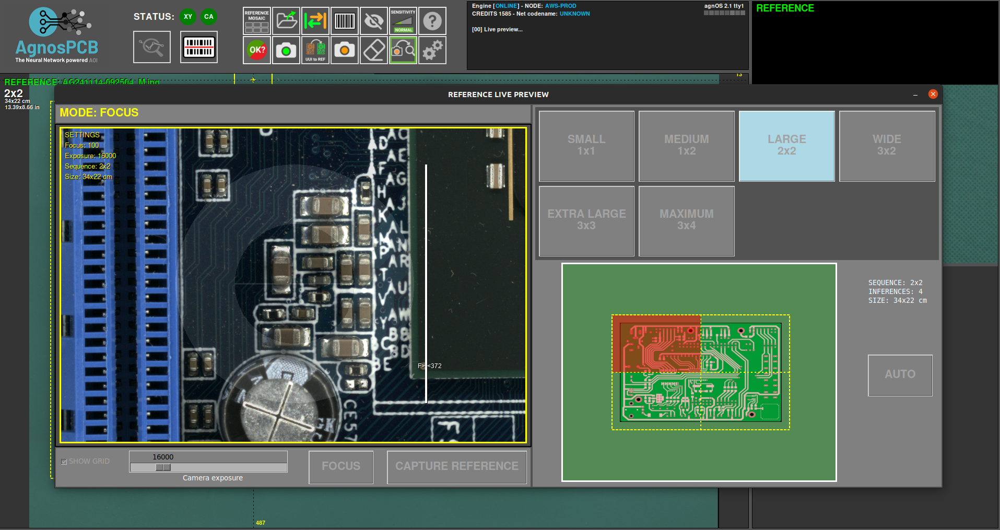{.center}

Diese Schaltfläche öffnet ein Fenster mit den Dienstprogrammen zum Generieren eines **REFERENZ**-Bildes von einer PCB oder einem Panel. Diese Funktion kann durch Drücken der Taste **r** auf der Tastatur aktiviert werden. Im Abschnitt [eine Referenz generieren](./Inspection_workflow.md#generieren-einer-referenz) erfahren Sie mehr über diese Funktion.

### UUI zu REFERENZ

{.center}

Diese Funktion wandelt das aktuelle **UUI**-Bild in eine **REFERENZ** um. Dies ist nützlich, wenn einige der Komponenten der PCBA durch ein Äquivalent ersetzt wurden und das **Neuronale Netzwerk** dies aufgrund eines visuellen Unterschieds als Fehler erkennt, die PCBA aber korrekt ist. Um mehr über diese Funktion zu erfahren, gehen Sie zum [folgenden Abschnitt](UUI_to_REFERENCE.md).

### Ein UUI-Bild aufnehmen

{.center}

{.center}

Diese Funktion öffnet ein Fenster mit einer Live-Vorschau des Inspektionsbereichs. Sobald die PCBA korrekt platziert ist, drücken Sie die Schaltfläche **Inspektion starten**, um ein Foto oder Fotos der PCBA/des Panels der **Unit Under Inspection** aufzunehmen. Wenn die [Schaltfläche Automatischer Prozess](./Workspace_icons.md#automatischer-prozess) aktiv ist, beginnt die Inspektion automatisch, sobald das UUI-Bild aufgenommen wurde. Diese Funktion kann auch durch Drücken der Taste **s** auf der Tastatur oder der physischen Aktionstaste auf der rechten Seite des AOI aktiviert werden. Weitere Informationen zu dieser Funktion finden Sie im [folgenden Abschnitt](./Inspection_workflow.md#aufnehmen-einer-uui).

### Radiergummi

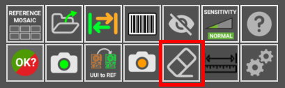{.center}

Löscht einen gezeichneten [**Ausschlussbereich**](./Set_exclusion_area.md).

### Messwerkzeug

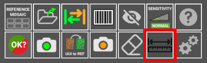{.center}

Die AgnosPCB-Software bietet ein präzises Werkzeug zum Vermessen von Bauteilen anhand der von der Inspektionsplattform aufgenommenen Bilder. Weitere Informationen zu diesem Werkzeug finden Sie auf der folgenden [Dokumentationsseite](../features/Measurement_tool.md).

### Einstellungen

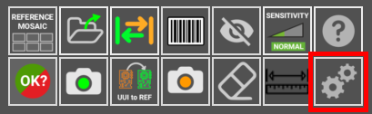{.center}

Diese Schaltfläche öffnet das [Einstellungsmenü](./Settings_menu.md).
