# Interfaz de usuario

## Áreas de trabajo principales

La siguiente imagen describe las áreas de trabajo principales del **software de inspección AgnosPCB**.

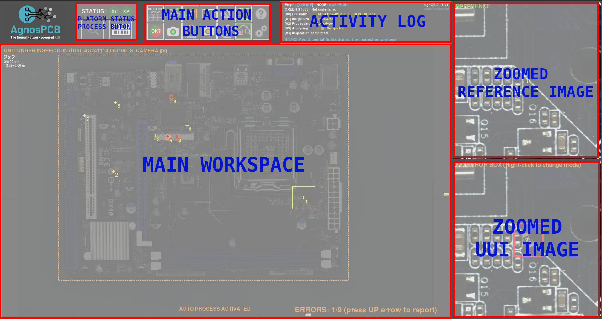{.center}

## Estado de la plataforma

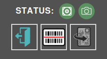{.center}

Esta área muestra el estado de la conexión con la plataforma de inspección y la cámara. Si la conexión falla, los iconos se volverán rojos. Esta área también contiene los siguientes botones de acción:

### Cerrar sesión

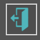{.center}

Si el [control de acceso de usuarios](../features/User_control.md) está habilitado, este botón permite al usuario cerrar la sesión. Pide confirmación y después limpia el espacio de trabajo (REFERENCIA cargada y resultados de inspección), de modo que el siguiente usuario empiece desde cero.

### Cargar REFERENCIA por código de barras

{.center}

{.center}

Este botón abre una ventana emergente para insertar un código, y carga la REFERENCIA que lo tiene como **Model ID** (el código del modelo de placa, que es el mismo en todas las placas). También es posible leer el código con un lector de mano e insertarlo en este campo. Si varias REFERENCIAS tienen ese código, una lista breve le permite elegir cuál cargar. Más información sobre esta característica [aquí](../features/Barcode_reader.md#cargar-una-referencia-por-codigo-de-barras).

### Alternar TOP/BOTTOM

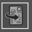{width=80 .center}

Si la imagen de REFERENCIA contiene tanto la cara superior como la inferior de la PCBA, alterna entre ambas imágenes. Una vez inspeccionadas ambas caras de una placa, alterna en su lugar entre los **resultados** de las dos caras. Las teclas **Page Up** (TOP) y **Page Down** (BOTTOM) hacen lo mismo. Consulte [Inspección de ambas caras de una placa](Inspection_workflow.md#inspeccion-de-ambas-caras-de-una-placa).

Esto también puede ocurrir automáticamente al comenzar cada inspección: habilite **Cambio automático TOP/BOTTOM** en el [menú de configuración](Settings_menu.md#cambio-automatico-topbottom).

### Herramienta de medición

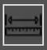{width=80 .center}

Este botón le permite seleccionar una región dentro del PCB para medir un área de interés. Encontrará más información sobre esta función [aquí](../features/Measurement_tool.md).

## Registro de actividad

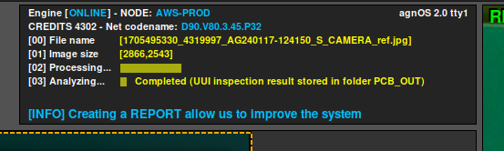{.center}

El área de **registro de actividad** está ubicada en la parte superior derecha y muestra los **créditos disponibles actuales** y los detalles operativos de la aplicación, como el estado del proceso de análisis. Cuando el [control de acceso de usuarios](../features/User_control.md) está habilitado, también muestra el usuario que ha iniciado sesión.

## Espacio de trabajo principal

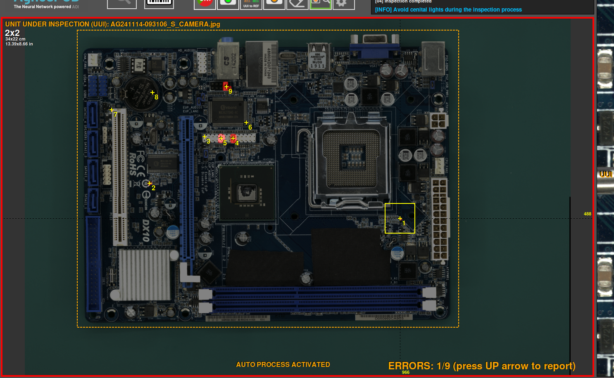{.center}

Esta es la sección principal donde se trabaja con las imágenes de **REFERENCIA** y **UUI**, las cuales se pueden alternar presionando la tecla TAB en el teclado o [el botón en la aplicación](#intercambiar). Los resultados de la inspección también se muestran en esta área utilizando retículos y números junto a los errores detectados.

## Comparación lado a lado

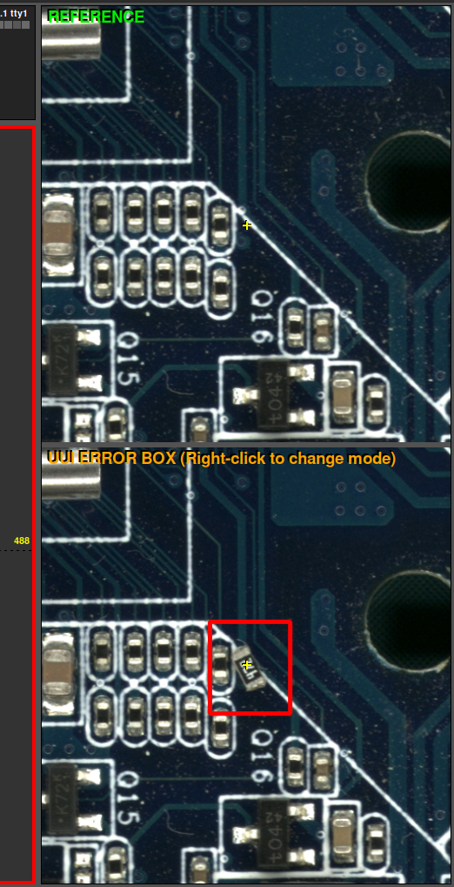{width=400px .center}

Esta sección de la interfaz está dividida en dos partes. La parte superior muestra la imagen de **REFERENCIA**, que sirve como estándar para la comparación, mientras que la parte inferior muestra la imagen **UUI**. Estas imágenes se magnifican y se mueven en paralelo mostrando exactamente la misma área en la **REFERENCIA** y **UUI** donde apunta el cursor en el espacio de trabajo principal.

### Lista de detecciones

Después de una inspección, al mover el ratón a esta área se muestra la **lista de detecciones**: una fila por detección, con su número, su tipo y una franja de color que indica su estado (sin revisar, error o falso positivo).

| Acción | Efecto |
| --- | --- |
| Pasar el ratón por una fila | Resalta la detección en la imagen y muestra junto a ella dos miniaturas flotantes: la REFERENCIA arriba y la UUI abajo. Al cabo de un momento crecen a un tamaño mayor. Una vez que lo han hecho, mantener el puntero sobre la fila durante aproximadamente un segundo marca la detección como **vista**. |
| Clic en una fila | Se desplaza a esa detección en la imagen. |
| Doble clic en una fila | Se desplaza a esa detección y abre la ventana de reporte. |
| **Cruz roja** / **tic verde** al final de una fila | Reporta la detección como error real / falso positivo, igual que las teclas de flecha **arriba** / **abajo**. En una detección ya reportada, el botón de su veredicto aparece contorneado. |
| Rueda del ratón | Mientras se muestran las miniaturas, cambia su zoom. Si no, desplaza la lista. |
| **Shift** + rueda del ratón | Desplaza la lista, también mientras se muestran las miniaturas. |
| Clic central | Alterna la vista de la miniatura inferior: UUI, máscara de error, recuadro de error. |
| Puntero en el borde superior o inferior de la lista | Cuando la lista es más larga que el panel, se desplaza sola; cuanto más cerca del borde, más rápido. Una flecha tenue marca el borde hacia el que aún puede moverse. |

Con [Preferencia de análisis](Settings_menu.md#preferencia-de-analisis) establecida en **LIST**, las teclas de flecha actúan sobre esta lista. Consulte [Reporte de errores](Inspection_workflow.md#reporte-de-errores).

### Panel de información de la Referencia

Según el modo de vista seleccionado con la tecla **TAB**, al pasar el ratón por la imagen de REFERENCIA se muestra en esta área el **panel de información de la Referencia**: nombre, fecha, códigos, óptica y secuencia de la REFERENCIA cargada, y si sus [niveles de revisión obligatoria](Inspection_workflow.md#niveles-de-revision-obligatoria) están habilitados.

Cuando [Mostrar estadísticas y mapa de calor de errores por Referencia](Settings_menu.md#mostrar-estadisticas-y-mapa-de-calor-de-errores-por-referencia) está habilitado, el panel también muestra:

- **Estadísticas de inspección**: total de inspecciones, OK y NO OK, rendimiento, errores confirmados, falsos positivos, detecciones aún sin revisar, los tipos de error más frecuentes y más.
- **Mapa de calor de errores**: el área de placa de la REFERENCIA con una superposición de calor que muestra dónde fallan sus placas. Solo se cuentan los errores confirmados por el operador; los falsos positivos y las detecciones sin revisar nunca aparecen. Los errores se sitúan sobre la REFERENCIA usando la alineación de cada inspección, de modo que una placa ligeramente desplazada sigue cayendo en el lugar correcto.

Una inspección se cuenta una sola vez, cuando se guarda su informe. Guardar de nuevo el informe de la misma inspección sustituye su entrada anterior en lugar de añadir una nueva.

Al hacer clic derecho en la parte superior del panel se abren las [opciones de la Referencia](#opciones-de-la-referencia) de la REFERENCIA cargada.

## Panel de botones

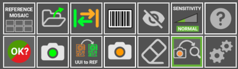{.center}

Aquí se encuentran varias **funciones y opciones** diseñadas para **optimizar** su flujo de trabajo y acelerar sus tareas. Cada característica se define a continuación:

### Mosaico de referencias

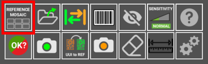{width=350px .center}

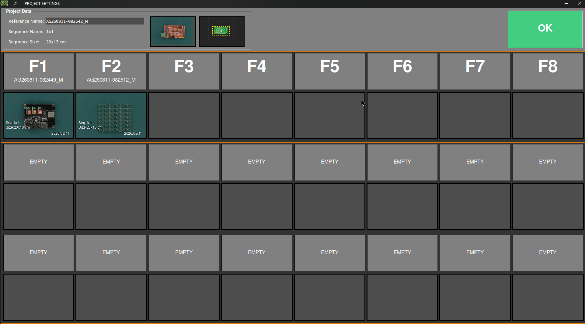{width=600px .center}

El mosaico de referencias se utiliza para almacenar REFERENCIAS como archivos para encontrar y cargar rápidamente cualquiera de ellas. El menú mosaico aparece automáticamente después de tomar una REFERENCIA usando el [botón para tomar foto de REFERENCIA](#tomar-una-imagen-de-referencia) o cargándola [como un archivo](#cargar-referencia-como-archivo). En esta ventana también es posible nombrar la REFERENCIA tomada en la parte superior derecha de la ventana. Una REFERENCIA almacenada en el mosaico se puede cargar rápidamente presionando un **botón F** (F1-F8). Al hacer clic derecho en un espacio se abren las [opciones de la Referencia](#opciones-de-la-referencia) de esa REFERENCIA.

### CARGAR REFERENCIA como archivo

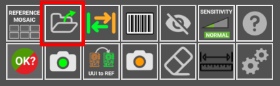{width=350px .center}

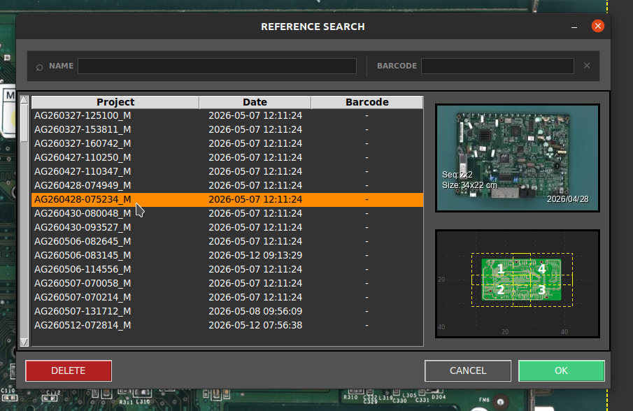{.center}

Use este icono para cargar una imagen capturada previamente como **REFERENCIA** y le permite ordenarlas por nombre o fecha, o filtrarlas por nombre, alias o **Model ID**. Todas las imágenes de **REFERENCIA** se pueden encontrar dentro de la carpeta **APP/REFERENCE** en una carpeta nombrada según la hora en que se tomó la foto.

Una REFERENCIA de doble cara aparece en la lista una sola vez, por su cara TOP, con una marca en la columna **Sides**; a su cara BOTTOM se accede con el [botón TOP/BOTTOM](#alternar-topbottom) una vez cargada. Las REFERENCIAS que no tienen [Model ID](../features/Barcode_reader.md#cargar-una-referencia-por-codigo-de-barras) muestran atenuado el código con el que estaban indexadas antes.

!!! note "Nota"
    Desde la versión 7, el software **no permite** cargar imágenes tomadas de cualquier fuente que no sea la plataforma misma, ya que las imágenes contienen parámetros específicos para la óptica. Cada imagen de REFERENCIA debe capturarse utilizando la **AI-4050 AOI**.

#### Opciones de la Referencia

La ventana **Reference options** contiene los ajustes de cada REFERENCIA: su alias de visualización y sus niveles de revisión obligatoria. Ábrala de cualquiera de estas formas:

- Seleccione una REFERENCIA en esta lista y pulse **OPTIONS**.
- Haga clic derecho en un espacio del [mosaico de referencias](#mosaico-de-referencias).
- Haga clic derecho en la parte superior del [panel de información de la Referencia](#panel-de-informacion-de-la-referencia).

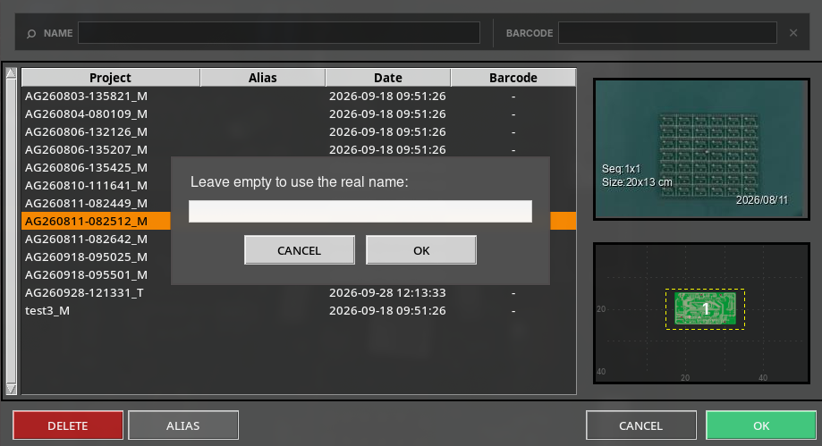{.center}

**Alias de visualización**

Una REFERENCIA puede recibir un **alias de visualización** opcional: un nombre más amigable que se muestra en la columna **Alias** de esta lista en lugar del nombre real de la REFERENCIA, sin renombrarla. Esto resulta útil cuando el nombre real de la REFERENCIA —un código de barras, una marca de tiempo— no es fácil de interpretar de un vistazo. El alias también se usa en el mosaico y en los informes de inspección (PDF y JSON), donde se muestra junto al nombre real.

Si deja el campo vacío, el alias se elimina y la lista vuelve a mostrar el nombre real de la REFERENCIA.

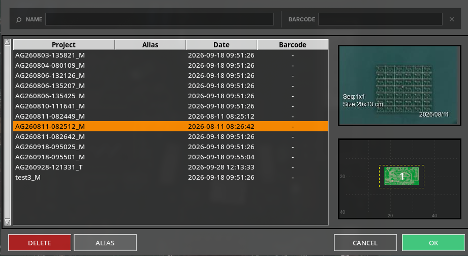{.center}

!!! note "Nota"
    El alias es solo una etiqueta. Todo lo que identifica o carga la REFERENCIA —su nombre de archivo, su Model ID— sigue usando su nombre real.

**Niveles de revisión obligatoria**

Tres casillas —**Revisión obligatoria de errores**, **Reporte obligatorio de errores** e **Informe final obligatorio**— hacen obligatorio ese nivel para quien inspeccione con esta REFERENCIA, independientemente de su rol o de lo que indique la configuración global. Consulte [Niveles de revisión obligatoria](Inspection_workflow.md#niveles-de-revision-obligatoria).

En una REFERENCIA de doble cara, los ajustes se guardan en ambas caras. Una REFERENCIA creada con [UUI a REFERENCIA](UUI_to_REFERENCE.md) los hereda de la REFERENCIA de la que procede; una recién capturada empieza con todos ellos deshabilitados.

!!! note "Permisos"
    Con el [control de acceso de usuarios](../features/User_control.md) habilitado, el alias requiere el permiso **Set Reference display alias** y los niveles obligatorios requieren el permiso **Edit Reference options**.

### Intercambiar

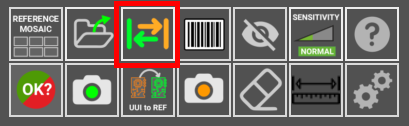{width=350px .center}

Alterna entre las imágenes de **REFERENCIA** y **UUI** en el [área principal del espacio de trabajo](#espacio-de-trabajo-principal).

### Dibujo de área de código de barras

{width=350px .center}

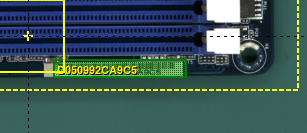{.center}

Haga clic en este botón para dibujar manualmente un rectángulo en la imagen **REFERENCIA** donde hay un código de barras. El software lo leerá y usará ese código para nombrar las imágenes e incluirlo en el **informe PDF** final. Más información sobre la función de lectura de código de barras en la [siguiente sección](../features/Barcode_reader.md).

### Exclusión

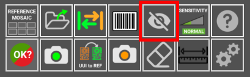{width=350px .center}

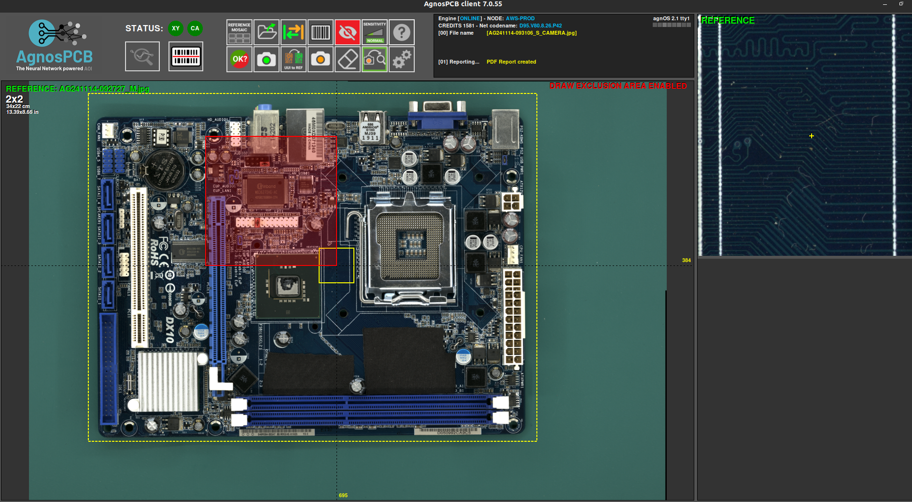{.center}

Crea un área de exclusión donde el sistema no buscará fallos. Puede crear tantas áreas como sea necesario. Esta función se detalla en la [siguiente sección](Set_exclusion_area.md).

### Sensibilidad

{width=350px .center}

Si el proceso de fabricación requiere un control de calidad más riguroso, puede aumentar la sensibilidad de detección de errores con esta función. Al aumentar la sensibilidad, el software marcará errores que normalmente no lo haría con una configuración de sensibilidad más baja. Hay tres niveles de sensibilidad: Normal, Alto y Muy Alto. Se puede configurar usando las teclas 1, 2, 3 del teclado. Esta función se detalla en la [siguiente sección](./Set_sensitivity.md).

### Ayuda

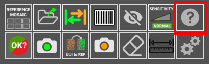{width=350px .center}

Este botón le llevará a esta documentación.

### Resultado final

{.center}

{.center}

Una vez que los errores detectados han sido supervisados por el operador, la inspección se puede completar presionando este botón y, dependiendo del criterio de fabricación, marcar la PCBA inspeccionada como **OK** o **NO OK**. Después de eso, el software creará un informe que incluye los errores reportados por el operador en un documento PDF. Para obtener más información sobre esta función, vaya a la [siguiente sección](./Inspection_workflow.md#generacion-de-un-informe-pdf-final).

### Tomar una imagen de REFERENCIA

{.center}

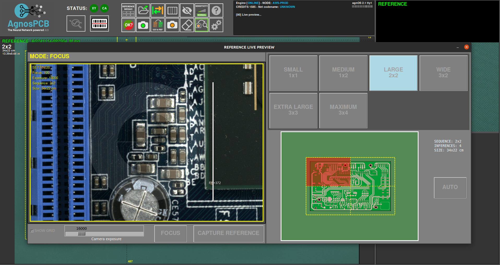{.center}

Este botón abre una ventana con las utilidades para generar una imagen de **REFERENCIA** a partir de una PCB o panel. Esta función se puede activar presionando el botón **r** en el teclado. En la sección [generar una referencia](./Inspection_workflow.md#generacion-de-una-referencia) aprenderá más sobre esta función.

### UUI a REFERENCIA

{.center}

Esta función convierte la imagen **UUI** actual en una **REFERENCIA**. Esto es útil cuando algunos de los componentes de la PCBA han sido cambiados por uno equivalente y la **Red Neuronal** lo detecta como un error debido a una diferencia visual, pero la PCBA es correcta. Para obtener más información sobre esta característica, vaya a la [siguiente sección](UUI_to_REFERENCE.md).

### Tomar una imagen UUI

{.center}

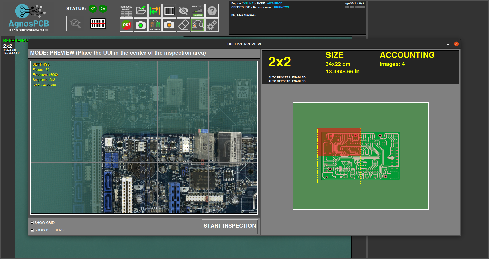{.center}

Esta función abre una ventana con una vista previa en vivo del área de inspección. Una vez que la PCBA esté colocada correctamente, presione el botón **Iniciar inspección** para tomar una foto o fotos de la PCBA/Panel de la **Unidad Bajo Inspección**. Si el [botón de proceso automático](./Workspace_icons.md#proceso-automatico) está activo, la inspección comenzará automáticamente una vez que se tome la imagen UUI. Esta función también se puede activar presionando la tecla **s** en el teclado o el botón de acción físico ubicado en el lado derecho de la AOI. Consulte la [siguiente sección](./Inspection_workflow.md#capturando-una-uui) para obtener más información sobre esta característica.

### Borrador

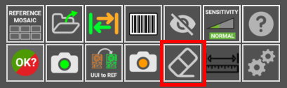{.center}

Elimina un [**área de exclusión**](./Set_exclusion_area.md) dibujada.

### Herramienta de medición

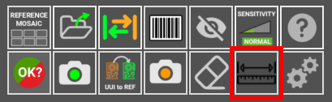{.center}

El software AgnosPCB ofrece una herramienta precisa para medir componentes utilizando las imágenes capturadas por la plataforma de inspección. Para más información sobre esta herramienta, consulte la siguiente [página de documentación](../features/Measurement_tool.md).

### Configuración

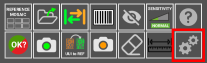{.center}

Este botón abre el [menú de configuración](./Settings_menu.md).
