# Interfaccia utente

## Aree di lavoro principali

L'immagine seguente descrive le aree di lavoro principali del **software di ispezione AgnosPCB**.

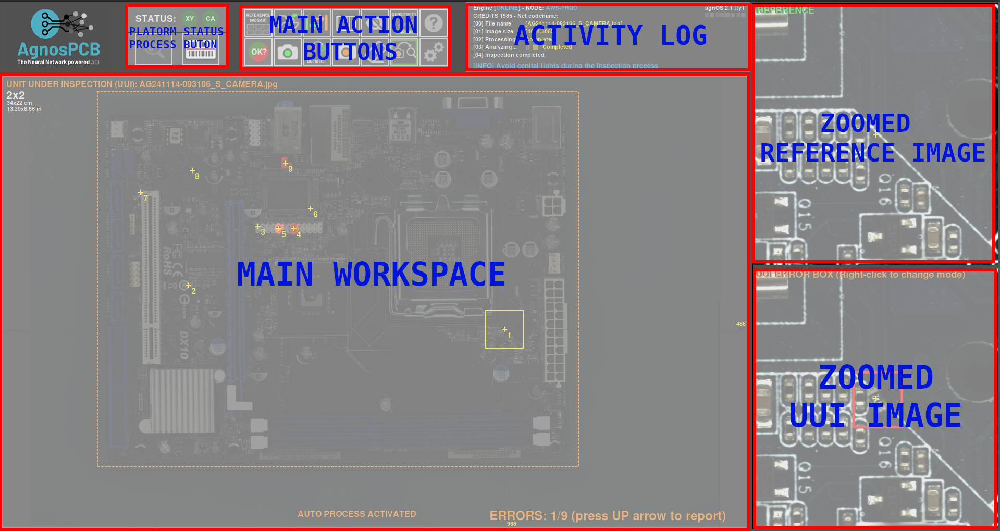{.center}

## Stato della piattaforma

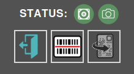{.center}

Quest'area visualizza lo stato della connessione con la piattaforma di ispezione e la telecamera. Se la connessione fallisce, le icone diventeranno rosse. Quest'area contiene anche i seguenti pulsanti di azione:

### Disconnessione

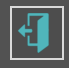{.center}

Se il [controllo di accesso utenti](../features/User_control.md) è abilitato, questo pulsante consente all'utente di disconnettersi. Chiede una conferma e poi svuota l'area di lavoro (RIFERIMENTO caricato e risultati dell'ispezione), così l'utente successivo inizia da zero.

### Caricamento RIFERIMENTO tramite codice a barre

{.center}

{.center}

Questo pulsante apre una finestra pop-up per inserire un codice e carica il RIFERIMENTO che lo ha come **Model ID** (il codice del modello di scheda, identico su ogni scheda). È anche possibile leggere il codice con un lettore portatile e inserirlo in questo campo. Se più RIFERIMENTI hanno quel codice, un breve elenco consente di scegliere quale caricare. Maggiori informazioni su questa funzionalità [qui](../features/Barcode_reader.md#caricare-un-riferimento-tramite-codice-a-barre).

### Alterna TOP/BOTTOM

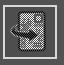{width=80 .center}

Se l'immagine di RIFERIMENTO contiene sia il lato superiore sia quello inferiore della PCBA, alterna tra le due immagini. Una volta ispezionati entrambi i lati di una scheda, passa invece tra i **risultati** dei due lati. I tasti **Page Up** (TOP) e **Page Down** (BOTTOM) fanno lo stesso. Consultate [Ispezionare entrambi i lati di una scheda](Inspection_workflow.md#ispezionare-entrambi-i-lati-di-una-scheda).

Questo può avvenire anche automaticamente all'inizio di ogni ispezione: abilitate **Cambio automatico TOP/BOTTOM** nel [menu Impostazioni](Settings_menu.md#cambio-automatico-topbottom).

### Strumento di misurazione

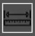{width=80 .center}

Questo pulsante consente di selezionare una regione all'interno del PCB per misurare un'area di interesse. Trovate maggiori informazioni su questa funzione [qui](../features/Measurement_tool.md).

## Registro attività

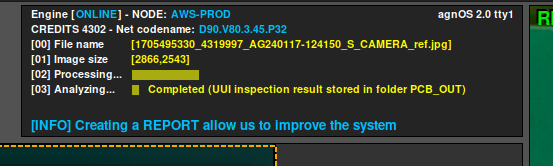{.center}

L'area del **registro attività** si trova in alto a destra e mostra i **crediti attualmente disponibili** e i dettagli operativi dell'applicazione, come lo stato del processo di analisi. Quando il [controllo di accesso utenti](../features/User_control.md) è abilitato, mostra anche l'utente connesso.

## Area di lavoro principale

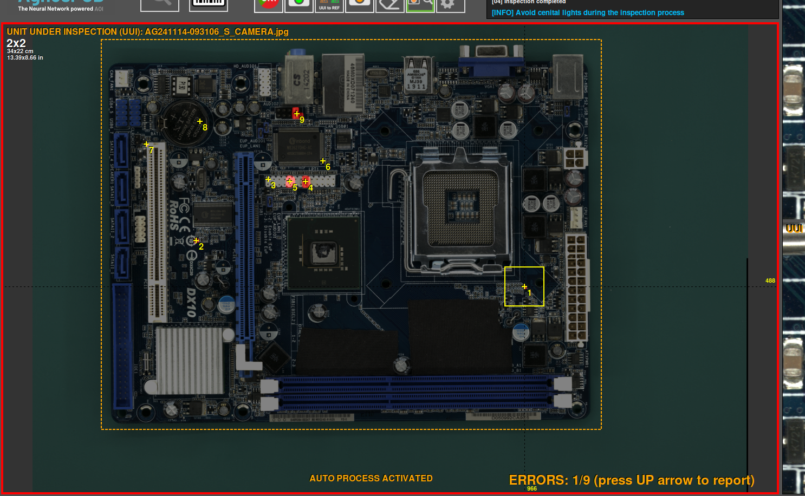{.center}

Questa è la sezione principale in cui si lavora con le immagini di **RIFERIMENTO** e **UUI**, che possono essere scambiate premendo il tasto TAB sulla tastiera o [il pulsante sull'applicazione](#scambia). I risultati dell'ispezione vengono visualizzati anche in quest'area utilizzando reticoli e numeri accanto agli errori rilevati.

## Confronto affiancato

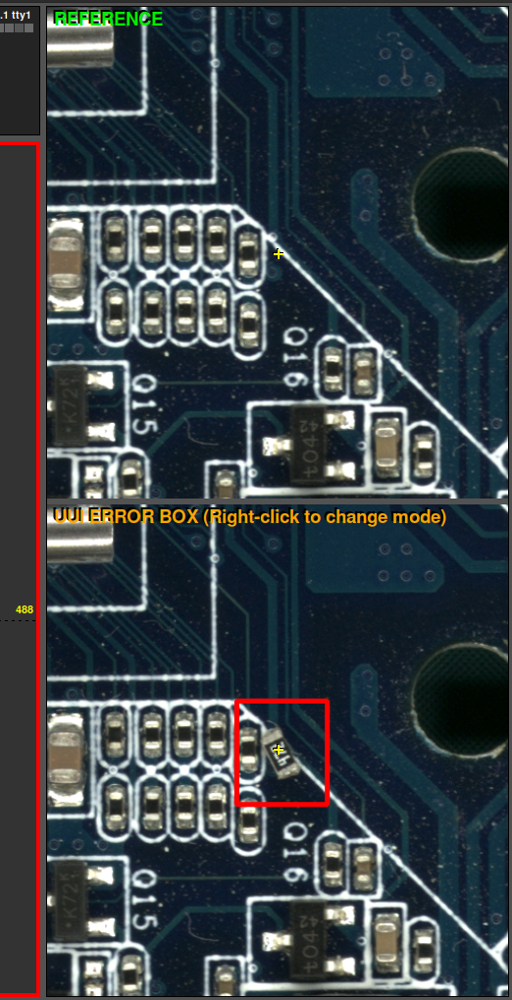{width=400px .center}

Questa sezione dell'interfaccia è divisa in due parti. La parte superiore visualizza l'immagine di **RIFERIMENTO**, che funge da standard per il confronto, mentre la parte inferiore mostra l'immagine **UUI**. Queste immagini sono ingrandite e si muovono in parallelo mostrando esattamente la stessa area nel **RIFERIMENTO** e nell'**UUI** dove punta il cursore nell'area di lavoro principale.

### Elenco delle rilevazioni

Dopo un'ispezione, spostando il mouse in quest'area viene mostrato l'**elenco delle rilevazioni**: una riga per ogni rilevazione, con il suo numero, il suo tipo e una striscia colorata che ne indica lo stato (non esaminata, errore o falso positivo).

| Azione | Effetto |
| --- | --- |
| Passare sopra una riga | Evidenzia la rilevazione sull'immagine e mostra accanto due miniature fluttuanti: il RIFERIMENTO sopra e l'UUI sotto. Dopo un momento si ingrandiscono. Una volta ingrandite, tenendo il puntatore sulla riga per circa un secondo la rilevazione viene contrassegnata come **seen**. |
| Clic su una riga | Si sposta su quella rilevazione nell'immagine. |
| Doppio clic su una riga | Si sposta su quella rilevazione e apre la finestra di segnalazione. |
| **Croce rossa** / **spunta verde** alla fine di una riga | Segnala la rilevazione come errore reale / falso positivo, come i tasti freccia **su** / **giù**. Su una rilevazione già segnalata, il pulsante del suo verdetto appare evidenziato da un contorno. |
| Rotellina del mouse | Mentre sono mostrate le miniature, ne cambia lo zoom. Altrimenti, scorre l'elenco. |
| **Shift** + rotellina del mouse | Scorre l'elenco, anche mentre sono mostrate le miniature. |
| Clic centrale | Alterna la vista della miniatura inferiore: UUI, maschera dell'errore, riquadro dell'errore. |
| Puntatore sul bordo superiore o inferiore dell'elenco | Quando l'elenco è più lungo del pannello, scorre da solo; più si è vicini al bordo, più è veloce. Una freccia tenue indica il bordo verso cui può ancora scorrere. |

Con la [Preferenza di analisi](Settings_menu.md#preferenza-di-analisi) impostata su **LIST**, i tasti freccia agiscono su questo elenco. Consultate [Segnalazione degli errori](Inspection_workflow.md#segnalazione-degli-errori).

### Pannello informazioni del Riferimento

A seconda della modalità di visualizzazione selezionata con il tasto **TAB**, passando sopra l'immagine di RIFERIMENTO in quest'area viene mostrato il **pannello informazioni del Riferimento**: nome, data, codici, ottica e sequenza del RIFERIMENTO caricato, e se i suoi [livelli di revisione obbligatoria](Inspection_workflow.md#livelli-di-revisione-obbligatoria) sono abilitati.

Quando l'opzione [Mostra statistiche e mappa di calore degli errori per Riferimento](Settings_menu.md#mostra-statistiche-e-mappa-di-calore-degli-errori-per-riferimento) è abilitata, il pannello mostra anche:

- **Statistiche di ispezione**: ispezioni totali, OK e NON OK, resa, errori confermati, falsi positivi, rilevazioni ancora non esaminate, i tipi di errore più frequenti e altro.
- **Mappa di calore degli errori**: l'area della scheda del RIFERIMENTO con una sovrapposizione termica che mostra dove le sue schede presentano difetti. Vengono conteggiati solo gli errori confermati dall'operatore; i falsi positivi e le rilevazioni non esaminate non compaiono mai. Gli errori vengono posizionati sul RIFERIMENTO utilizzando l'allineamento di ciascuna ispezione, così una scheda leggermente spostata ricade comunque nel punto giusto.

Un'ispezione viene conteggiata una sola volta, quando viene salvato il suo report. Salvare di nuovo il report della stessa ispezione sostituisce la voce precedente invece di aggiungerne una nuova.

Facendo clic destro sulla parte superiore del pannello si aprono le [Opzioni del Riferimento](#opzioni-del-riferimento) del RIFERIMENTO caricato.

## Pannello pulsanti

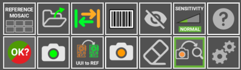{.center}

Qui si trovano diverse **funzioni e opzioni** progettate per **ottimizzare** il flusso di lavoro e velocizzare le attività. Ogni funzionalità è definita di seguito:

### Mosaico di riferimenti

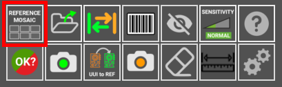{width=350px .center}

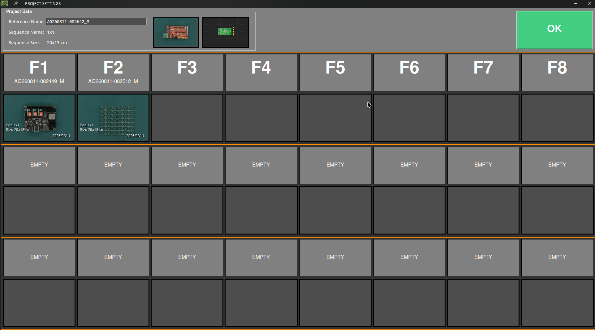{width=600px .center}

Il mosaico di riferimenti viene utilizzato per archiviare i RIFERIMENTI come file per trovarli e caricarli rapidamente. Il menu mosaico appare automaticamente dopo aver acquisito un RIFERIMENTO utilizzando il [pulsante scatta foto RIFERIMENTO](#scatta-unimmagine-di-riferimento) o caricandolo [come file](#carica-riferimento-come-file). In questa finestra è anche possibile nominare il RIFERIMENTO acquisito nella parte in alto a destra della finestra. Un RIFERIMENTO memorizzato nel mosaico può essere caricato rapidamente premendo un **pulsante F** (F1-F8). Facendo clic destro su uno slot si aprono le [Opzioni del Riferimento](#opzioni-del-riferimento) di quel RIFERIMENTO.

### CARICA RIFERIMENTO come file

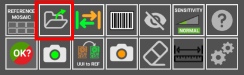{width=350px .center}

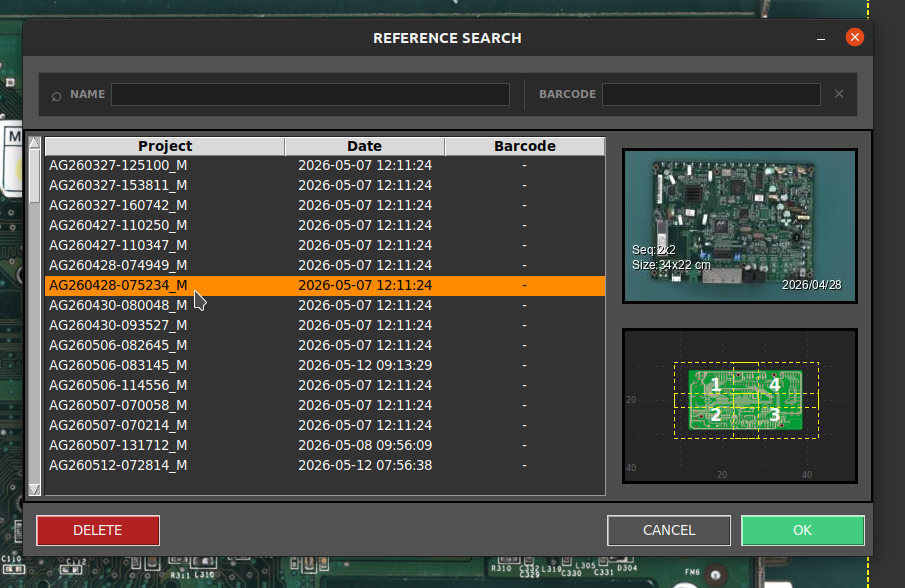{.center}

Utilizzare questa icona per caricare un'immagine precedentemente catturata come **RIFERIMENTO** e consente di ordinarle per nome o data, oppure di filtrarle per nome, alias o **Model ID**. Tutte le immagini di **RIFERIMENTO** si trovano all'interno della cartella **APP/REFERENCE** in una cartella denominata in base all'ora in cui è stata scattata la foto.

Un RIFERIMENTO a doppia faccia compare una sola volta, tramite il suo lato TOP, con un segno nella colonna **Sides**; al suo lato BOTTOM si accede con il [pulsante TOP/BOTTOM](#alterna-topbottom) una volta caricato. I RIFERIMENTI che non hanno un [Model ID](../features/Barcode_reader.md#caricare-un-riferimento-tramite-codice-a-barre) mostrano, attenuato, il codice con cui erano indicizzati in precedenza.

!!! note "Nota"
    Dalla versione 7, il software **non consente** di caricare immagini acquisite da fonti diverse dalla piattaforma stessa poiché le immagini contengono parametri specifici per l'ottica. Ogni immagine di RIFERIMENTO deve essere acquisita utilizzando l'**AI-4050 AOI**.

#### Opzioni del Riferimento

La finestra **Reference options** contiene le impostazioni di ciascun RIFERIMENTO: il suo alias di visualizzazione e i suoi livelli di revisione obbligatoria. Si apre in uno di questi modi:

- Selezionate un RIFERIMENTO in questo elenco e premete **OPTIONS**.
- Fate clic destro su uno slot del [Mosaico di riferimenti](#mosaico-di-riferimenti).
- Fate clic destro sulla parte superiore del [pannello informazioni del Riferimento](#pannello-informazioni-del-riferimento).

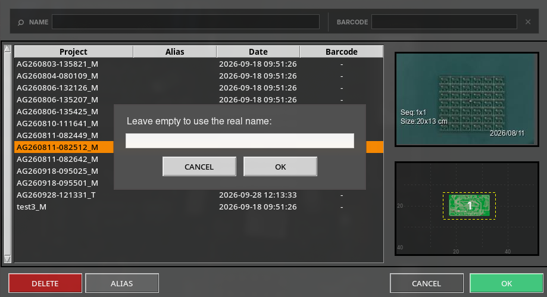{.center}

**Alias di visualizzazione**

A un RIFERIMENTO può essere assegnato un **alias di visualizzazione** opzionale: un nome più amichevole mostrato nella colonna **Alias** di questo elenco al posto del nome reale del RIFERIMENTO, senza rinominarlo. È utile quando il nome reale del RIFERIMENTO — un codice a barre, una marca temporale — non è immediatamente comprensibile. L'alias viene usato anche nel mosaico e nei report di ispezione (PDF e JSON), dove viene mostrato accanto al nome reale.

Lasciando il campo vuoto l'alias viene rimosso e l'elenco torna a mostrare il nome reale del RIFERIMENTO.

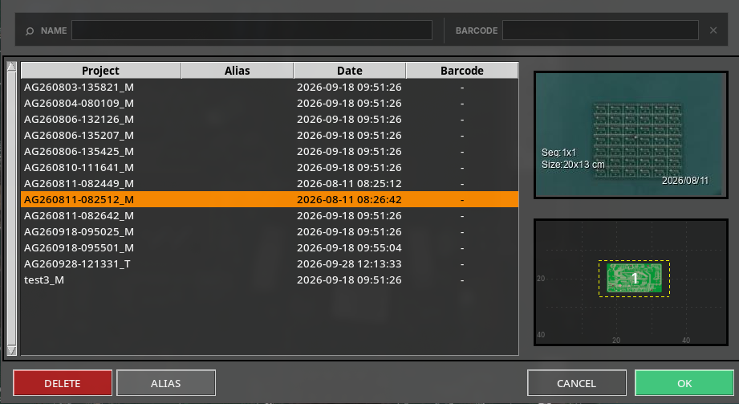{.center}

!!! note "Nota"
    L'alias è solo un'etichetta. Tutto ciò che identifica o carica il RIFERIMENTO — il suo nome file, il suo Model ID — continua a usare il suo nome reale.

**Livelli di revisione obbligatoria**

Tre caselle di controllo — **Mandatory errors review**, **Mandatory errors report** e **Mandatory final report** — rendono obbligatorio quel livello per chiunque ispezioni con questo RIFERIMENTO, qualunque sia il suo ruolo o quanto indicato dalle impostazioni globali. Consultate [Livelli di revisione obbligatoria](Inspection_workflow.md#livelli-di-revisione-obbligatoria).

Su un RIFERIMENTO a doppia faccia, le impostazioni vengono salvate su entrambi i lati. Un RIFERIMENTO creato con [Da UUI a RIFERIMENTO](UUI_to_REFERENCE.md) le eredita dal RIFERIMENTO da cui proviene; uno acquisito da zero parte con tutte disabilitate.

!!! note "Permessi"
    Con il [controllo di accesso utenti](../features/User_control.md) abilitato, l'alias richiede il permesso **Set Reference display alias** e i livelli obbligatori richiedono il permesso **Edit Reference options**.

### Scambia

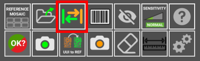{width=350px .center}

Alterna tra le immagini di **RIFERIMENTO** e **UUI** nell'[area di lavoro principale](#area-di-lavoro-principale).

### Disegno area codice a barre

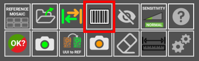{width=350px .center}

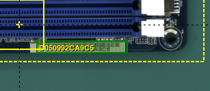{.center}

Fare clic su questo pulsante per disegnare manualmente un rettangolo nell'immagine di **RIFERIMENTO** dove è presente un codice a barre. Il software lo leggerà e utilizzerà quel codice per nominare le immagini e includerlo nel **report PDF** finale. Maggiori informazioni sulla funzione di lettura del codice a barre nella [sezione seguente](../features/Barcode_reader.md).

### Esclusione

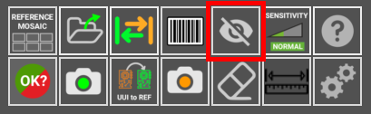{width=350px .center}

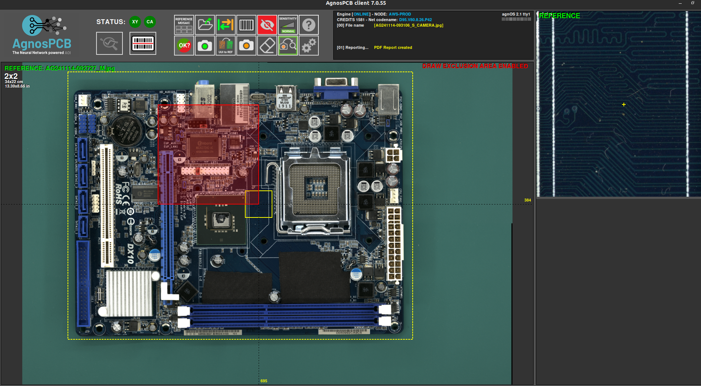{.center}

Crea un'area di esclusione dove il sistema non cercherà difetti. È possibile creare tutte le aree necessarie. Questa funzione è dettagliata nella [sezione seguente](Set_exclusion_area.md).

### Sensibilità

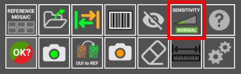{width=350px .center}

Se il processo di produzione richiede un controllo qualità più rigoroso, è possibile aumentare la sensibilità di rilevamento degli errori con questa funzionalità. Aumentando la sensibilità, il software segnalerà errori che normalmente non segnalerebbe con un'impostazione di sensibilità inferiore. Ci sono tre livelli di sensibilità: Normale, Alta e Molto Alta. Può essere impostata utilizzando i tasti 1, 2, 3 della tastiera. Questa funzione è dettagliata nella [sezione seguente](./Set_sensitivity.md).

### Aiuto

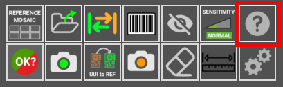{width=350px .center}

Questo pulsante ti indirizzerà a questa documentazione.

### Risultato finale

{.center}

{.center}

Una volta che gli errori rilevati sono stati supervisionati dall'operatore, l'ispezione può essere completata premendo questo pulsante e, a seconda dei criteri di produzione, contrassegnare la PCBA ispezionata come **OK** o **NON OK**. Dopodiché, il software creerà un report che include gli errori segnalati dall'operatore su un documento PDF. Per saperne di più su questa funzionalità, consultare la [sezione seguente](./Inspection_workflow.md#generazione-di-un-report-pdf-finale).

### Scatta un'immagine di RIFERIMENTO

{.center}

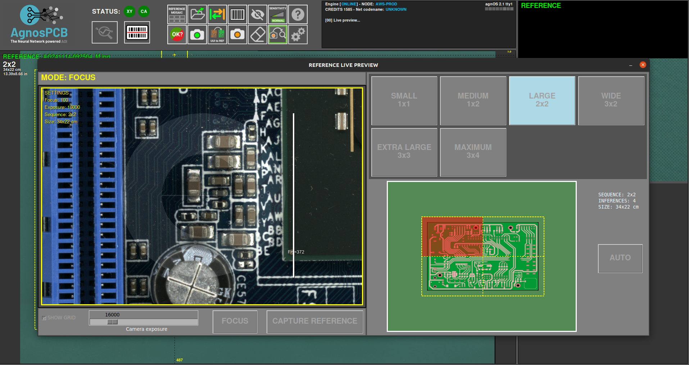{.center}

Questo pulsante apre una finestra con le utilità per generare un'immagine di **RIFERIMENTO** da una PCB o pannello. Questa funzione può essere attivata premendo il tasto **r** sulla tastiera. Nella sezione [generare un riferimento](./Inspection_workflow.md#generazione-di-un-riferimento) imparerai di più su questa funzione.

### UUI a RIFERIMENTO

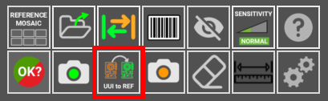{.center}

Questa funzione trasforma l'immagine **UUI** corrente in un **RIFERIMENTO**. Ciò è utile quando alcuni dei componenti della PCBA sono stati cambiati con un equivalente e la **Rete Neurale** lo rileva come un errore a causa di una differenza visiva, ma la PCBA è corretta. Per saperne di più su questa funzionalità, consultare la [sezione seguente](UUI_to_REFERENCE.md).

### Scatta un'immagine UUI

{.center}

{.center}

Questa funzione apre una finestra con un'anteprima in tempo reale dell'area di ispezione. Una volta che la PCBA è posizionata correttamente, premere il pulsante **Avvia ispezione** per scattare una foto o più foto della PCBA/Pannello dell'**Unità Sotto Ispezione**. Se il [pulsante processo automatico](./Workspace_icons.md#processo-automatico) è attivo, l'ispezione inizierà automaticamente non appena viene acquisita l'immagine UUI. Questa funzione può anche essere attivata premendo il tasto **s** sulla tastiera o il pulsante di azione fisico situato sul lato destro dell'AOI. Consultare la [sezione seguente](./Inspection_workflow.md#acquisizione-di-una-uui) per saperne di più su questa funzionalità.

### Gomma

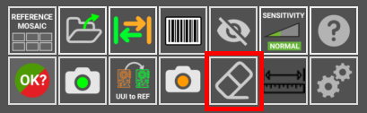{.center}

Elimina un'[**area di esclusione**](./Set_exclusion_area.md) disegnata.

### Strumento di misurazione

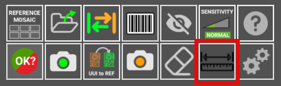{.center}

Il software AgnosPCB offre uno strumento preciso per misurare i componenti utilizzando le immagini acquisite dalla piattaforma di ispezione. Per maggiori informazioni su questo strumento, consultate la seguente [pagina di documentazione](../features/Measurement_tool.md).

### Impostazioni

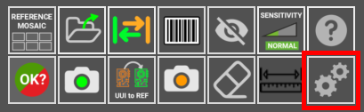{.center}

Questo pulsante apre il [menu impostazioni](./Settings_menu.md).
