# User interface

## Main working areas

The following image describes the main working areas of the **AgnosPCB inspection software**.

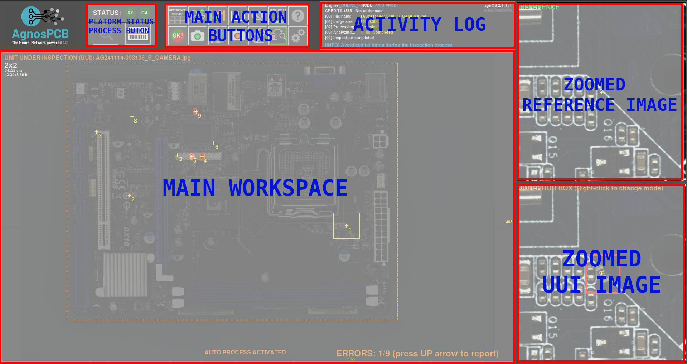{.center}

## Platform status

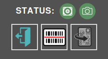{.center}

This area displays the connection status with the inspection platform and camera. If the connection fails, the icons will turn red. This area also contains the following action buttons:

### Logout

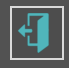{.center}

If [user access control](../features/User_control.md) is enabled, this button allows the user to logout. It asks for confirmation and then clears the workspace (loaded REFERENCE and inspection results), so the next user starts fresh.

### Loading REFERENCE by barcode

{.center}

{.center}

This button opens a pop-up window for inserting a code, and loads the REFERENCE that has it as its **Model ID** (the code of the board model, which is the same on every board). It is also possible to read the code with a handheld reader and insert it into this field. If several REFERENCES have that code, a short list lets you choose which one to load. More information about this feature [here](../features/Barcode_reader.md#load-a-reference-by-barcode).

### Switch TOP/BOTTOM

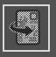{width=80 .center}

If the REFERENCE image contains both the top and bottom images of the PCBA, alternate between the two images. Once both sides of a board have been inspected, it switches between the **results** of the two sides instead. The **Page Up** (TOP) and **Page Down** (BOTTOM) keys do the same. See [Inspecting both sides of a board](Inspection_workflow.md#inspecting-both-sides-of-a-board).

This can also happen automatically at the start of each inspection — enable **TOP/BOTTOM auto switch** in the [settings menu](Settings_menu.md#topbottom-auto-switch).

### Measurement tool

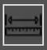{width=80 .center}

This button allows you to select a region within the PCB to measure an area of interest. More information about this feature can be found [here](../features/Measurement_tool.md).

## Activity log

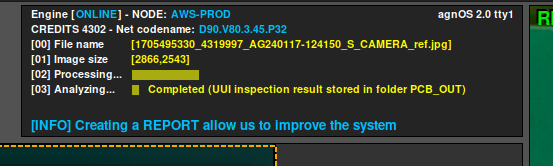{.center}

The **activity log** area is located in the top right side and shows the **current available credits** and the application's operational details such as the status of the analysis process. When [user access control](../features/User_control.md) is enabled, it also shows the logged-in user.

## Main workspace

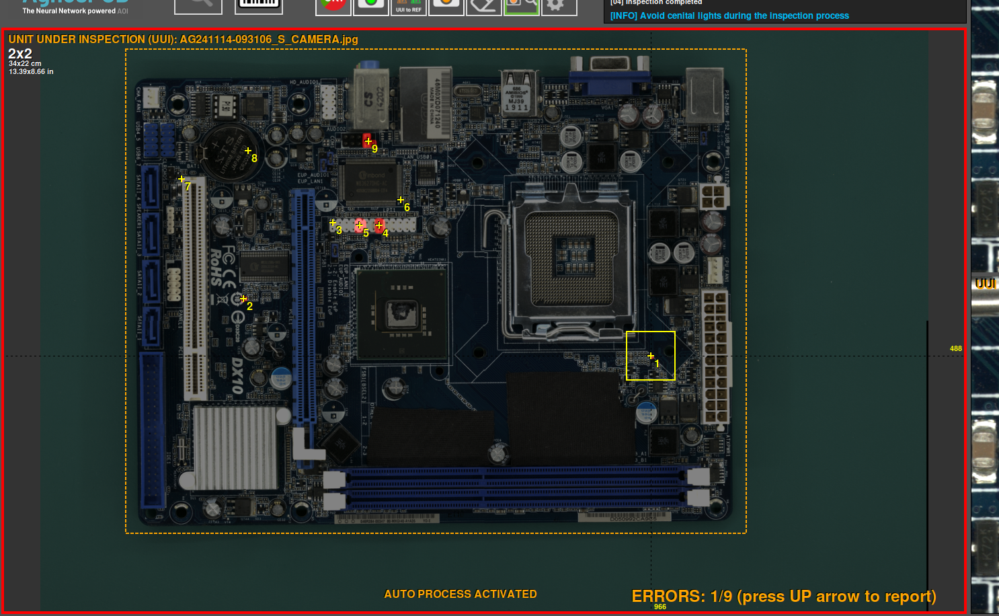{.center}

This is the main section where you work with the **REFERENCE** and the **UUI** images, which can be switched by pressing the TAB key on the keyboard or [the button on the application](#swap). The inspection results are also displayed in this area using crosshairs and numbers next to the detected errors.

## Side-by-side comparison

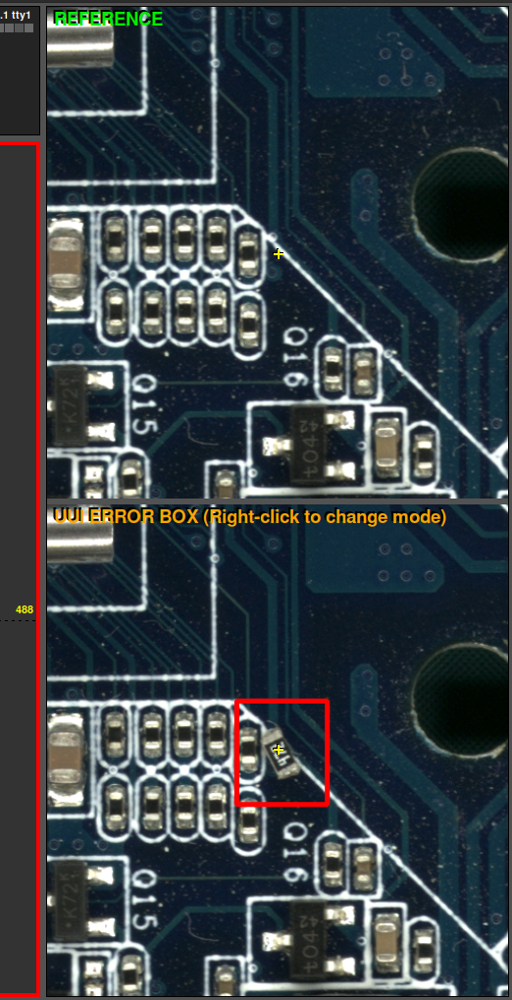{width=400px .center}

This interface section is divided into two parts. The top part displays the **REFERENCE** image, serving as a standard for comparison, while the bottom part shows the **UUI** image. These images are magnified and move in parallel, showing exactly the same area in the **REFERENCE** and **UUI** where the cursor is pointing in the main workspace.

### Detections list

After an inspection, moving the mouse into this area shows the **detections list**: one row per detection, with its number, its type and a colored strip showing its state (unreviewed, error or false positive).

| Action | Effect |
| --- | --- |
| Hover a row | Highlights the detection on the image and shows two floating thumbnails next to it: the REFERENCE above and the UUI below. They grow to a larger size after a moment. Once they have, keeping the pointer on the row for about one second marks the detection as **seen**. |
| Click a row | Moves to that detection on the image. |
| Double-click a row | Moves to that detection and opens the reporting window. |
| **Red cross** / **green tick** at the end of a row | Reports the detection as an actual error / a false positive, the same as the **up** / **down** arrow keys. On a detection already reported, the button of its verdict is outlined. |
| Mouse wheel | While the thumbnails are shown, changes their zoom. Otherwise, scrolls the list. |
| **Shift** + mouse wheel | Scrolls the list, also while the thumbnails are shown. |
| Middle click | Cycles the view of the lower thumbnail: UUI, error mask, error box. |
| Pointer at the top or bottom edge of the list | When the list is longer than the panel, it scrolls by itself; the closer to the edge, the faster. A faint arrow marks the edge where it can still move. |

With [Analysis preference](Settings_menu.md#analysis-preference) set to **LIST**, the arrow keys work on this list. See [Reporting errors](Inspection_workflow.md#reporting-errors).

### Reference information panel

Depending on the view mode selected with the **TAB** key, hovering the REFERENCE image shows the **Reference information panel** in this area: name, date, codes, optics and sequence of the loaded REFERENCE, and whether its [mandatory review levels](Inspection_workflow.md#mandatory-review-levels) are enabled.

When [Show statistics and error heatmap per Reference](Settings_menu.md#show-statistics-and-error-heatmap-per-reference) is enabled, the panel also shows:

- **Inspection statistics**: total inspections, OK and NOT OK, yield, errors confirmed, false positives, detections still unreviewed, the most frequent error types and more.
- **Error heatmap**: the board area of the REFERENCE with a heat overlay showing where its boards fail. Only errors confirmed by the operator are counted; false positives and unreviewed detections never appear. Errors are placed on the REFERENCE using the alignment of each inspection, so a slightly shifted board still lands on the right spot.

An inspection is counted once, when its report is saved. Saving the report of the same inspection again replaces its previous entry instead of adding a new one.

Right-clicking the upper part of the panel opens the [Reference options](#reference-options) of the loaded REFERENCE.

## Buttons panel

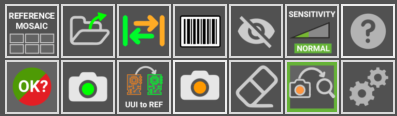{.center}

Here you will find various **functions and options** designed to **optimize** your workflow and speed up your tasks. Each feature is defined below:

### Reference mosaic

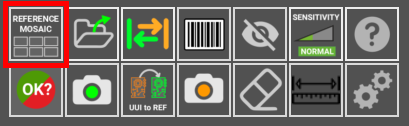{width=350px .center}

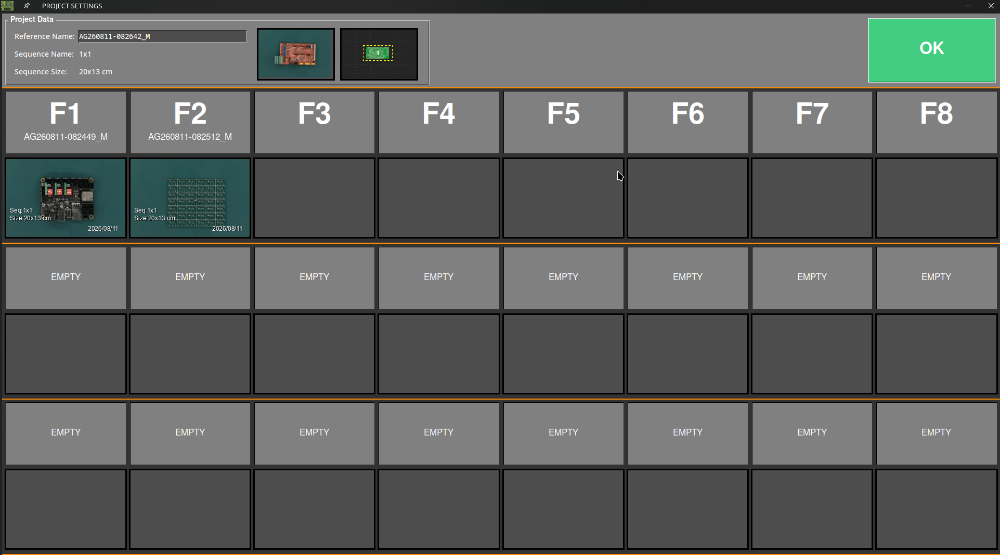{width=600px .center}

The reference mosaic is used to store REFERENCES as files to quickly find and load any of them. The mosaic menu automatically appears after taking a REFERENCE by using the [take REFERENCE photo button](#take-a-reference-image) or by loading it [as a file](#load-reference-as-file). In this window it is also possible to name the taken REFERENCE in the top right part of the window. A REFERENCE stored in the mosaic can be quickly loaded by pressing an **F button** (F1-F8). Right-clicking a slot opens the [Reference options](#reference-options) of that REFERENCE.

### LOAD REFERENCE as file

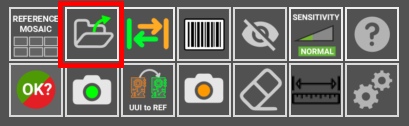{width=350px .center}

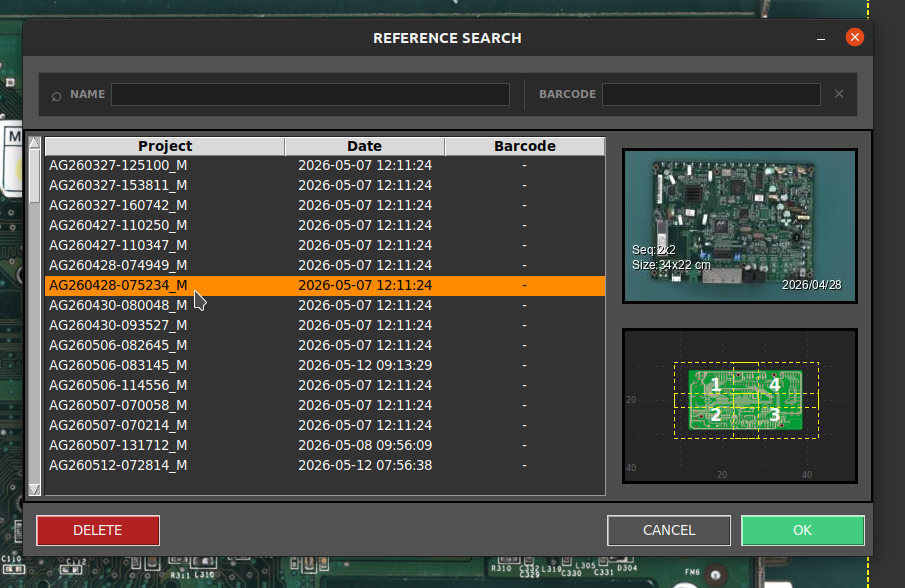{.center}

Use this icon to load an image previously captured as a **REFERENCE** and it allows you to sort them by name or date, or to filter them by name, alias or **Model ID**. All the **REFERENCE** images can be found inside the folder **APP/REFERENCE** in a folder named after the time the picture was taken.

A double-sided REFERENCE is listed only once, by its TOP side, with a mark in the **Sides** column; its BOTTOM side is reached with the [TOP/BOTTOM button](#switch-topbottom) once it is loaded. REFERENCES that have no [Model ID](../features/Barcode_reader.md#load-a-reference-by-barcode) show the code they were indexed with before, dimmed.

!!! note "Note"
    Since version 7, the software **does not allow** loading images taken from any source other than the platform itself, as the images contain specific parameters for the optics. Every REFERENCE image has to be captured using the **AI-4050 AOI**.

#### Reference options

The **Reference options** window holds the settings of each REFERENCE: its display alias and its mandatory review levels. Open it in any of these ways:

- Select a REFERENCE in this list and press **OPTIONS**.
- Right-click a slot of the [Reference mosaic](#reference-mosaic).
- Right-click the upper part of the [Reference information panel](#reference-information-panel).

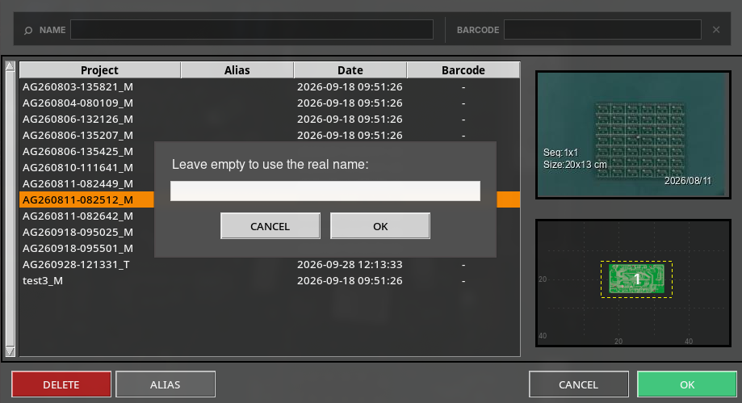{.center}

**Display alias**

A REFERENCE can be given an optional **display alias**: a friendlier name shown in the **Alias** column of this list, instead of the REFERENCE's real name, without renaming the REFERENCE itself. This is useful when the REFERENCE's real name — a barcode, a timestamp — is not meaningful to read at a glance. The alias is also used in the mosaic and in the inspection reports (PDF and JSON), where it is shown next to the real name.

Leaving the field empty clears the alias, so the list goes back to showing the REFERENCE's real name.

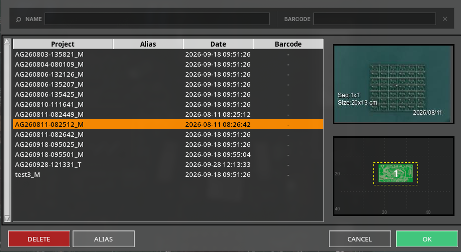{.center}

!!! note "Note"
    The alias is only a label. Everything that identifies or loads the REFERENCE — its file name, its Model ID — keeps using its real name.

**Mandatory review levels**

Three checkboxes — **Mandatory errors review**, **Mandatory errors report** and **Mandatory final report** — make that level required for whoever inspects with this REFERENCE, whatever their role or the global settings say. See [Mandatory review levels](Inspection_workflow.md#mandatory-review-levels).

On a double-sided REFERENCE, the settings are saved on both sides. A REFERENCE created with [UUI to REFERENCE](UUI_to_REFERENCE.md) inherits them from the REFERENCE it came from; a newly captured one starts with all of them disabled.

!!! note "Permissions"
    With [user access control](../features/User_control.md) enabled, the alias requires the **Set Reference display alias** permission and the mandatory levels require the **Edit Reference options** permission.

### Swap

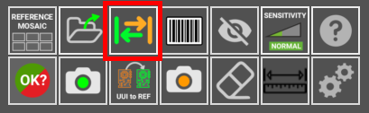{width=350px .center}

It toggles between **REFERENCE** and **UUI** images in the [main workspace area](#main-workspace).

### Barcode area drawing

{width=350px .center}

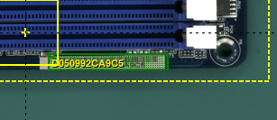{.center}

Click this button to manually draw a rectangle in the **REFERENCE** image where there is a barcode. The software will read it and use that code to name the images and include it in the final **PDF report**. More information about the barcode reading function in the [following section](../features/Barcode_reader.md).

### Exclusion

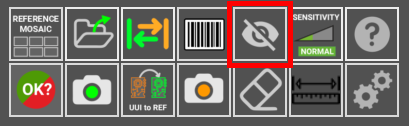{width=350px .center}

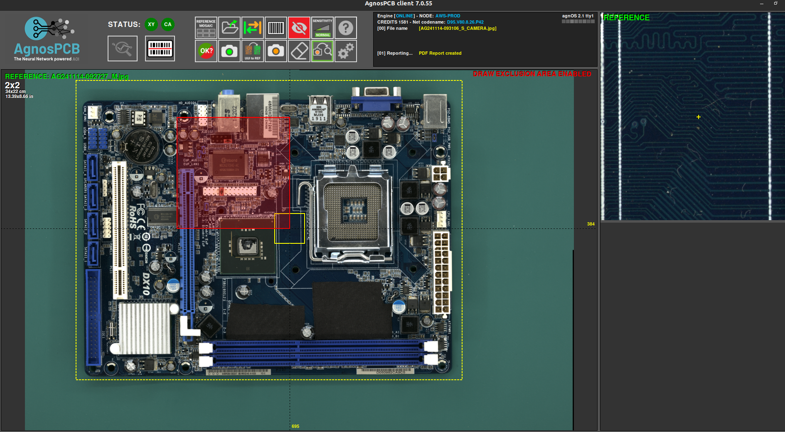{.center}

Creates an exclusion area where the system will not look for faults. You can create as many areas as required. This function is detailed in the [following section](Set_exclusion_area.md).

### Sensitivity

{width=350px .center}

If the manufacturing process requires more rigorous quality control, you can increase the error detection sensitivity with this feature. By increasing the sensitivity, the software will flag errors that it normally wouldn't with a lower sensitivity setting. There are three levels of sensitivity: Normal, High and Very High. It can be set using the 1, 2, 3 keys of the keyboard. This function is detailed in the [following section](./Set_sensitivity.md).

### Help

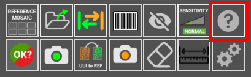{width=350px .center}

This button will take you to this documentation.

### Final result

{.center}

{.center}

Once the detected errors have been supervised by the operator, the inspection can be completed by pressing this button and, depending on the manufacturing criteria, mark the inspected PCBA as **OK** or **NOT OK**. After that, the software will create a report that includes the errors reported by the operator in a PDF document. To learn more about this feature go to the [following section](./Inspection_workflow.md#generating-a-final-pdf-report).

### Take a REFERENCE image

{.center}

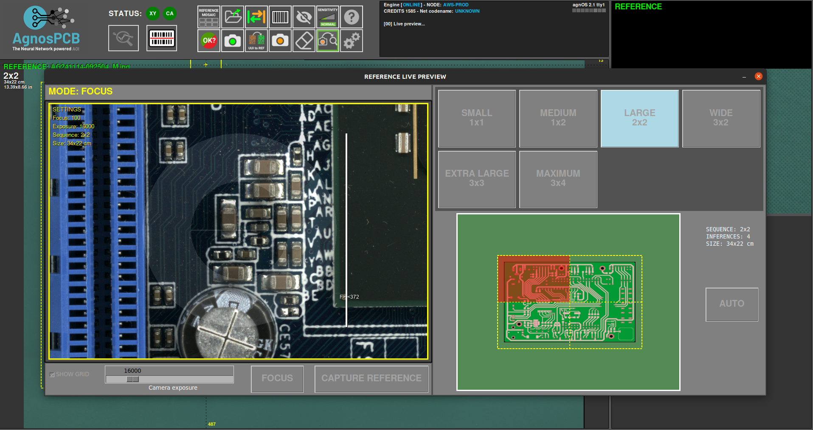{.center}

This button opens a window with the tools to generate a **REFERENCE** image from a PCB or panel. This function can be activated by pressing the **r** key on the keyboard. In the [generate a reference](./Inspection_workflow.md#generating-a-reference) section, you will learn more about this function.

### UUI to REFERENCE

{.center}

This function turns the current **UUI** image into a **REFERENCE**. This is useful when one of the components of the PCBA has been changed for an equivalent part and the **Neural Network** detects it as an error due to a visual difference, even though the PCBA itself is correct. To learn more about this feature go to the [following section](UUI_to_REFERENCE.md).

### Take an UUI image

{.center}

{.center}

This function opens a window with a live preview of the inspection area. Once the PCBA is placed correctly, press the **Start inspection** button to take a photo or photos of the **Unit Under Inspection** PCBA/Panel. If the [auto process](./Workspace_icons.md#auto-process) button is active, the inspection will start automatically once the UUI image is taken. This feature can also be activated by pressing the **s** key on the keyboard or the physical action button located on the right side of the AOI. See the [following section](./Inspection_workflow.md#capturing-an-uui) to learn more about this feature.

### Eraser

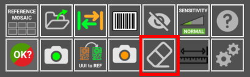{.center}

Deletes a drawn [**exclusion area**](./Set_exclusion_area.md).

### Measurement tool

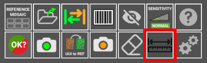{.center}

The AgnosPCB Inspection Tool software provides a precise tool for measuring components using images captured by the inspection platform. For more information about this tool, please refer to the following [documentation page](../features/Measurement_tool.md).

### Settings

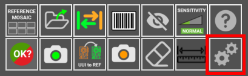{.center}

This button opens the [settings menu](./Settings_menu.md).
