# Menu des paramètres

Le **menu des paramètres** est divisé en plusieurs sections, décrites ci-dessous.

## Paramètres généraux

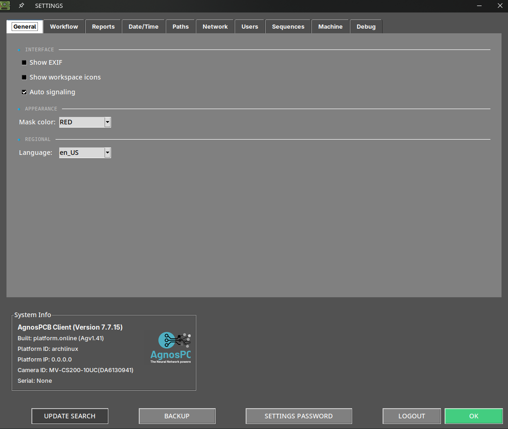{.center}

#### Afficher exif

Affiche les métadonnées de l'image actuelle dans la [zone de travail principale](./Screen-layout.md#espace-de-travail-principal).

#### Afficher les icônes de l'espace de travail

Active un ensemble de fonctionnalités dans la [zone de travail principale](./Screen-layout.md#espace-de-travail-principal). Pour en savoir plus sur ces fonctions, consultez la [section suivante](./Workspace_icons.md).

#### Signalisation automatique

Par défaut, le logiciel numérote chaque erreur après l'inspection. Lorsque cette option est désactivée, seule la zone concernée est mise en évidence en couleur, sans numéro.

#### Couleur du masque

Cette option vous permet de changer la couleur de l'erreur marquée. Lorsque la couleur de l'erreur marquée correspond à celle de la PCBA, il est conseillé de choisir une couleur plus contrastée afin de rendre les zones marquées plus visibles.

#### Afficher les statistiques et la carte thermique des erreurs par référence

Ajoute au [panneau d'informations de la référence](Screen-layout.md#panneau-dinformations-de-la-reference) les statistiques d'inspection de la RÉFÉRENCE chargée et une carte thermique des endroits où ses cartes présentent des défauts. Désactivée par défaut.

Les statistiques sont collectées même lorsque cette option est désactivée, de sorte que l'historique est déjà disponible lorsque vous l'activez. Les inspections réalisées avant la version 7.10 ne sont pas incluses.

#### Langue

Change la langue de l'interface. Les langues actuellement disponibles sont : **anglais, français, allemand, italien et espagnol**.

## Options de flux de travail

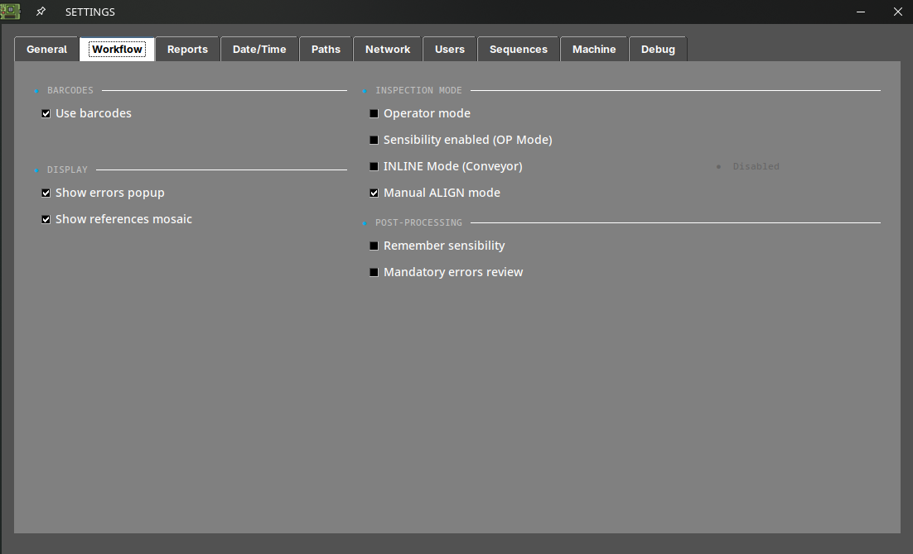{.center}

#### Utiliser les codes-barres

Active ou désactive la [fonction de lecture de code-barres](../features/Barcode_reader.md).

#### Afficher la fenêtre d'erreurs

En désactivant cette option, la fenêtre de rapport n'apparaîtra plus lors du signalement d'une erreur avec les flèches **HAUT** ou **BAS**. Les erreurs signalées seront générées avec l'étiquette "**other**" dans le rapport PDF final.

#### Afficher la mosaïque de références

En désactivant cette option, le menu mosaïque n'apparaîtra plus après la prise d'une image de **RÉFÉRENCE**.

#### Mode opérateur

L'activation de cette option masquera plusieurs fonctionnalités de l'interface, simplifiant l'utilisation du logiciel. Elle empêche également l'opérateur de modifier l'image de RÉFÉRENCE ou la sensibilité des inspections. Un [mot de passe](#mot-de-passe-des-parametres) peut être ajouté afin que seul l'administrateur puisse désactiver cette option.

#### Sensibilité activée

Permet de modifier la sensibilité lorsque le logiciel est en mode opérateur.

#### Mode INLINE

Sélectionnez ce mode lorsque l'AOI est installée sur un convoyeur. Pour en savoir plus sur cette fonctionnalité, consultez la section suivante : [Intégration en ligne de production](../maintenance/Conveyor_integration.md)

#### Mode d'alignement manuel

Activez cette option pour aligner manuellement les images de RÉFÉRENCE et d'UUI. Pour en savoir plus sur cette fonctionnalité, consultez la section suivante : [Outil d'alignement manuel](../features/Manual_alignment.md)

#### Mémoriser la sensibilité

En activant cette option, le logiciel conservera la sensibilité d'inspection configurée après avoir réalisé une nouvelle inspection.

#### Révision obligatoire des erreurs

Si cette option est activée, le logiciel ne démarrera pas de nouvelle inspection tant que toutes les détections de l'inspection en cours n'auront pas été passées en revue : [signalées](Inspection_workflow.md#signalement-des-erreurs) comme erreur ou comme faux positif, ou au moins marquées comme **vues**.

#### Signalement obligatoire des erreurs

Si cette option est activée, chaque détection doit être **classée** comme erreur ou comme faux positif avant qu'une nouvelle inspection puisse démarrer. La marquer comme vue ne suffit pas. Elle inclut la révision ci-dessus.

#### Rapport final obligatoire

Si cette option est activée, l'opérateur doit confirmer le [rapport final OK / NON OK](Inspection_workflow.md#generation-dun-rapport-pdf-final) de l'inspection avant qu'une nouvelle puisse démarrer. Un rapport généré automatiquement par le [Rapport automatique](#rapport-automatique) ne compte pas.

!!! note "Où s'appliquent ces trois options"
    Ces options s'appliquent à tous uniquement lorsque le [contrôle d'accès des utilisateurs](../features/User_control.md) est désactivé. Lorsqu'il est activé, les trois cases sont grisées et chaque **rôle** dispose de son propre réglage. Une RÉFÉRENCE peut également exiger l'une d'entre elles, quel que soit l'utilisateur qui inspecte avec elle. Consultez [Niveaux de révision obligatoire](Inspection_workflow.md#niveaux-de-revision-obligatoire) pour savoir comment elles se combinent.

#### Avertir d'une face non examinée

Avant que la carte suivante ne démarre, le logiciel vous avertit si une face de la carte en cours comporte des détections mais qu'aucune d'entre elles n'a été examinée ni signalée, et vous permet de continuer (**OK**) ou de revenir en arrière (**CANCEL**). Il s'agit d'un avertissement, pas d'un blocage. Activée par défaut. Consultez [Niveaux de révision obligatoire](Inspection_workflow.md#avertissement-de-face-non-examinee).

#### Bascule automatique TOP/BOTTOM

Pour les RÉFÉRENCES recto verso, activer cette option bascule automatiquement vers l'autre face (**TOP**/**BOTTOM**) au début de l'inspection suivante, sans nécessiter de [bascule manuelle](Screen-layout.md#basculer-topbottom).

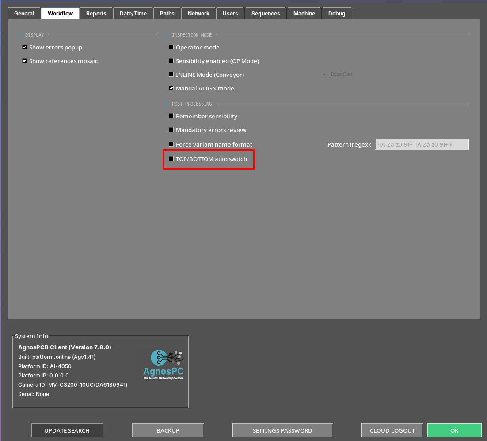{.center}

#### Préférence d'analyse

Définit l'endroit où vous examinez les détections après une inspection :

- **LIST** (par défaut sur les nouvelles installations) : le curseur se place sur la première ligne de la [liste des détections](Screen-layout.md#liste-des-detections). Les touches fléchées **gauche** et **droite** parcourent la liste et les touches fléchées **haut** et **bas** classent la ligne sous le curseur comme erreur ou comme faux positif.
- **CANVAS** : le curseur se place sur la première détection de l'image, et les touches fléchées passent d'une détection à l'autre sur l'image.

Les installations mises à jour depuis une version précédente conservent la valeur qu'elles avaient déjà.

#### Nombre max. de variantes par référence

Nombre maximal de [variantes de référence](../features/Multivariant_feature.md) utilisées pour chaque RÉFÉRENCE : 20 par défaut, jusqu'à 50. L'augmenter affiche un avertissement, car le panneau des variantes et l'inspection ralentissent lorsqu'il y a plus de variantes. Une RÉFÉRENCE ayant plus de variantes que la limite n'utilise que les premières ; les autres sont conservées intactes.

#### Mode Démo / Boucle

Une fois que l'opérateur a lancé manuellement la première inspection, le logiciel répète automatiquement la capture et l'inspection. Ce mode est destiné aux démonstrations sans surveillance.

- Il se désactive de lui-même à la fermeture de l'application, de sorte que le démarrage suivant se fait toujours en mode normal.
- Tant qu'il est activé, aucun des niveaux de révision obligatoire n'est exigé.
- Cocher l'une des trois options obligatoires ci-dessus décoche ce mode, et inversement.
- Lorsque le [contrôle d'accès des utilisateurs](../features/User_control.md) est activé, seul le rôle **admin** peut le modifier.

!!! warning "Important"
    De longues exécutions sans surveillance avec de très grandes séquences de capture (12 images ou plus) peuvent épuiser la mémoire de l'ordinateur. Évitez de laisser tourner en boucle de très grandes séquences pendant de longues périodes.

## Options de rapport

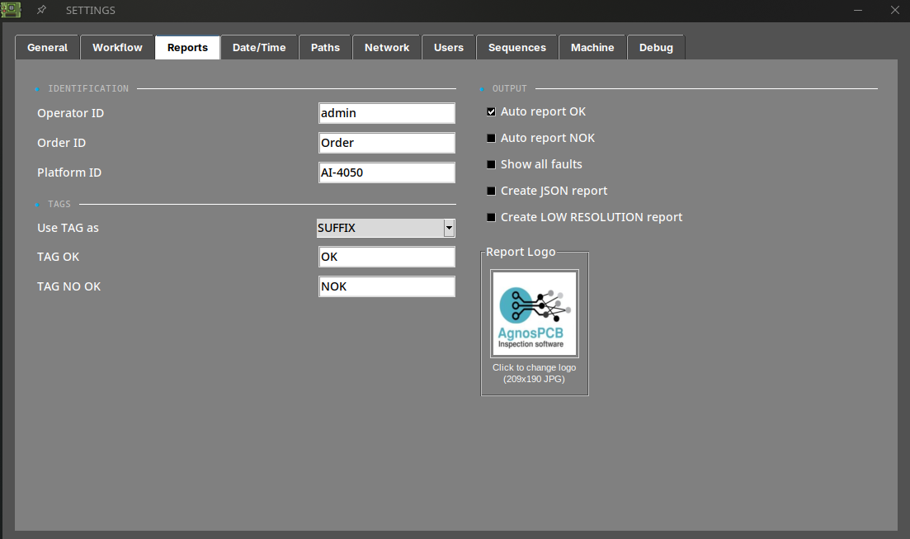{.center}

#### ID opérateur

Définit un identifiant pour l'opérateur actuel. Cet identifiant sera affiché dans le rapport PDF final une fois l'inspection terminée.

#### ID de commande

Définit un identifiant pour l'ordre de fabrication actuel. Cet identifiant sera affiché dans le rapport PDF final une fois l'inspection terminée.

#### ID de plateforme

Définit un identifiant pour l'AOI.

#### Utiliser le TAG comme

Définit le TAG (OK ou NOK) du rapport PDF final comme **suffixe** ou **préfixe** du nom de fichier.

#### TAG OK

Définit un TAG OK personnalisé pour le rapport PDF final.

#### TAG NO OK

Définit un TAG NO OK personnalisé pour le rapport PDF final.

#### Rapport automatique

Lorsque cette option est activée, un rapport PDF final étiqueté OK sera généré automatiquement si aucune erreur n'est détectée après l'inspection. Le rapport PDF final peut également être généré si des erreurs sont détectées pendant l'inspection.

!!! note "Note"
    Lors de la génération automatique d'un rapport PDF, toutes les erreurs détectées seront marquées avec l'étiquette "unknown". Un rapport automatique ne compte pas comme rapport final confirmé pour le [Rapport final obligatoire](#rapport-final-obligatoire).

#### Afficher tous les défauts

Affiche toutes les erreurs détectées dans le rapport PDF, même si l'opérateur ne les a pas signalées.

#### Créer un rapport JSON

Génère un **fichier JSON exploitable par une machine** contenant les données de l'inspection, en plus du rapport PDF. Utilisez cette option lorsque les résultats doivent être traités par un autre système — un MES, un ERP ou une base de données de traçabilité — au lieu d'être lus par une personne.

Le fichier JSON est écrit dans le même dossier que le rapport PDF, à l'intérieur du répertoire [PCB OUT](#pcb-out).

!!! note "Note"
    Il s'agit d'une fonctionnalité sous licence. Si l'option ne génère aucun fichier, contactez [support@agnospcb.com](mailto:support@agnospcb.com) pour vérifier si votre profil de compte l'inclut.

#### Créer un rapport BASSE RÉSOLUTION

Génère un **rapport PDF supplémentaire de taille réduite**. Le rapport standard continue d'être généré : cette option ajoute une copie plus légère, elle ne le remplace pas.

C'est utile lorsque les rapports doivent être envoyés par e-mail, archivés à long terme, ou transférés via une connexion lente ou limitée, où les images en pleine résolution rendraient le fichier trop volumineux.

#### Logo

Définit un logo pour le rapport PDF.

## Options de date/heure

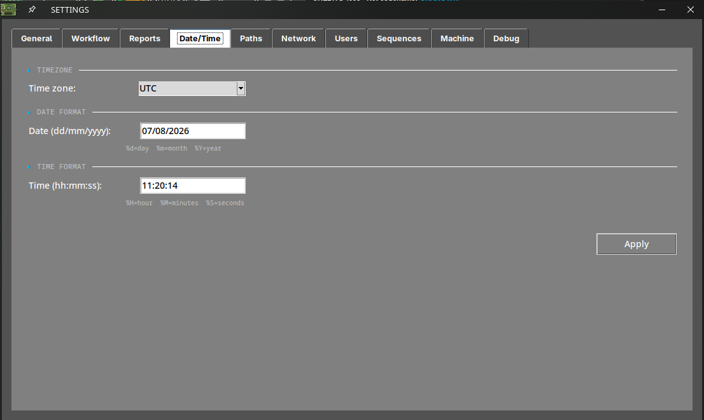{.center}

#### Fuseau horaire

Définit le fuseau horaire.

#### Date et heure

Définit le jour et l'heure.

!!! note "Note"
    Pour appliquer les modifications, appuyez sur le bouton **SET** et redémarrez le système.

## Option de chemin

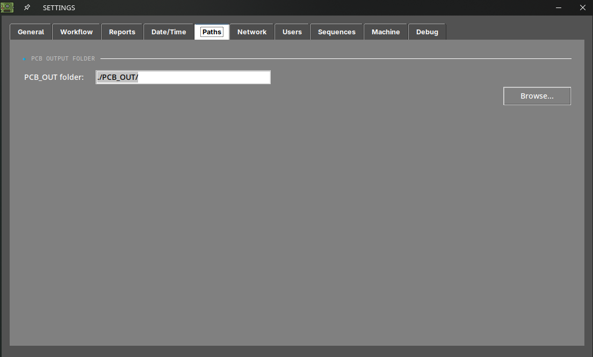{.center}

#### PCB OUT

Modifie le chemin où les inspections sont générées.

## Options de partage

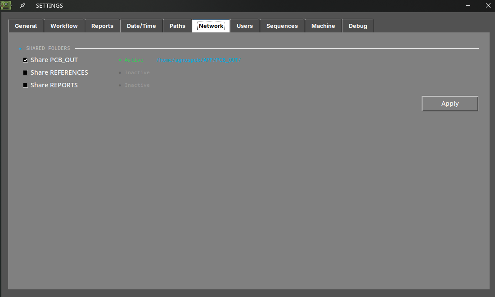{.center}

#### Partager les dossiers

En activant ces options, le système partagera automatiquement les dossiers PCB_OUT et REFERENCE sur votre réseau local. L'adresse d'accès sera affichée une fois l'option définie.

!!! note "Note"
    Pour appliquer les modifications, appuyez sur le bouton **Apply**.

!!! note "Note"
    Pour les unités OFFLINE, si vous devez changer l'interface réseau de votre unité, veuillez consulter l'[article de configuration réseau](../maintenance/network_configuration.md).

## Utilisateurs

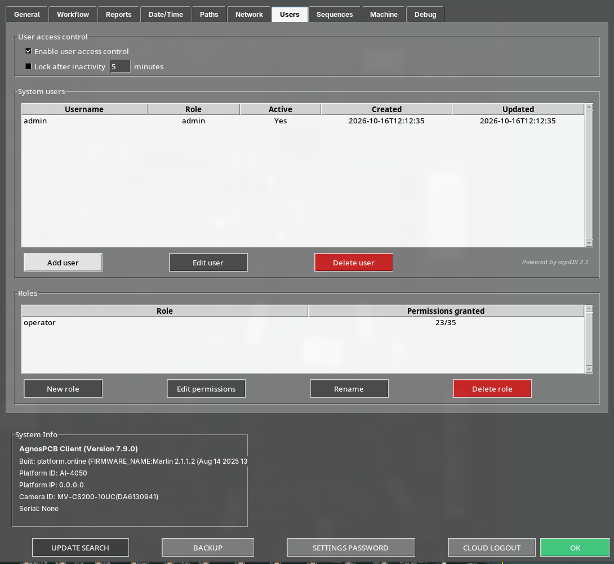{.center}

Cet onglet n'est disponible que pour les utilisateurs ayant le rôle **admin**, ou un rôle auquel l'accès a été accordé. Il permet de créer les comptes autorisés à utiliser l'AOI, de définir leurs rôles et leurs permissions, et d'exiger un nom d'utilisateur et un mot de passe à chaque démarrage du logiciel.

Pour activer **Enable user access control**, il faut qu'au moins un compte **admin** actif existe.

Pour en savoir plus sur cette fonctionnalité, consultez la section suivante : [Contrôle d'accès des utilisateurs](../features/User_control.md)

## Séquences

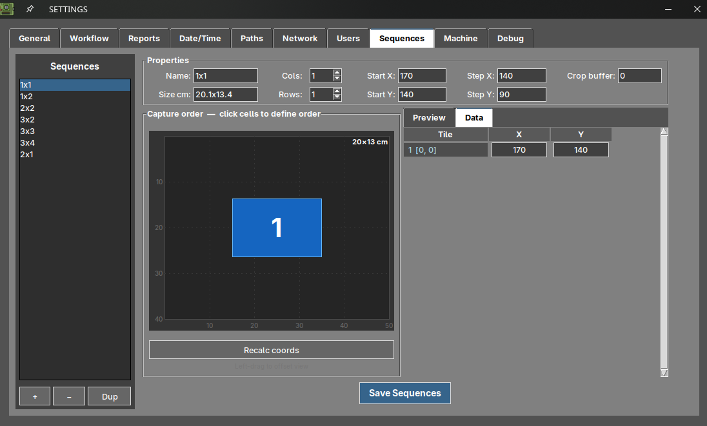{.center}

Cet onglet n'est disponible que pour les utilisateurs ayant le rôle **admin**. Il permet de définir vos propres **séquences de capture**, c'est-à-dire la grille de photographies que la caméra prend et assemble pour composer l'image d'une grande carte.

Utilisez-le lorsqu'aucune des séquences prédéfinies ne convient à votre carte. Les séquences que vous enregistrez ici apparaissent comme options **CUSTOM** dans la fenêtre de vue en direct lors de la prise d'une RÉFÉRENCE ou du lancement d'une inspection.

Pour en savoir plus sur cette fonctionnalité, consultez la section suivante : [Séquences de capture personnalisées](../features/Custom_sequences.md)

!!! note "Note"
    Cet onglet n'est pas affiché sur les unités configurées en **mode Q1**, qui ne réalisent qu'une seule capture.

## Machine

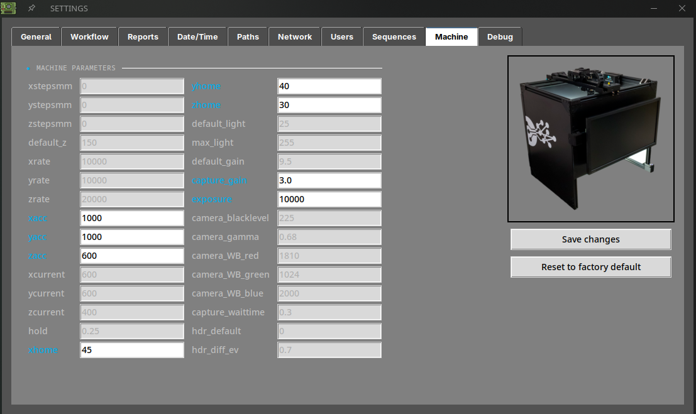{.center}

Cet onglet n'est disponible que pour les utilisateurs ayant le rôle **admin**. Il affiche les paramètres matériels modifiables de votre unité, stockés dans le fichier **machine.json**, regroupés selon ce qu'ils affectent et accompagnés chacun d'une brève explication :

| Groupe | Champ | Description |
| --- | --- | --- |
| Motion | **Acceleration (X / Y / Z)** | Accélération de chaque axe. Des valeurs plus élevées permettent des déplacements plus rapides, mais peuvent provoquer des pertes de pas ou des vibrations. |
| Motion | **Homing sensitivity (X / Y / Z)** | La façon dont chaque axe détecte qu'il a atteint sa position d'origine. |
| Camera | **Capture gain** | Gain de la caméra pendant la capture. Des valeurs plus élevées éclaircissent l'image, mais ajoutent du bruit. |
| Camera | **Exposure (µs)** | Temps d'exposition de la caméra. Des valeurs plus élevées laissent entrer plus de lumière, mais augmentent le risque de flou dû aux vibrations. |
| Camera | **Rotate image 180°** | Fait pivoter l'image de la caméra de 180°. Ne l'activez que si la caméra est montée à l'envers. |

Appuyez sur **Save changes** pour enregistrer les nouvelles valeurs, ou sur **Reset to factory default** pour rétablir tous les paramètres à leur valeur d'origine.

!!! note "Note"
    Les modifications ne sont pas appliquées immédiatement. Redémarrez l'application pour que les nouvelles valeurs prennent effet.

!!! warning "Important"
    Ces paramètres influent sur le déplacement de la plateforme et sur la capture des images. Les modifier incorrectement peut dégrader la qualité d'image ou le mouvement des axes. Ne les modifiez que lorsque le [support](mailto:support@agnospcb.com) vous le demande.

!!! note "Note"
    Cet onglet n'est pas affiché sur les unités sans plateforme XYZ.

## Débogage

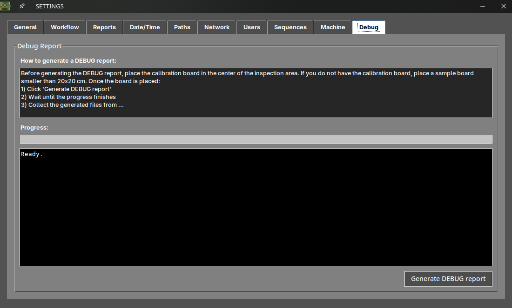{.center}

Cet onglet n'est disponible que pour les utilisateurs ayant le rôle **admin**. Il génère un **rapport de diagnostic** qui permet à notre équipe de support d'analyser le comportement de votre unité.

Pour le générer :

1. Placez la **carte de calibration** au centre de la zone d'inspection. Si vous ne l'avez pas, utilisez une carte d'essai **de moins de 20x20 cm**.
2. Appuyez sur **Generate DEBUG report**.
3. Attendez que la barre de progression soit terminée. La zone de texte en dessous affiche l'avancement du processus.
4. Récupérez les fichiers générés et envoyez-les à [support@agnospcb.com](mailto:support@agnospcb.com).

## Section informations

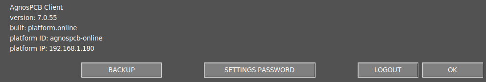{width=650px .center}

#### Informations AOI

Les informations de l'AOI sont affichées dans cette section.

#### Sauvegarde

Cette fonction génère automatiquement un fichier compressé de sauvegarde du dossier **PCB_OUT**. Le fichier de sauvegarde est stocké dans le dossier **APP/BACKUP**.

#### Mot de passe des paramètres

Définit un mot de passe pour accéder au menu des paramètres.

!!! note "Note"
    Laissez le mot de passe vide pour désactiver l'exigence de mot de passe.
