# Menu Impostazioni

Il **menu Impostazioni** è diviso in diverse sezioni, descritte di seguito.

## Impostazioni generali

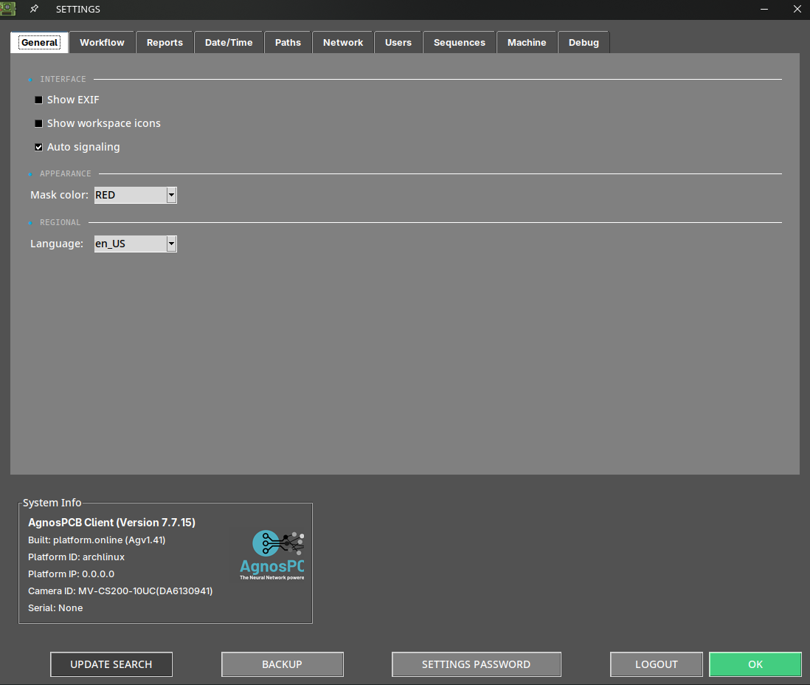{.center}

#### Mostra exif

Mostra i metadati dell'immagine corrente nell'[area di lavoro principale](./Screen-layout.md#area-di-lavoro-principale).

#### Mostra icone dell'area di lavoro

Abilita una serie di funzioni nell'[area di lavoro principale](./Screen-layout.md#area-di-lavoro-principale). Per maggiori informazioni su queste funzioni, consultate la [sezione successiva](./Workspace_icons.md).

#### Segnalazione automatica

Per impostazione predefinita, il software numera ogni errore dopo l'ispezione. Disabilitando questa opzione, viene evidenziata a colori solo l'area interessata, senza numero.

#### Colore della maschera

Questa opzione consente di cambiare il colore dell'errore contrassegnato. Quando il colore dell'errore contrassegnato coincide con quello della PCBA, è consigliabile scegliere un colore a contrasto maggiore per rendere più visibili le aree contrassegnate.

#### Mostra statistiche e mappa di calore degli errori per Riferimento

Aggiunge al [pannello informazioni del Riferimento](Screen-layout.md#pannello-informazioni-del-riferimento) le statistiche di ispezione del RIFERIMENTO caricato e una mappa di calore dei punti in cui le sue schede presentano difetti. Disabilitata per impostazione predefinita.

Le statistiche vengono raccolte anche mentre questa opzione è disabilitata, quindi lo storico è già disponibile quando la si abilita. Le ispezioni eseguite prima della versione 7.10 non sono incluse.

#### Lingua

Cambia la lingua dell'interfaccia. Le lingue attualmente disponibili sono: **inglese, francese, tedesco, italiano e spagnolo**.

## Opzioni del flusso di lavoro

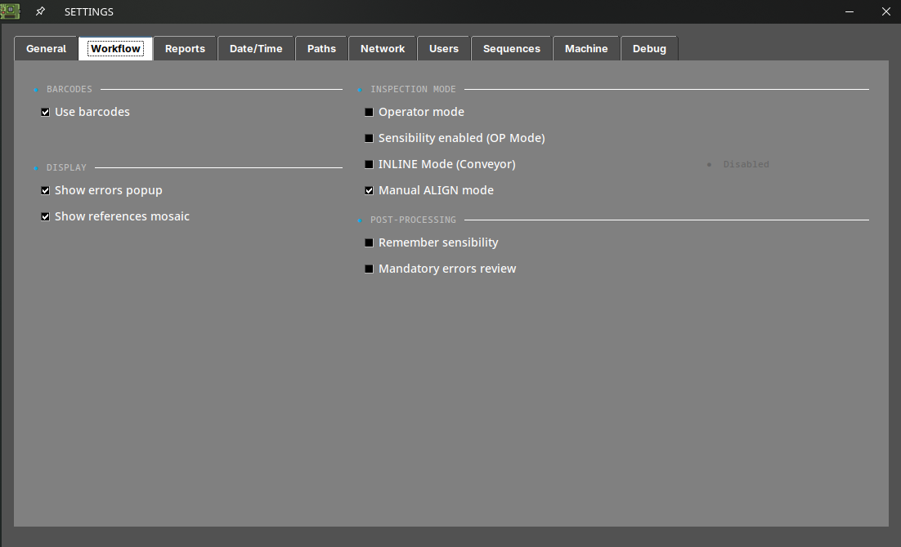{.center}

#### Usa codici a barre

Attiva o disattiva la [funzione di lettura dei codici a barre](../features/Barcode_reader.md).

#### Mostra finestra degli errori

Disabilitando questa opzione, la finestra di segnalazione non comparirà più quando si segnala un errore con i tasti freccia **SU** o **GIÙ**. Gli errori segnalati verranno generati con l'etichetta "**other**" nel report PDF finale.

#### Mostra mosaico dei riferimenti

Disabilitando questa opzione, il menu a mosaico non comparirà dopo l'acquisizione di un'immagine di **RIFERIMENTO**.

#### Modalità operatore

Abilitando questa opzione verranno nascoste diverse funzioni dell'interfaccia, semplificando l'uso del software. Impedisce inoltre all'operatore di cambiare l'immagine di RIFERIMENTO o la sensibilità delle ispezioni. È possibile aggiungere una [password](#password-impostazioni) affinché solo l'amministratore possa disabilitare questa opzione.

#### Sensibilità abilitata

Consente di modificare la sensibilità quando il software è in modalità operatore.

#### Modalità INLINE

Selezionate questa modalità quando l'AOI è installata su un nastro trasportatore. Per maggiori informazioni su questa funzionalità, consultate la sezione seguente: [Integrazione in linea di produzione](../maintenance/Conveyor_integration.md)

#### Modalità di allineamento manuale

Abilitate questa opzione per allineare manualmente le immagini di RIFERIMENTO e UUI. Per maggiori informazioni su questa funzionalità, consultate la sezione seguente: [Strumento di allineamento manuale](../features/Manual_alignment.md)

#### Ricorda sensibilità

Attivando questa opzione, il software manterrà la sensibilità di ispezione configurata dopo aver eseguito una nuova ispezione.

#### Revisione obbligatoria degli errori

Se questa opzione è abilitata, il software non avvierà una nuova ispezione finché tutte le rilevazioni di quella corrente non saranno state esaminate: [segnalate](Inspection_workflow.md#segnalazione-degli-errori) come errore o come falso positivo, oppure almeno contrassegnate come **seen**.

#### Segnalazione obbligatoria degli errori

Se questa opzione è abilitata, ogni rilevazione deve essere **classificata** come errore o come falso positivo prima che possa iniziare una nuova ispezione. Contrassegnarla come seen non è sufficiente. Include la revisione descritta sopra.

#### Report finale obbligatorio

Se questa opzione è abilitata, l'operatore deve confermare il [report finale OK / NON OK](Inspection_workflow.md#generazione-di-un-report-pdf-finale) dell'ispezione prima che ne possa iniziare una nuova. Un report generato automaticamente da [Report automatico](#report-automatico) non viene conteggiato.

!!! note "Dove si applicano queste tre opzioni"
    Queste opzioni si applicano a tutti solo mentre il [controllo di accesso utenti](../features/User_control.md) è disabilitato. Quando è abilitato, le tre caselle di controllo appaiono in grigio e ogni **ruolo** ha invece la propria impostazione. Anche un RIFERIMENTO può richiederne una qualsiasi, chiunque ispezioni con esso. Consultate [Livelli di revisione obbligatoria](Inspection_workflow.md#livelli-di-revisione-obbligatoria) per sapere come si combinano.

#### Avvisa se un lato non è stato esaminato

Prima che inizi la scheda successiva, il software vi avvisa se un lato della scheda corrente presenta rilevazioni ma nessuna di esse è stata esaminata o segnalata, e vi permette di continuare (**OK**) o di tornare indietro (**CANCEL**). È un avviso, non un blocco. Abilitata per impostazione predefinita. Consultate [Livelli di revisione obbligatoria](Inspection_workflow.md#avviso-per-un-lato-non-esaminato).

#### Cambio automatico TOP/BOTTOM

Per i RIFERIMENTI a doppia faccia, abilitando questa opzione si passa automaticamente all'altro lato (**TOP**/**BOTTOM**) all'inizio dell'ispezione successiva, senza bisogno di un [cambio manuale](Screen-layout.md#alterna-topbottom).

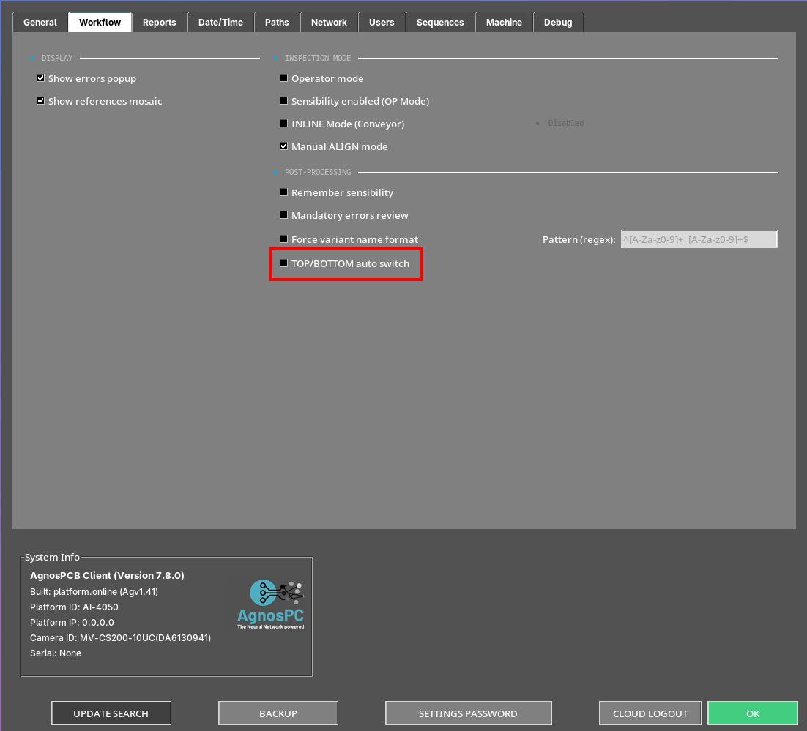{.center}

#### Preferenza di analisi

Imposta dove esaminare le rilevazioni dopo un'ispezione:

- **LIST** (predefinita sulle nuove installazioni): il cursore va alla prima riga dell'[elenco delle rilevazioni](Screen-layout.md#elenco-delle-rilevazioni). I tasti freccia **sinistra** e **destra** si spostano lungo l'elenco e i tasti freccia **su** e **giù** classificano la riga sotto il cursore come errore o come falso positivo.
- **CANVAS**: il cursore va alla prima rilevazione sull'immagine e i tasti freccia si spostano tra le rilevazioni sull'immagine.

Le installazioni aggiornate da una versione precedente mantengono il valore che avevano già.

#### Max. varianti per Riferimento

Numero massimo di [Varianti di riferimento](../features/Multivariant_feature.md) utilizzate per ogni RIFERIMENTO: 20 per impostazione predefinita, fino a 50. Aumentandolo viene mostrato un avviso, perché il pannello delle varianti e l'ispezione diventano più lenti con più varianti. Un RIFERIMENTO che ha più varianti del limite utilizza solo le prime; le altre vengono conservate intatte.

#### Modalità Demo / Loop

Dopo che l'operatore ha eseguito manualmente la prima ispezione, il software continua a ripetere automaticamente l'acquisizione e l'ispezione. È pensata per dimostrazioni non presidiate.

- Si disattiva da sola alla chiusura dell'applicazione, quindi l'avvio successivo avviene sempre in modalità normale.
- Mentre è attiva, nessuno dei livelli di revisione obbligatoria è richiesto.
- Selezionando una qualsiasi delle tre opzioni obbligatorie descritte sopra questa modalità viene deselezionata, e viceversa.
- Con il [controllo di accesso utenti](../features/User_control.md) abilitato, solo il ruolo **admin** può modificarla.

!!! warning "Importante"
    Esecuzioni non presidiate prolungate con sequenze di acquisizione molto grandi (12 o più immagini) possono esaurire la memoria del computer. Evitate di lasciare in ciclo sequenze molto grandi per lunghi periodi.

## Opzioni del report

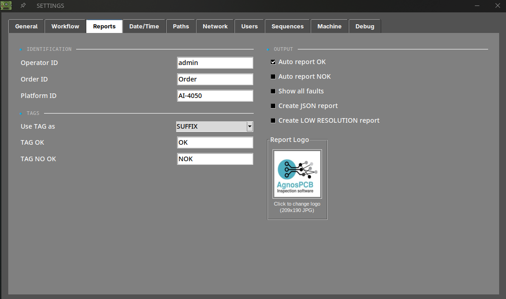{.center}

#### ID operatore

Imposta un ID per l'operatore corrente. Questo ID verrà visualizzato nel report PDF finale al termine dell'ispezione.

#### ID ordine

Imposta un ID per l'ordine di produzione corrente. Questo ID verrà visualizzato nel report PDF finale al termine dell'ispezione.

#### ID piattaforma

Imposta un ID per l'AOI.

#### Usa TAG come

Imposta il TAG (OK o NOK) del report PDF finale come **suffisso** o **prefisso** del nome del file.

#### TAG OK

Imposta un TAG OK personalizzato per il report PDF finale.

#### TAG NO OK

Imposta un TAG NO OK personalizzato per il report PDF finale.

#### Report automatico

Quando questa opzione è abilitata, verrà generato automaticamente un report PDF finale etichettato come OK se non vengono rilevati errori dopo l'ispezione. Il report PDF finale può essere generato anche se vengono rilevati errori durante l'ispezione.

!!! note "Nota"
    Quando si genera automaticamente un report PDF, tutti gli errori rilevati vengono contrassegnati con l'etichetta "unknown". Un report automatico non viene conteggiato come report finale confermato ai fini del [Report finale obbligatorio](#report-finale-obbligatorio).

#### Mostra tutti i difetti

Mostra tutti gli errori rilevati nel report PDF anche se l'operatore non li ha segnalati.

#### Crea report JSON

Genera un **file JSON leggibile da una macchina** con i dati dell'ispezione, in aggiunta al report PDF. Utilizzate questa opzione quando i risultati devono essere elaborati da un altro sistema — un MES, un ERP o un database di tracciabilità — invece di essere letti da una persona.

Il file JSON viene scritto nella stessa cartella del report PDF, all'interno della directory [PCB OUT](#pcb-out).

!!! note "Nota"
    Questa è una funzione con licenza. Se l'opzione non genera alcun file, contattate [support@agnospcb.com](mailto:support@agnospcb.com) per verificare se il vostro profilo account la include.

#### Crea report a BASSA RISOLUZIONE

Genera un **report PDF aggiuntivo con dimensioni di file ridotte**. Il report standard continua a essere generato: questa opzione aggiunge una copia più leggera, non lo sostituisce.

È utile quando i report devono essere inviati per e-mail, archiviati a lungo termine o trasferiti tramite una connessione lenta o limitata, dove le immagini a piena risoluzione renderebbero il file troppo grande.

#### Logo

Imposta un logo per il report PDF.

## Opzioni data/ora

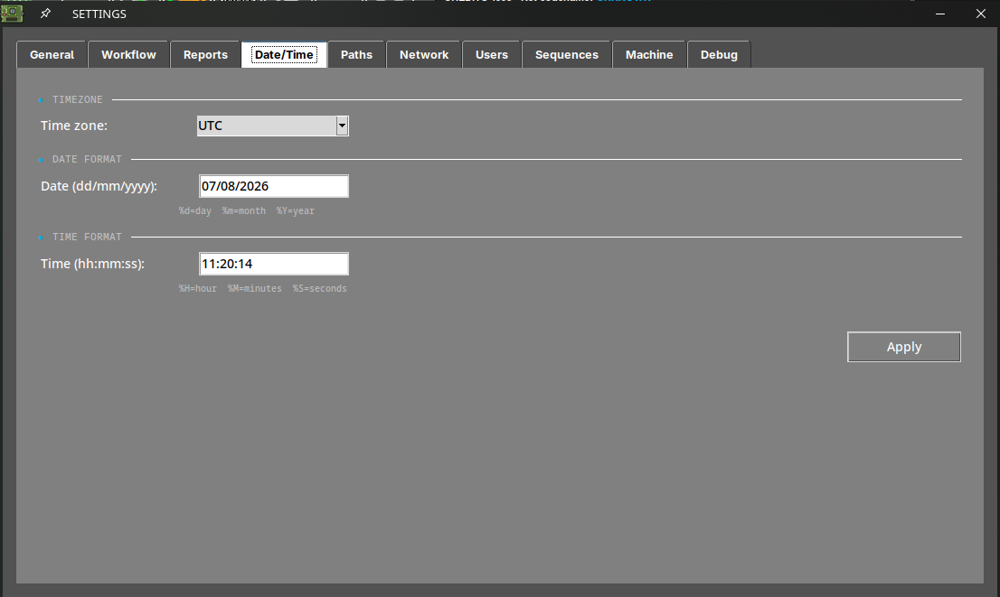{.center}

#### Fuso orario

Imposta il fuso orario.

#### Data e ora

Imposta il giorno e l'ora.

!!! note "Nota"
    Per applicare le modifiche premete il pulsante **SET** e riavviate il sistema.

## Opzione percorso

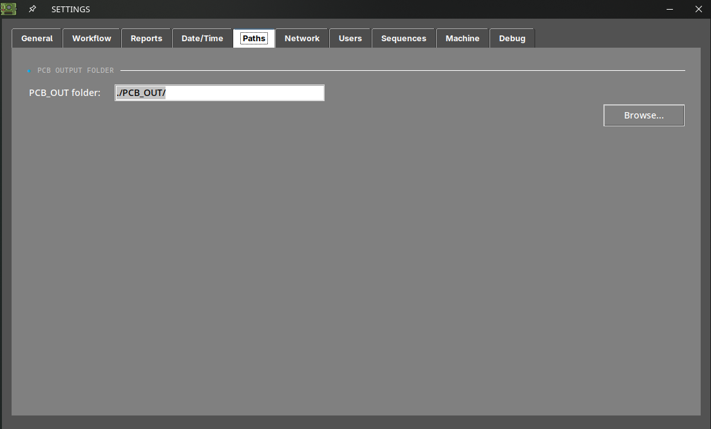{.center}

#### PCB OUT

Cambia il percorso in cui vengono generate le ispezioni.

## Opzioni di condivisione

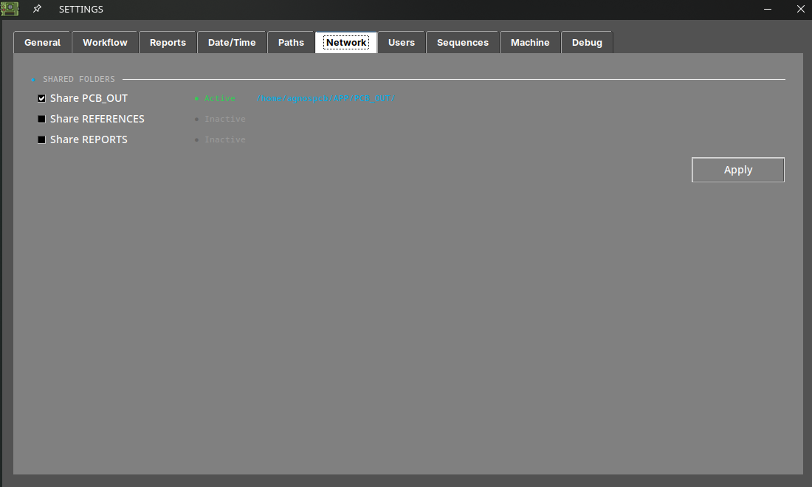{.center}

#### Condividi cartelle

Abilitando queste opzioni, il sistema condividerà automaticamente le cartelle PCB_OUT e REFERENCE sulla rete locale. L'indirizzo di accesso verrà visualizzato una volta impostata l'opzione.

!!! note "Nota"
    Per applicare le modifiche premete il pulsante **Apply**.

!!! note "Nota"
    Per le unità OFFLINE, se dovete cambiare l'interfaccia di rete della vostra unità, consultate l'[articolo sulla configurazione di rete](../maintenance/network_configuration.md).

## Utenti

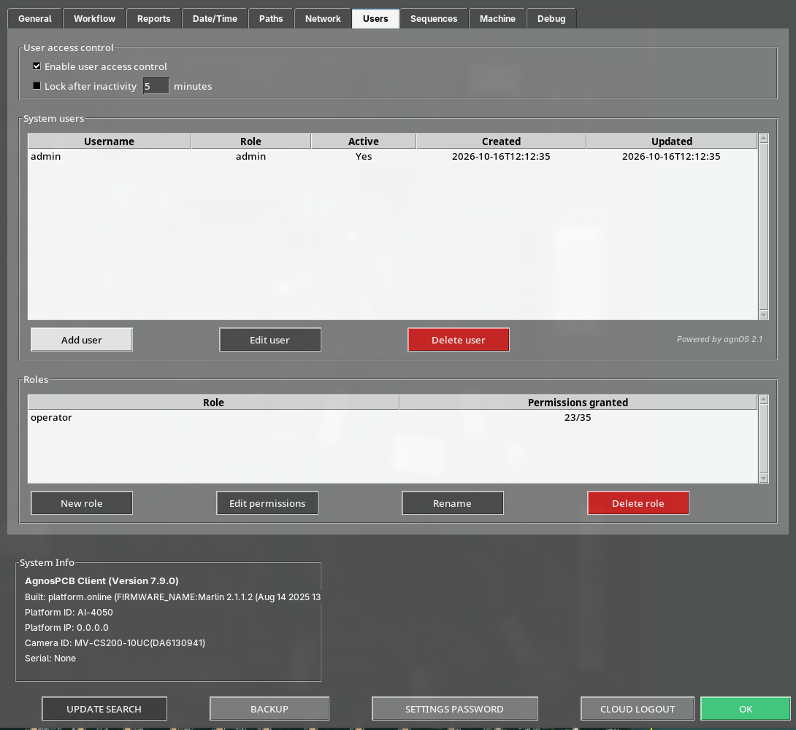{.center}

Questa scheda è disponibile solo per gli utenti con ruolo **admin**, oppure con un ruolo a cui è stato concesso l'accesso. Consente di creare gli account che possono utilizzare l'AOI, di definirne ruoli e permessi, e di richiedere nome utente e password ogni volta che il software viene avviato.

Per abilitare **Enable user access control** deve esistere almeno un account **admin** attivo.

Per maggiori informazioni su questa funzionalità, consultate la sezione seguente: [Controllo accessi utenti](../features/User_control.md)

## Sequenze

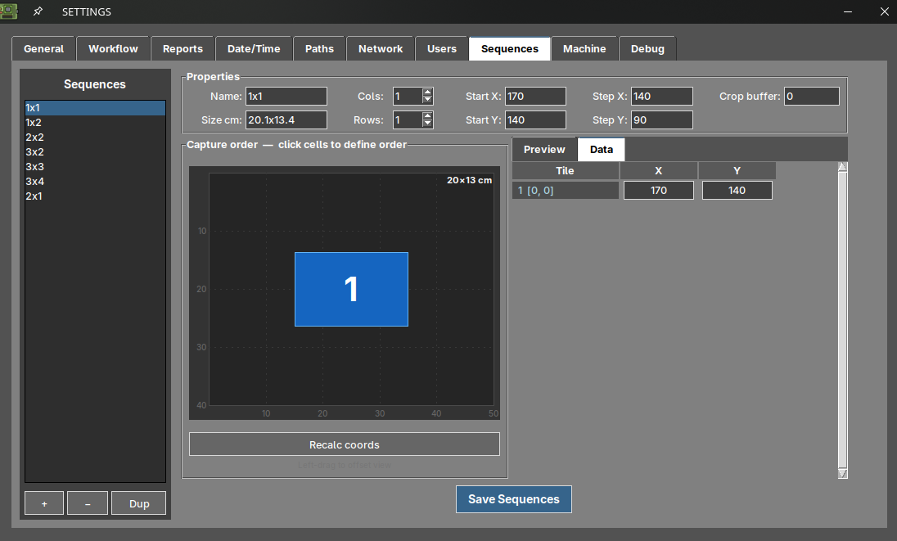{.center}

Questa scheda è disponibile solo per gli utenti con ruolo **admin**. Consente di definire le vostre **sequenze di acquisizione**, ovvero la griglia di fotografie che la telecamera scatta e unisce per comporre l'immagine di una scheda grande.

Utilizzatela quando nessuna delle sequenze predefinite si adatta correttamente alla vostra scheda. Le sequenze salvate qui appaiono come opzioni **CUSTOM** nella finestra di anteprima dal vivo quando si acquisisce un RIFERIMENTO o si avvia un'ispezione.

Per maggiori informazioni su questa funzionalità, consultate la sezione seguente: [Sequenze di acquisizione personalizzate](../features/Custom_sequences.md)

!!! note "Nota"
    Questa scheda non viene visualizzata sulle unità configurate in **modalità Q1**, che eseguono una sola acquisizione.

## Macchina

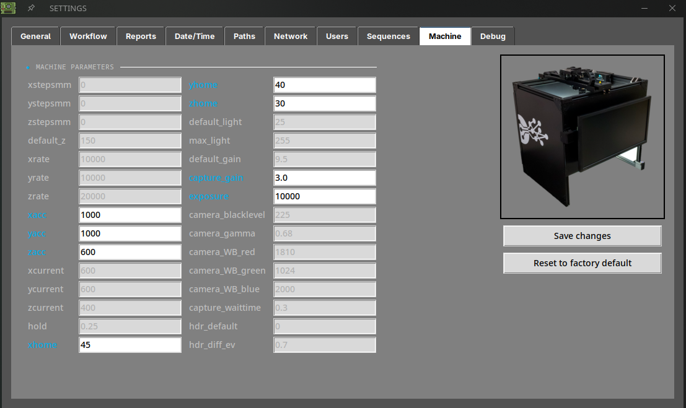{.center}

Questa scheda è disponibile solo per gli utenti con ruolo **admin**. Mostra i parametri hardware modificabili della vostra unità, memorizzati nel file **machine.json**, raggruppati in base a ciò su cui influiscono e ciascuno con una breve spiegazione:

| Gruppo | Campo | Descrizione |
| --- | --- | --- |
| Movimento | **Acceleration (X / Y / Z)** | Accelerazione di ciascun asse. Valori più alti rendono il movimento più rapido, ma possono causare perdita di passi o vibrazioni. |
| Movimento | **Homing sensitivity (X / Y / Z)** | Il modo in cui ciascun asse rileva di aver raggiunto la posizione di origine. |
| Telecamera | **Capture gain** | Guadagno della telecamera durante l'acquisizione. Valori più alti schiariscono l'immagine ma aggiungono rumore. |
| Telecamera | **Exposure (µs)** | Tempo di esposizione della telecamera. Valori più alti fanno entrare più luce ma aumentano il rischio di sfocatura dovuta alle vibrazioni. |
| Telecamera | **Rotate image 180°** | Ruota l'immagine della telecamera di 180°. Abilitatela solo se la telecamera è montata capovolta. |

Premete **Save changes** per memorizzare i nuovi valori, oppure **Reset to factory default** per ripristinare tutti i parametri al valore originale.

!!! note "Nota"
    Le modifiche non vengono applicate immediatamente. Riavviate l'applicazione affinché i nuovi valori abbiano effetto.

!!! warning "Importante"
    Questi parametri influiscono sul movimento della piattaforma e sull'acquisizione delle immagini. Modificarli in modo errato può degradare la qualità dell'immagine o il movimento degli assi. Modificateli solo quando il [supporto](mailto:support@agnospcb.com) ve lo richiede.

!!! note "Nota"
    Questa scheda non viene visualizzata sulle unità senza piattaforma XYZ.

## Debug

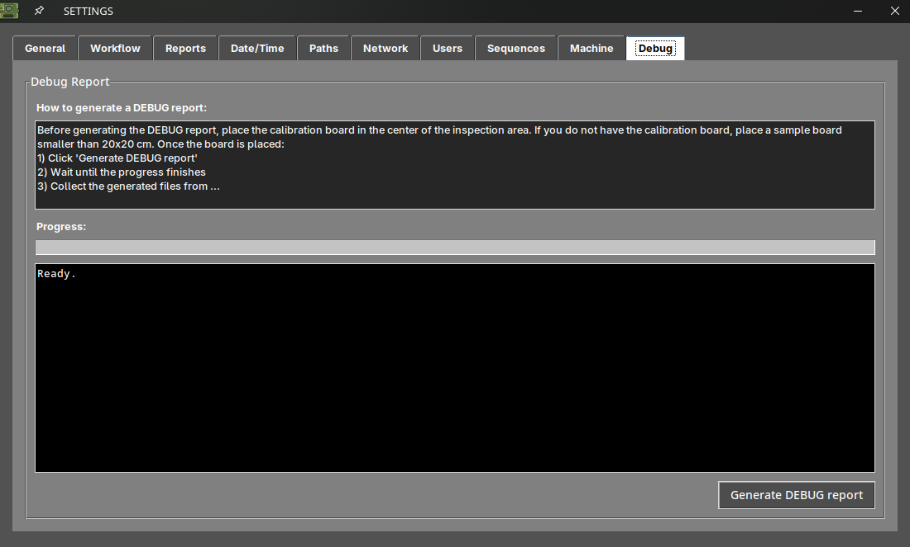{.center}

Questa scheda è disponibile solo per gli utenti con ruolo **admin**. Genera un **report diagnostico** che consente al nostro team di supporto di analizzare il comportamento della vostra unità.

Per generarlo:

1. Posizionate la **scheda di calibrazione** al centro dell'area di ispezione. Se non ne disponete, utilizzate una scheda di prova **più piccola di 20x20 cm**.
2. Premete **Generate DEBUG report**.
3. Attendete il completamento della barra di progresso. L'area di testo sottostante mostra l'avanzamento del processo.
4. Raccogliete i file generati e inviateli a [support@agnospcb.com](mailto:support@agnospcb.com).

## Sezione informazioni

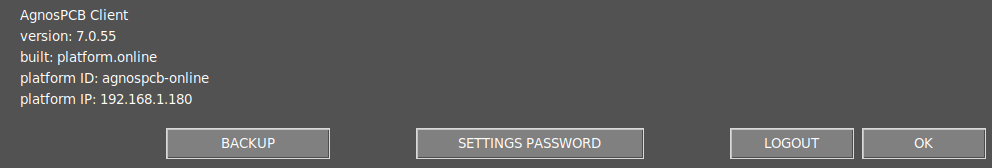{width=650px .center}

#### Informazioni AOI

Le informazioni dell'AOI vengono visualizzate in questa sezione.

#### Backup

Questa funzione genera automaticamente un file compresso di backup della cartella **PCB_OUT**. Il file di backup viene salvato nella cartella **APP/BACKUP**.

#### Password impostazioni

Imposta una password per accedere al menu Impostazioni.

!!! note "Nota"
    Lasciate la password vuota per disabilitare la richiesta di password.
