# Settings menu

The **settings menu** is divided into several sections, which are described below.

## General settings

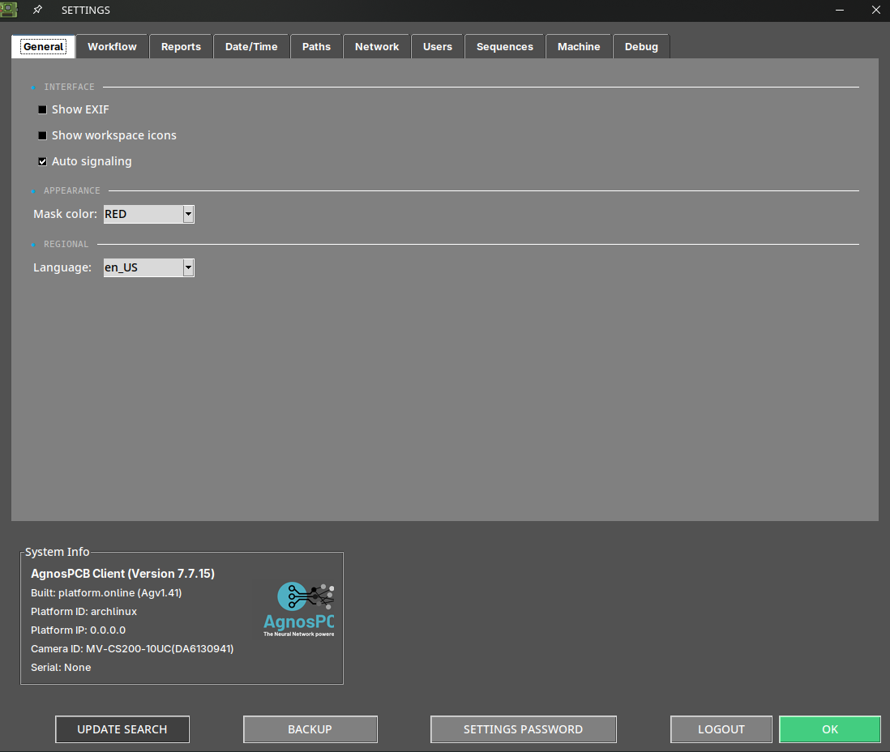{.center}

#### Show exif

Displays the metadata of the current image in the [main workspace area](./Screen-layout.md#main-workspace).

#### Show workspace icons

Enable a set of features in the main [main workspace area](./Screen-layout.md#main-workspace). Learn more about these features in the [next section](./Workspace_icons.md).

#### Auto signaling

By default, the software numbers each error after the inspection. When this option is disabled, only the affected area is highlighted in color, without a number.

#### Mask color

This option allows you to change the color of the marked error. When the color of the marked error matches the color of the PCBA, it's advisable to change it to a higher contrast color to make the marked areas more visible.

#### Show statistics and error heatmap per Reference

Adds the inspection statistics of the loaded REFERENCE and a heatmap of where its boards fail to the [Reference information panel](Screen-layout.md#reference-information-panel). Disabled by default.

The statistics are collected even while this option is disabled, so the history is already there when you enable it. Inspections made before version 7.10 are not included.

#### Language

Change the interface language. The current available languages are: **English, French, German, Italian and Spanish**.

## Workflow options

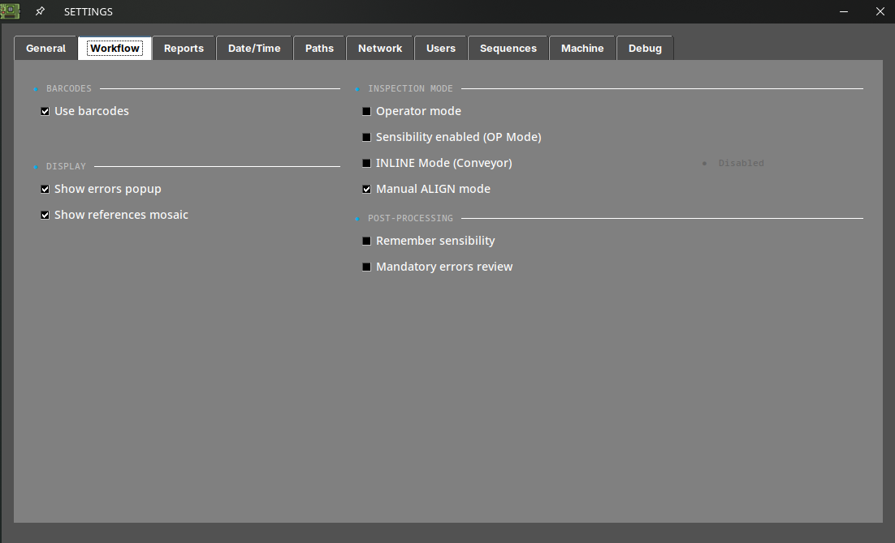{.center}

#### Use barcode

Toggles the [barcode reading function](../features/Barcode_reader.md)

#### Show errors popup

By disabling this option, the reporting window will no longer pop up when reporting an error with the **UP** or **DOWN** arrow keys. The reported errors will be generated with the "**other**" label in the final PDF report.

#### Show references mosaic

By disabling this option, the mosaic menu won't pop up after taking a **REFERENCE** image.

#### Operator mode

Enabling this option will hide several features from the interface, simplifying the software's use. It also prevents the operator from changing the REFERENCE image or the sensitivity of the inspections. A [password](#settings-password) can be added so that only the administrator can disable this option.

#### Sensitivity enabled

It allows you to change the sensitivity while in operator mode.

#### INLINE Mode

Select this mode when the AOI is installed on a conveyor belt. Learn more about this functionality in the following section: [Production line integration](../maintenance/Conveyor_integration.md)

#### Manual align mode

Enable this option to align the REFERENCE and UUI images manually. Learn more about this functionality in the following section: [Manual alignment tool](../features/Manual_alignment.md)

#### Remember sensibility

By activating this option, the software will maintain the configured inspection sensitivity after performing a new inspection.

#### Mandatory errors review

If this option is enabled, the software will not start a new inspection until every detection in the current one has been reviewed: [reported](Inspection_workflow.md#reporting-errors) as an error or a false positive, or at least marked as **seen**.

#### Mandatory errors report

If this option is enabled, every detection must be **classified** as an error or a false positive before a new inspection can start. Marking it as seen is not enough. It includes the review above.

#### Mandatory final report

If this option is enabled, the operator must confirm the [final OK / NOT OK report](Inspection_workflow.md#generating-a-final-pdf-report) of the inspection before a new one can start. A report generated automatically by [Auto report](#auto-report) does not count.

!!! note "Where these three options apply"
    These options apply to everyone only while [user access control](../features/User_control.md) is disabled. With it enabled, the three checkboxes are grayed out and each **role** has its own setting instead. A REFERENCE can also require any of them, whoever inspects with it. See [Mandatory review levels](Inspection_workflow.md#mandatory-review-levels) for how they combine.

#### Warn about a side not reviewed

Before the next board starts, the software warns you if a side of the current board has detections but none of them has been reviewed or reported, and lets you continue (**OK**) or go back (**CANCEL**). It is a warning, not a block. Enabled by default. See [Mandatory review levels](Inspection_workflow.md#warning-about-a-side-not-reviewed).

#### TOP/BOTTOM auto switch

For double-sided REFERENCES, enabling this option automatically switches to the other side (**TOP**/**BOTTOM**) at the start of the next inspection, instead of requiring a [manual switch](Screen-layout.md#switch-topbottom).

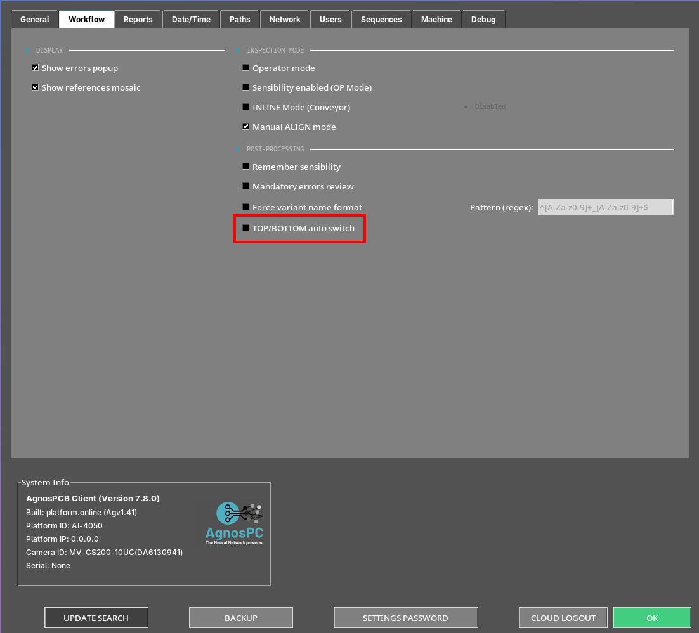{.center}

#### Analysis preference

Sets where you review the detections after an inspection:

- **LIST** (default on new installations): the cursor goes to the first row of the [detections list](Screen-layout.md#detections-list). The **left** and **right** arrow keys move along the list and the **up** and **down** arrow keys classify the row under the cursor as an error or a false positive.
- **CANVAS**: the cursor goes to the first detection on the image, and the arrow keys move between the detections on the image.

Installations updated from a previous version keep the value they already had.

#### Max. variants per Reference

Maximum number of [Reference Variants](../features/Multivariant_feature.md) used for each REFERENCE: 20 by default, up to 50. Raising it shows a warning, because the variants panel and the inspection get slower with more variants. A REFERENCE that has more variants than the limit only uses the first ones; the rest are kept untouched.

#### Demo / Loop mode

After the operator runs the first inspection manually, the software keeps repeating the capture and the inspection automatically. It is meant for unattended demonstrations.

- It turns itself off when the application is closed, so the next start is always in normal mode.
- While it is on, none of the mandatory review levels is required.
- Checking any of the three mandatory options above unchecks this mode, and the other way round.
- With [user access control](../features/User_control.md) enabled, only the **admin** role can change it.

!!! warning "Important"
    Long unattended runs with very large capture sequences (12 or more images) can use up the memory of the computer. Avoid leaving very large sequences looping for long periods.

## Report options

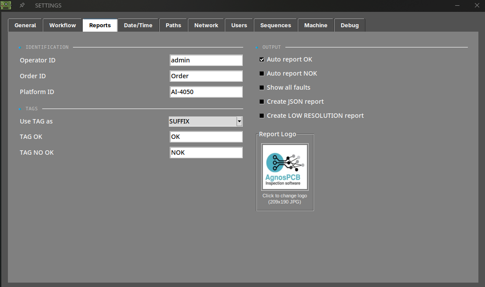{.center}

#### Operator ID

Set an ID for the current operator. This ID will be displayed in the final PDF report after the inspection is complete.

#### Order ID

Set an ID for the current manufacturing order. This ID will be displayed in the final PDF report after the inspection is complete.

#### Platform ID

Set an ID for the AOI. 

#### Use TAG as

Set the TAG (OK or NOK) of the final PDF report as a **suffix** or a **prefix** to the file name.

#### TAG OK

Set a custom OK TAG for the final PDF report. 

#### TAG NO OK

Set a custom NO OK TAG for the final PDF report.

#### Auto report

When this option is enabled, a final PDF report labeled OK will be automatically generated if no errors are detected after the inspection. The final PDF report can also be generated if any errors are detected during the inspection.

!!! note "Note"
    When generating a PDF report automatically, all errors detected will be marked with the "unknown" label. An automatic report does not count as a confirmed final report for [Mandatory final report](#mandatory-final-report).

#### Show all faults

Displays all detected errors in the PDF report even if the operator has not reported them.

#### Create JSON report

Generates a **machine-readable JSON file** with the inspection data, in addition to the PDF report. Use this option when the results have to be processed by another system — an MES, an ERP or a traceability database — instead of being read by a person.

The JSON file is written to the same folder as the PDF report, inside the [PCB OUT](#pcb-out) directory.

!!! note "Note"
    This is a licensed feature. If the option does not generate any file, contact [support@agnospcb.com](mailto:support@agnospcb.com) to check whether your account profile includes it.

#### Create LOW RESOLUTION report

Generates an **additional PDF report with a reduced file size**. The standard report is still generated: this option adds a lighter copy of it, it does not replace it.

This is useful when the reports have to be sent by email, archived long term, or transferred over a slow or metered connection, where the full resolution images would make the file impractically large.

#### Logo

Set a logo for the PDF report.

## Date/time options

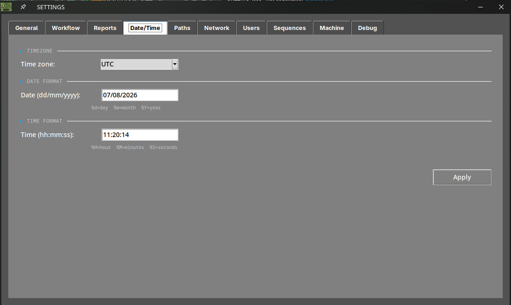{.center}

#### Time zone

Set the time zone.

#### Date and time

Set day and time.

!!! note "Note"
    To apply the changes press the **SET** button and reboot the system.

## Path option

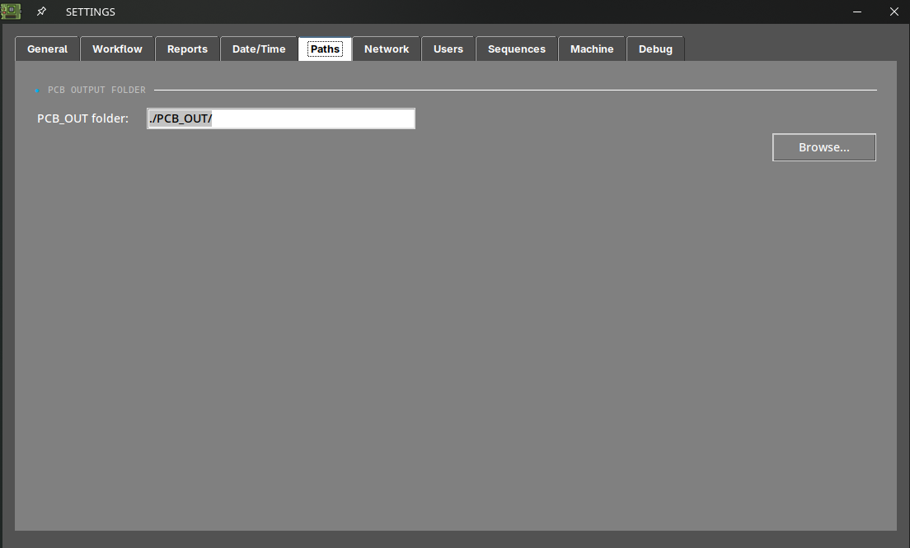{.center}

#### PCB OUT

Change the path where the inspections are generated.

## Share options

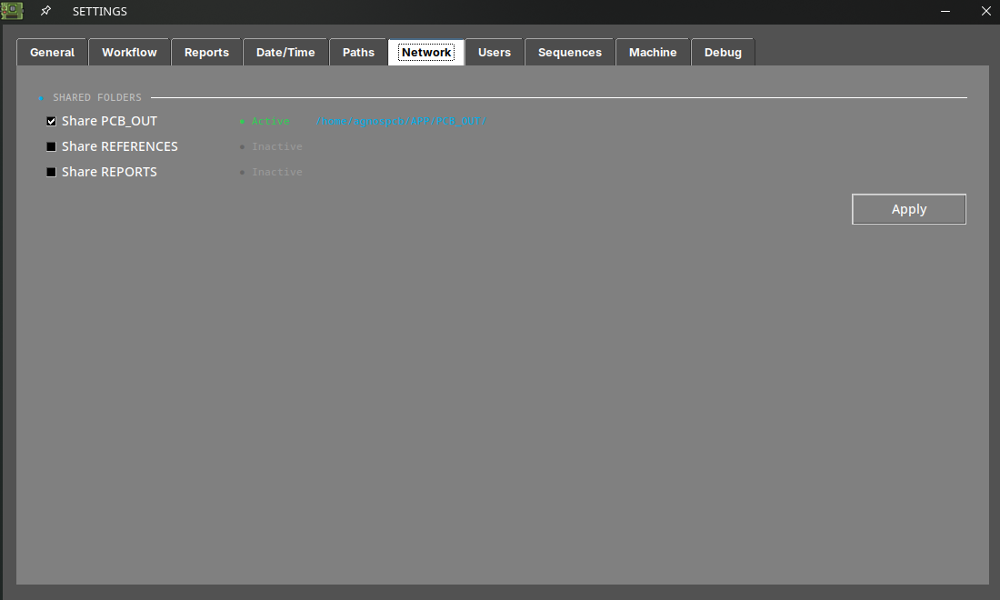{.center}

#### Share folders

By enabling these options, the system will automatically share the PCB_OUT and REFERENCE folders on your local network. The access address will be displayed once the option is set.

!!! note "Note"
    To apply the changes press the **Apply** button.

!!! note "Note"
    For the OFFLINE units, if you need to change the network interface of your unit, please refer to the [network configuration article](../maintenance/network_configuration.md).

## Users

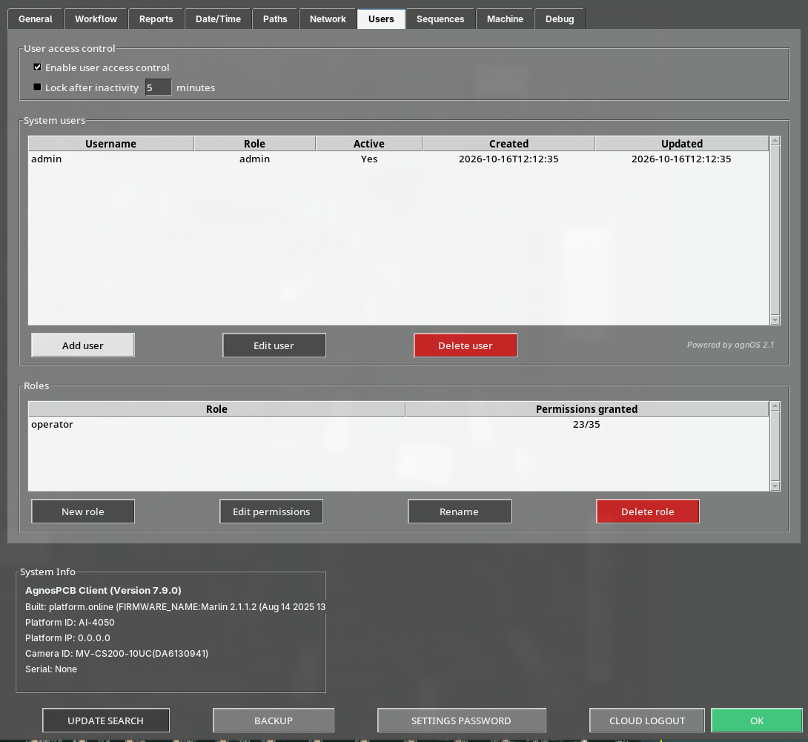{.center}

This tab is only available to users with the **admin** role, or with a role that has been granted access to it. It allows you to create the accounts that can operate the AOI, to define their roles and permissions, and to require a username and password every time the software starts.

Enabling **Enable user access control** requires at least one active **admin** account to exist.

Learn more about this functionality in the following section: [User access control](../features/User_control.md)

## Sequences

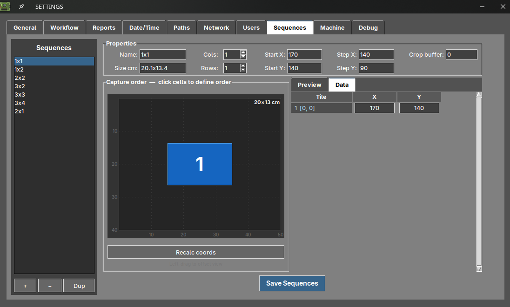{.center}

This tab is only available to users with the **admin** role. It allows you to define your own **capture sequences**, that is, the grid of photographs the camera takes and stitches together to compose the image of a large board.

Use it when none of the predefined sequences fits your board properly. The sequences you save here appear as **CUSTOM** options in the live preview window when taking a REFERENCE or starting an inspection.

Learn more about this functionality in the following section: [Custom capture sequences](../features/Custom_sequences.md)

!!! note "Note"
    This tab is not displayed on units configured in **Q1 mode**, which only take a single capture.

## Machine

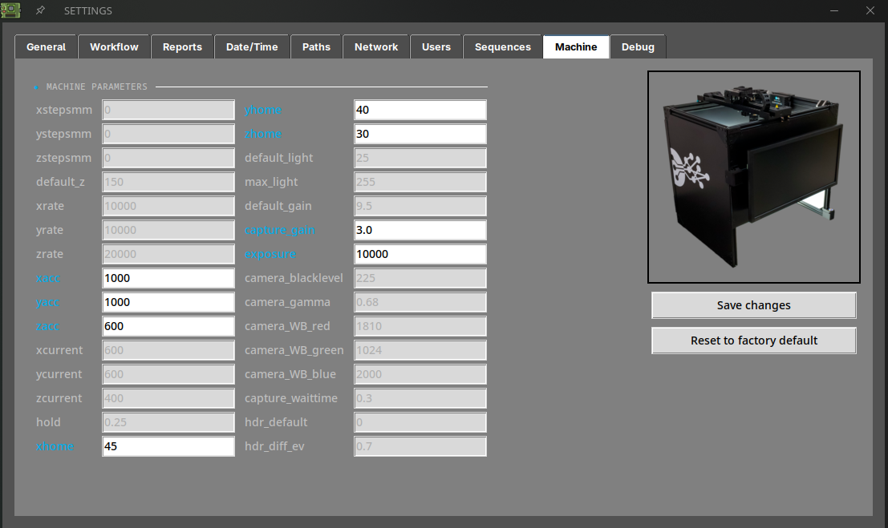{.center}

This tab is only available to users with the **admin** role. It shows the hardware parameters of your unit that can be modified, stored in the **machine.json** file, grouped by what they affect and each with a short explanation:

| Group | Field | Description |
| --- | --- | --- |
| Motion | **Acceleration (X / Y / Z)** | Acceleration of each axis. Higher values move faster but can cause skipped steps or vibration. |
| Motion | **Homing sensitivity (X / Y / Z)** | How each axis detects that it has reached its home position. |
| Camera | **Capture gain** | Camera gain during the capture. Higher values brighten the image but add noise. |
| Camera | **Exposure (µs)** | Camera exposure time. Higher values let in more light but increase the risk of blur from vibration. |
| Camera | **Rotate image 180°** | Rotates the camera image 180°. Enable it only if the camera is mounted upside down. |

Press **Save changes** to store the new values, or **Reset to factory default** to restore every parameter to its original value.

!!! note "Note"
    The changes are not applied immediately. Restart the application for the new values to take effect.

!!! warning "Important"
    These parameters affect how the platform moves and how the images are captured. Modifying them incorrectly may degrade the image quality or the movement of the axes. Change them only when [support](mailto:support@agnospcb.com) asks you to.

!!! note "Note"
    This tab is not displayed on units without an XYZ platform.

## Debug

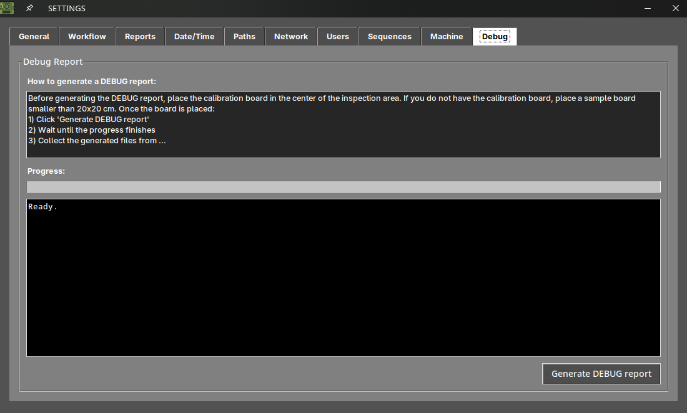{.center}

This tab is only available to users with the **admin** role. It generates a **diagnostic report** that allows our support team to analyze the behavior of your unit.

To generate it:

1. Place the **calibration board** in the center of the inspection area. If you do not have it, use a sample board **smaller than 20x20 cm**.
2. Press **Generate DEBUG report**.
3. Wait until the progress bar is complete. The text area below displays the progress of the process.
4. Collect the generated files and send them to [support@agnospcb.com](mailto:support@agnospcb.com).

## Info section

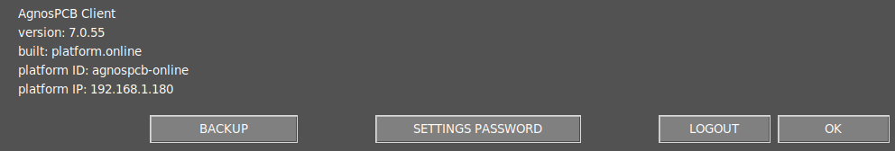{width=650px .center}

#### AOI info

The AOI information is displayed in this section.

#### Backup

This function generates a backup compressed file of the **PCB_OUT** folder automatically. The backup file is stored in the **APP/BACKUP** folder.

#### Settings password

Set a password to access the settings menu.

!!! note "Note"
    Set the password to blank to disable the password requirement.
