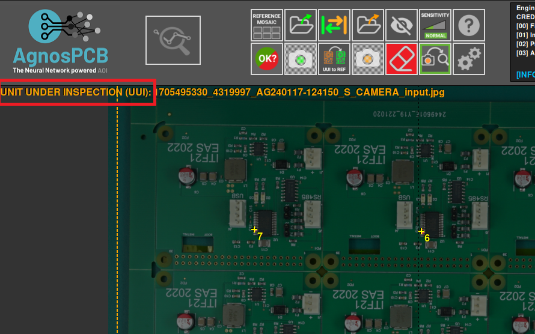
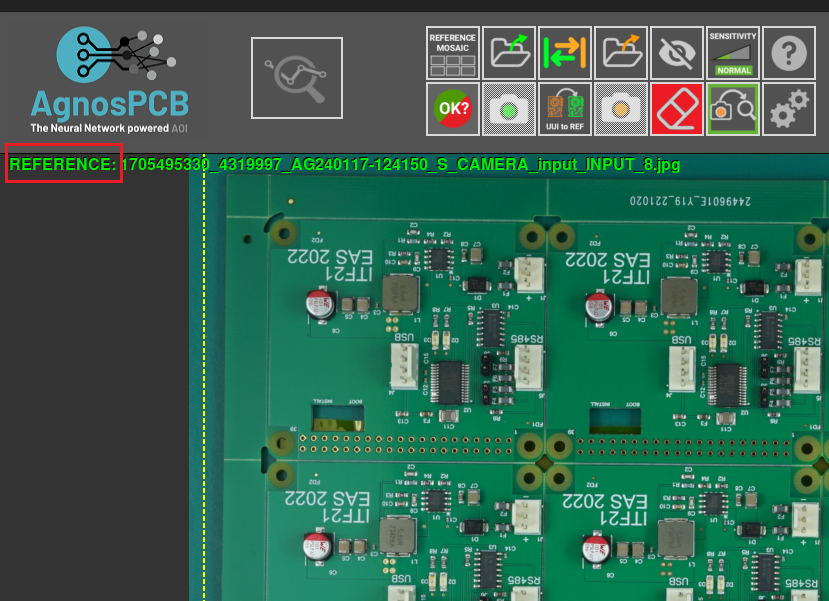

# UUI zu REFERENZ

Wenn Sie bei der Inspektion einer **PCB** feststellen, dass ein **UUI**-Bild besser als Referenz geeignet ist als das aktuelle, oder wenn es eine Komponentenvariante enthält, die von der Software fälschlicherweise als Fehler markiert wird, haben Sie die Möglichkeit, es mit einem **einzigen Klick** in ein Referenzbild umzuwandeln.

{.center}

Zum Beispiel haben wir auf diesem Bild eine **UUI**, die eine Komponentenvariante enthält und als Fehler markiert ist.

{.center}

Und nun, nach dem Drücken der Schaltfläche **"UUI zu REFERENZ"**, wird dieselbe PCBA als **REFERENZ** verwendet.

{.center}

Der Name der neuen REFERENZ darf noch nicht existieren. Ist das der Fall, zeigt die Software eine Warnung an und fragt nach einem anderen Namen.

Die neue REFERENZ übernimmt die [Referenzoptionen](Screen-layout.md#referenzoptionen) (verpflichtende Prüfstufen) der REFERENZ, aus der sie hervorgegangen ist.

## Doppelseitige REFERENZEN

Bei einer REFERENZ mit **TOP**- und **BOTTOM**-Seite erstellt **UUI zu REFERENZ** ein vollständiges TOP/BOTTOM-Paar:

- Wurden **beide Seiten** der Platine inspiziert, sind TOP und BOTTOM der neuen REFERENZ die beiden inspizierten Bilder.
- Wurde **nur eine Seite** inspiziert, wird diese Seite aus der Inspektion übernommen und die andere aus der REFERENZ kopiert, gegen die Sie inspiziert haben.

Es funktioniert gleich, egal ob Sie von der TOP- oder von der BOTTOM-Seite aus beginnen.
