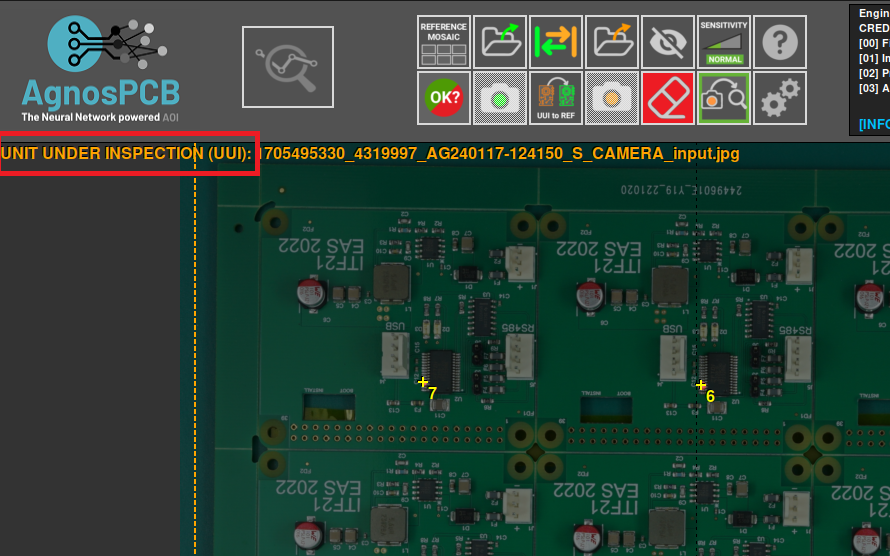
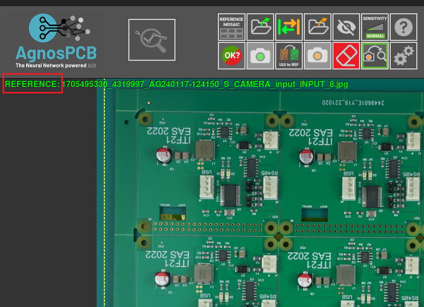

# UUI a REFERENCIA

Al inspeccionar una **PCB**, si descubre que una imagen **UUI** es más adecuada como referencia que la actual o contiene una variante de componente que hace que el software la marque como error, tiene la opción de convertirla en una imagen de referencia con un **solo clic de botón**.

{.center}

Por ejemplo, en esta imagen tenemos una **UUI** que contiene una variante de un componente y está marcada como un error.

{.center}

Y ahora, después de presionar el botón **"UUI a REFERENCIA"**, la misma PCBA se está utilizando como **REFERENCIA**.

{.center}

El nombre de la nueva REFERENCIA no debe existir ya. Si existe, el software muestra un aviso y pide otro distinto.

La nueva REFERENCIA hereda las [opciones de la Referencia](Screen-layout.md#opciones-de-la-referencia) (niveles de revisión obligatoria) de la REFERENCIA de la que procede.

## REFERENCIAS de doble cara

En una REFERENCIA con caras **TOP** y **BOTTOM**, **UUI a REFERENCIA** crea un par TOP/BOTTOM completo:

- Si se han inspeccionado **ambas caras** de la placa, la TOP y la BOTTOM de la nueva REFERENCIA son las dos imágenes inspeccionadas.
- Si solo se ha inspeccionado **una cara**, esa cara se toma de la inspección y la otra se copia de la REFERENCIA contra la que inspeccionó.

Funciona igual tanto si empieza desde la cara TOP como desde la BOTTOM.
