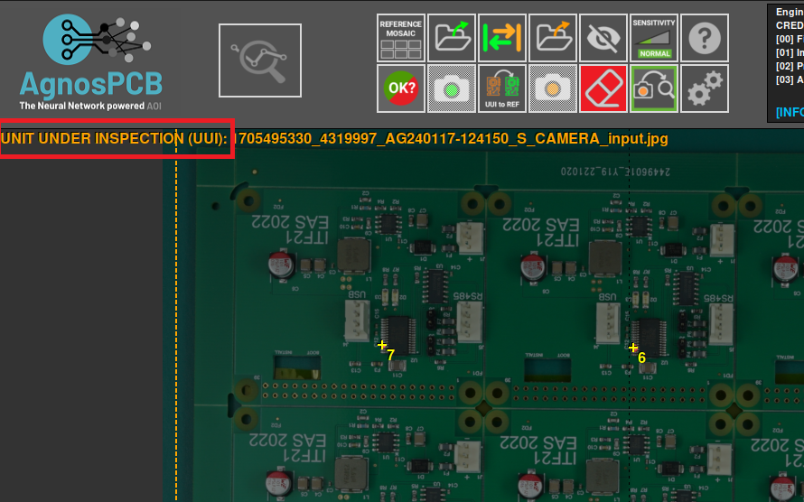
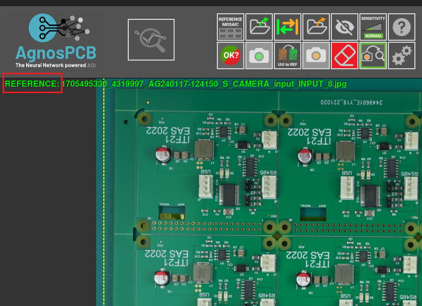

# UUI vers RÉFÉRENCE

Lors de l'inspection d'une **PCB**, si vous découvrez qu'une image **UUI** est plus appropriée comme référence que celle actuellement utilisée ou contient une variante de composant qui fait que le logiciel la signale comme une erreur, vous avez la possibilité de la convertir en image de référence en un **seul clic de bouton**.

{.center}

Par exemple, sur cette image, nous avons une **UUI** qui contient une variante d'un composant et qui est marquée comme une erreur.

{.center}

Et maintenant, après avoir appuyé sur le bouton **"UUI vers RÉFÉRENCE"**, la même PCBA est utilisée comme **RÉFÉRENCE**.

{.center}

Le nom de la nouvelle RÉFÉRENCE ne doit pas déjà exister. Si c'est le cas, le logiciel affiche un avertissement et vous en demande un autre.

La nouvelle RÉFÉRENCE hérite des [options de la référence](Screen-layout.md#options-de-la-reference) (niveaux de révision obligatoire) de la RÉFÉRENCE dont elle provient.

## RÉFÉRENCES recto verso

Sur une RÉFÉRENCE avec des faces **TOP** et **BOTTOM**, **UUI vers RÉFÉRENCE** crée une paire TOP/BOTTOM complète :

- Si **les deux faces** de la carte ont été inspectées, le TOP et le BOTTOM de la nouvelle RÉFÉRENCE sont les deux images inspectées.
- Si **une seule face** a été inspectée, cette face est reprise de l'inspection et l'autre est copiée depuis la RÉFÉRENCE par rapport à laquelle vous avez inspecté.

Le fonctionnement est le même que vous partiez de la face TOP ou de la face BOTTOM.
