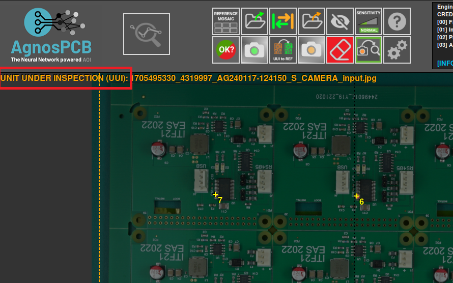
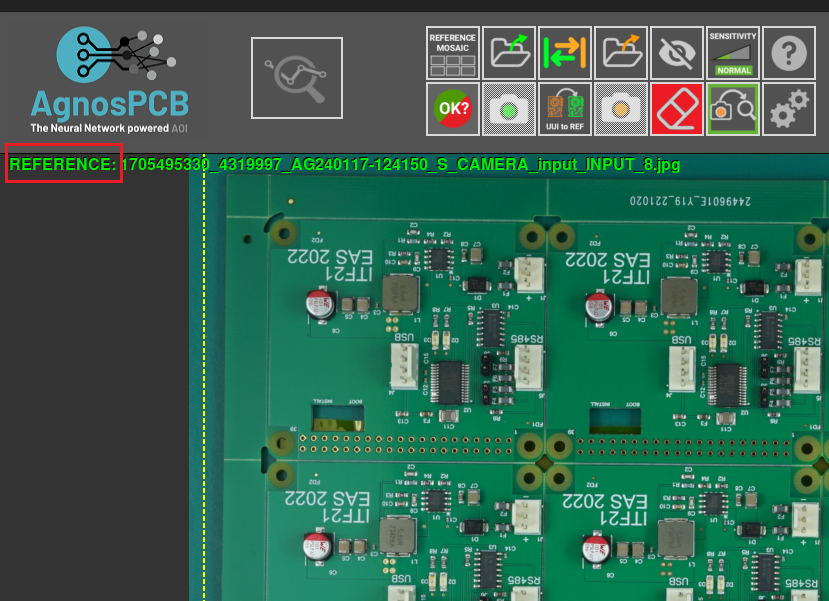

# Da UUI a RIFERIMENTO

Durante l'ispezione di una **PCB**, se si scopre che un'immagine **UUI** è più adatta come riferimento di quella attuale o contiene una variante di un componente che induce il software a segnalarla come errore, si ha la possibilità di convertirla in un'immagine di riferimento con un **singolo clic del pulsante**.

{.center}

Ad esempio, in questa immagine abbiamo una **UUI** che contiene una variante di un componente ed è contrassegnata come errore.

{.center}

E ora, dopo aver premuto il pulsante **"Da UUI a RIFERIMENTO"**, la stessa PCBA viene utilizzata come **RIFERIMENTO**.

{.center}

Il nome del nuovo RIFERIMENTO non deve esistere già. In tal caso, il software mostra un avviso e ne chiede uno diverso.

Il nuovo RIFERIMENTO eredita le [Opzioni del Riferimento](Screen-layout.md#opzioni-del-riferimento) (livelli di revisione obbligatoria) del RIFERIMENTO da cui proviene.

## RIFERIMENTI a doppia faccia

Su un RIFERIMENTO con lati **TOP** e **BOTTOM**, **Da UUI a RIFERIMENTO** crea una coppia TOP/BOTTOM completa:

- Se **entrambi i lati** della scheda sono stati ispezionati, il TOP e il BOTTOM del nuovo RIFERIMENTO sono le due immagini ispezionate.
- Se è stato ispezionato **un solo lato**, quel lato viene preso dall'ispezione e l'altro viene copiato dal RIFERIMENTO con cui avete eseguito l'ispezione.

Funziona allo stesso modo sia che partiate dal lato TOP sia dal lato BOTTOM.
