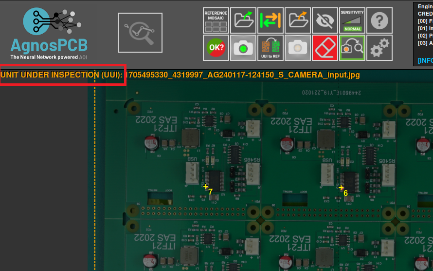
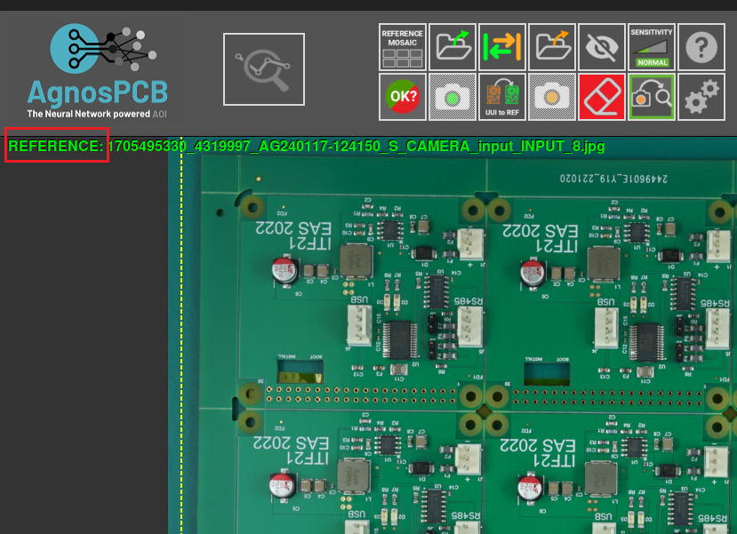

# UUI to REFERENCE

When inspecting a **PCB**, if you discover that a **UUI** image is more suitable as a REFERENCE than the current one, or it contains a component variant that causes the software to flag it as an error, you can convert it into a REFERENCE image with a **single button click**.

{.center}

For example, in this image we have a **UUI** that contains a variant of a component and it is marked as an error.

{.center}

After pressing the **UUI to REFERENCE** button, the same PCBA is used as the **REFERENCE**.

{.center}

The name of the new REFERENCE must not already exist. If it does, the software shows a warning and asks for a different one.

The new REFERENCE inherits the [Reference options](Screen-layout.md#reference-options) (mandatory review levels) of the REFERENCE it came from.

## Double-sided REFERENCES

On a REFERENCE with **TOP** and **BOTTOM** sides, **UUI to REFERENCE** creates a complete TOP/BOTTOM pair:

- If **both sides** of the board have been inspected, the TOP and the BOTTOM of the new REFERENCE are the two inspected images.
- If **only one side** has been inspected, that side is taken from the inspection and the other one is copied from the REFERENCE you inspected against.

It works the same whether you start from the TOP or from the BOTTOM side.
